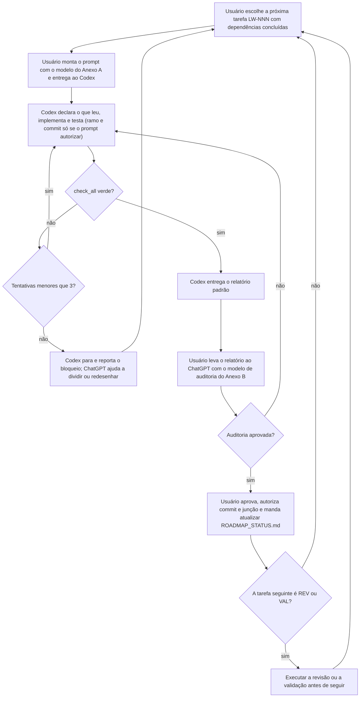
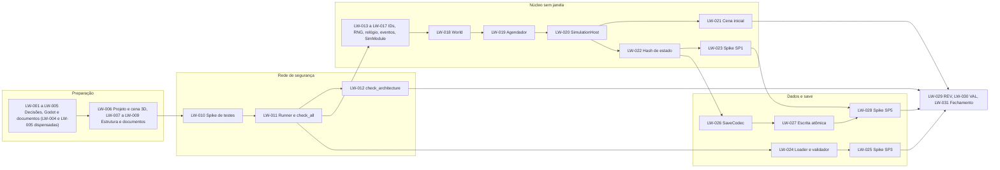
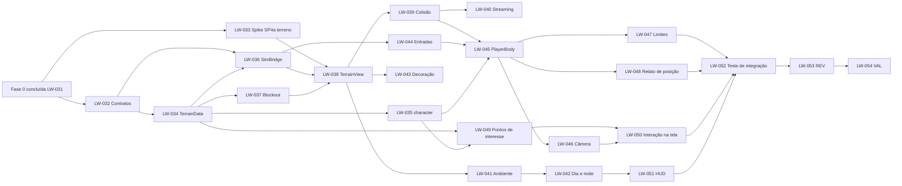
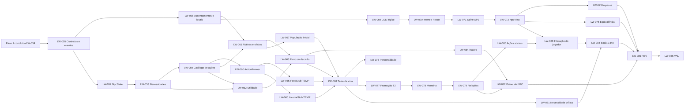
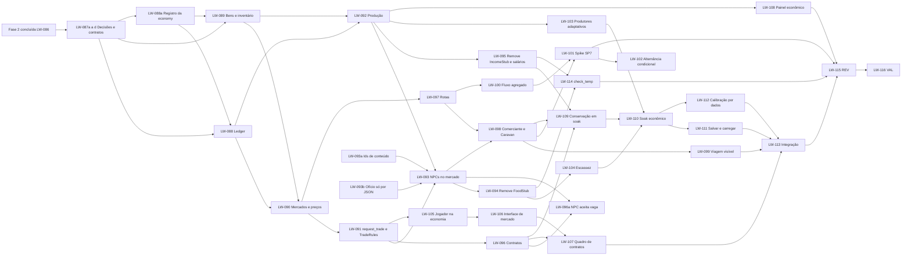
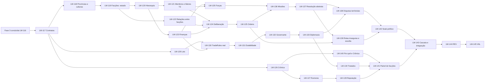

# LIVING WORLD — ROADMAP DE DESENVOLVIMENTO

**Versão do documento:** 0.3 (revisão final de 01/11/2026, 15:32 em Brasília; ver `docs/CONSISTENCY_REPORT.md`)
**Documentos de referência:** `GDD.md` (o que construir) e `TECHNICAL_ARCHITECTURE.md` (como construir). Este roadmap diz **em que ordem e em que passos pequenos** construir.
**Quem executa:** um desenvolvedor sem experiência de programação (o **Usuário**), com **Codex** como agente principal de implementação e **ChatGPT** como apoio de arquitetura, planejamento e auditoria.
**Prazos:** nenhum. O roadmap é medido por **tarefas concluídas e verificadas**, não por datas.

---

## 0. COMO USAR ESTE ROADMAP

### 0.1 O que este documento é

Um **plano executável**: cada fase tem objetivo, pré-requisitos, entregáveis, tarefas numeradas, dependências, critérios de aceitação, testes, riscos e uma definição de concluído. Cada tarefa é pequena o bastante para o Codex executar, testar e relatar **sem mexer em muitos sistemas ao mesmo tempo**.

### 0.2 Rótulos usados

| Rótulo | Significado |
|---|---|
| **[CONF]** | Decisão **APROVADA** em `DECISIONS.md` (escolha de Arthur no briefing mestre ou em instrução escrita posterior). O rótulo sozinho **não** prova aprovação: vale o status em `DECISIONS.md` |
| **[REC]** | Recomendação deste roadmap |
| **[PEND]** | Decisão sua ainda em aberto |
| **TEMP** | Código ou dado provisório, com tarefa de remoção já planejada |

### 0.3 Papéis

| Papel | Quem | Responsabilidades | O que **não** faz |
|---|---|---|---|
| **Usuário** (dono do produto) | Você | Escolhe a próxima tarefa, entrega o prompt ao Codex, roda `check_all`, joga os testes manuais, decide pendências, aprova mudanças de contrato, aceita ou recusa cada fase | Não precisa escrever nem ler código |
| **Codex** (implementador) | Agente de programação | Implementa **uma tarefa por vez** dentro do escopo, escreve testes, roda `check_all`, devolve o relatório padrão | Não decide design, não muda contratos sozinho, não antecipa tarefas futuras |
| **ChatGPT** (arquiteto e auditor) | Assistente de planejamento | Audita o relatório e as mudanças do Codex contra o GDD e a arquitetura, ajuda a quebrar tarefas, propõe decisões com recomendação, mantém o roadmap | Não implementa em paralelo; não cola código fora do fluxo de tarefas |
| **Segunda IA revisora** (opcional) | Outra conversa de IA | Revisão independente das diferenças (TA cap. 27.1) | Não implementa |

**Regra de ouro:** quem **escreve** o código nunca é o único a **aprová-lo**. Toda tarefa passa por **teste automático** (verde) e, nos pontos marcados, por **auditoria** e **validação sua**.

### 0.4 Tipos de tarefa e identificadores

Todas as tarefas têm identificador **`LW-NNN`** (sequencial, três dígitos, sem repetição e sem reaproveitamento). O número **nunca muda** depois de publicado. Tarefa nova entra no **fim da fase** com o próximo número livre, e a ordem de execução é dada pela coluna "Depende de".

| Tipo | Quem executa | Descrição |
|---|---|---|
| **IMPL** | Codex | Implementação com testes |
| **TESTE** | Codex | Tarefa cujo produto principal é um teste (soak, integração, carga) |
| **DOC** | Codex ou ChatGPT, com revisão sua | Documento, contrato, decisão registrada |
| **SPIKE** | Codex | Experimento **descartável** para tirar uma dúvida técnica; produz **relatório e decisão**, não funcionalidade |
| **USER** | Você, com passo a passo | Tarefa que só você pode fazer (instalar, configurar) |
| **REV** | ChatGPT (e opcionalmente segunda IA) | **Revisão arquitetural**: auditoria contra GDD e arquitetura |
| **VAL** | Você | **Validação do usuário**: jogar/usar e assinar uma checklist |

### 0.5 Regras de tamanho de tarefa **[REC]**

Uma tarefa só é "pequena o bastante" se **todas** as condições valem:

1. Altera **no máximo um módulo** de simulação (mais seus testes e dados), ou uma peça isolada de apresentação.
2. Produz **um comportamento verificável** descrito em uma ou duas frases.
3. Altera **até ~300 linhas** e **até ~8 arquivos**, contando testes.
4. Tem **critério de aceite** que pode ser conferido por teste automático ou por checklist curta.
5. Não exige mudar contrato de outro módulo (se exigir, vira **tarefa de contrato** antes).
6. Pode ser **desfeita** apagando um único commit.

**Se não cabe, divide.** O Codex deve **parar e propor a divisão** em vez de executar uma tarefa grande.

### 0.6 Ciclo de uma tarefa



### 0.7 Definição de pronto de **tarefa**

Uma tarefa só é considerada concluída quando **todos** estes itens estão verdadeiros:

- [ ] O critério de aceite da tarefa foi cumprido.
- [ ] Os testes pedidos existem e estão **verdes**, e `tools/check_all` está **verde**.
- [ ] Nenhum teste foi removido, enfraquecido ou "ajustado para passar".
- [ ] Nada foi alterado fora do escopo da tarefa.
- [ ] Contratos de módulo, `docs/events.md` e dados foram atualizados **se** a tarefa os afetou.
- [ ] O relatório padrão (modelo da seção 15 do `AGENTS.md`, que prevalece sobre qualquer outro modelo) foi entregue, com porcentagem de avanço da fase.
- [ ] A auditoria (ChatGPT) aprovou, ou a tarefa é dispensada de auditoria individual (ver 0.9).
- [ ] O trabalho está salvo no Git com mensagem `LW-NNN: ...` **somente se o prompt autorizou o commit** (`AGENTS.md` seção 10). Sem autorização, o Codex deixa as alterações no diretório de trabalho e informa a mensagem sugerida e a lista de arquivos.
- [ ] `docs/ROADMAP_STATUS.md` foi atualizado **depois da sua aprovação**, e apenas quando o prompt mandou atualizá-lo.

### 0.8 Regra de não-antecipação **[REC]**

Para impedir que o projeto cresça antes da hora:

1. **Uma tarefa só faz o que está escrito nela.** Funcionalidade que "vai ser útil depois" **não** entra.
2. **Nada de preparar o futuro com código.** A arquitetura já deixa as portas abertas (TA cap. 1 a 4). Nenhuma tarefa deve criar classes, campos ou eventos "para depois".
3. **Ideias novas vão para o `docs/backlog.md`** (estacionamento) e só viram tarefa por decisão sua, com ID novo.
4. **Itens [PREV] e [FUT] do GDD estão fora do roadmap.** A lista está no Anexo E.
5. **Provisórios (TEMP) são permitidos só quando o roadmap os nomeia**, com a tarefa que os remove. Lista no Anexo D. Um verificador (LW-114) falha se algum sobrar.
6. **Um módulo só nasce na tarefa que o cria.** Pastas vazias da estrutura (LW-007) têm apenas README.
7. **O Codex que identificar uma "melhoria óbvia" fora do escopo registra no backlog e segue.**

### 0.9 Pontos de revisão e validação **[REC]**

| Ponto | Quando | O que faz | Resultado |
|---|---|---|---|
| **Auditoria por tarefa** | Toda tarefa IMPL, TESTE e DOC | Você leva o relatório ao ChatGPT (modelo do Anexo B) | Aprovado ou lista de correções |
| **REV (revisão arquitetural)** | Fim de cada fase e em dois pontos intermediários da Fase 5 | ChatGPT confere acoplamento, camadas, contratos, eventos, dados, desempenho e derivas em relação ao GDD e à arquitetura | Relatório de revisão, ajustes e **decisões registradas** (`docs/decisions/`) |
| **VAL (validação do usuário)** | Fim de cada fase | Você usa o resultado seguindo uma checklist de uso real | Checklist assinada (ou lista de problemas) |
| **Tag no Git** | Depois de REV e VAL aprovados | Marca o ponto seguro (`fase-N-concluida`) | Ponto de retorno |

**Regra de portão:** **nenhuma tarefa da fase N+1 (exceto DOC de planejamento) começa antes** da REV e da VAL da fase N estarem aprovadas. Isso evita construir sobre base duvidosa.

**Tarefas SPIKE** são dispensadas de auditoria de código (são descartáveis), mas **exigem relatório e decisão registrada**.

### 0.10 Git **[REC]**

- Ramo principal **sempre verde**. Ninguém trabalha direto nele.
- **Um ramo por tarefa**: `lw-NNN-descricao-curta`. **Um commit final** com mensagem `LW-NNN: <resumo>`. Ramo de spike: `spike-lw-NNN`.
- **O agente só cria ramo, faz commit ou push se o prompt da tarefa autorizar, item por item** (campos GIT do Anexo A). Commit e push são autorizações separadas e valem só para a tarefa em curso. Sem autorização, vale o que está no `AGENTS.md` seção 10.
- Junta-se ao principal **só** com: `check_all` verde + auditoria aprovada.
- **Tag** ao fim de cada fase: `fase-0-concluida` etc.; tag final: `prototipo-v0.1`.
- Cópia remota sempre atualizada. Desfazer um erro = voltar ao commit anterior.

### 0.11 Quando uma tarefa não funciona **[REC]**

1. O Codex tenta **até 3 vezes** corrigir, sem ampliar o escopo.
2. Se continuar vermelho, **para** e entrega **relatório de bloqueio**: o que tentou, o que falhou, hipótese de causa.
3. Você leva o bloqueio ao ChatGPT, que **divide a tarefa**, ajusta o contrato ou propõe um SPIKE.
4. O ramo problemático é **descartado**, não "consertado às pressas".
5. Se o bloqueio revelar **erro de design**, ele vira registro de decisão e pode alterar GDD ou arquitetura (com sua aprovação).

### 0.12 Controle de progresso **[REC]**

`docs/ROADMAP_STATUS.md` (modelo no Anexo C) lista todas as tarefas com estado (pendente, em andamento, em auditoria, concluída, bloqueada) e calcula a **porcentagem por fase** (tarefas concluídas ÷ tarefas da fase). Ao fim de cada tarefa, o Codex informa a porcentagem atualizada **no relatório**; o arquivo só é alterado quando o prompt mandar e depois da sua aprovação. Tarefas opcionais (marcadas) só contam se forem adotadas.

### 0.13 Mapeamento com o GDD e a arquitetura

**Marcos do GDD (M0 a M7) e spikes da arquitetura (SP1 a SP8; o SP8 é futuro) neste roadmap:**

| Fase do roadmap | Marcos do GDD cobertos | Spikes da arquitetura | Módulos principais |
|---|---|---|---|
| Fase 0 — Fundação técnica | M0 | SP1, SP3, SP5 | core, data, entities, persistence, app, tools |
| Fase 1 — Primeiro mundo jogável | Parte de M3 e de M5/M6 (somente o essencial) | SP4a (terreno e subida de câmera); **SP6 (combate) logo depois da LW-054** (antecipado, DEC-080) | world, bridge, character (mínimo), presentation |
| Fase 2 — Primeira sociedade | M2 | SP2 | npc |
| Fase 3 — Economia | M1 | SP7 | economy (bens, inventário de bens, mercados, produção, `Ledger`, contratos, comércio) |
| Fase 4 — Facções e conflitos | M4 (sem os eventos dinâmicos) | — | factions, politics, military (abstrato), events (crônica e reputação), npc/rumors |
| Fase 5 — Integração e protótipo | Resto de M3, M5, M6 e M7, mais os eventos dinâmicos do M4 | SP4 (final) | combat, character (habilidades, equipamentos, origem), ecology, events dinâmicos, câmera, persistência completa |

**Ordem diferente da planejada antes [CONF/aviso].** O GDD sugeria economia (M1) antes de sociedade (M2) e mundo físico (M3). Este roadmap segue **a ordem e os nomes das fases que você definiu** (mundo jogável, sociedade, economia; DEC-094 e DEC-112). **O conteúdo de cada fase é proposta deste roadmap (DEC-070), não decisão sua.** Para isso funcionar sem retrabalho:

- A Fase 1 entrega o mundo físico **mínimo** (terreno, jogador, câmera, interação) e **não** as demais partes de M3.
- A Fase 2 usa dois **provisórios (TEMP)**: um estoque simples de comida e uma renda simbólica, para os NPCs terem o que comer e o que ganhar. Ambos têm tarefa de **remoção** na Fase 3 (LW-094 e LW-095), e o verificador LW-114 garante que nada sobra.
- A **arquitetura não muda**: continua valendo "um dono por dado", camadas e comunicação por eventos.

### 0.13-B Desvios deliberados em relação ao GDD e à arquitetura **[REC]**

Para manter o plano executável por uma pessoa e um agente, este roadmap faz as escolhas abaixo. **Nenhuma muda a arquitetura**; todas são reversíveis e ficam registradas aqui. Todas são **PROPOSTAS** em `DECISIONS.md` (seção 4.1), exceto a ordem das fases e a regra de nomes genéricos (aprovadas antes) e os desvios 2, 3 e 4, que você aprovou em 01/11/2026 nos termos descritos (diretrizes 8, 10 e 9); as demais valem como padrão de trabalho até você ratificá-las ou a tarefa indicada na última coluna decidir.

| # | Desvio | Motivo | Onde é tratado |
|---|---|---|---|
| 1 | **Ordem das fases:** mundo físico e sociedade antes da economia (o GDD sugeria economia primeiro) | Segue a ordem e os nomes das fases que você definiu | Seção 0.13 acima; provisórios TEMP |
| 2 | **T0 / `PopulationGroup` e LOD agregado (S2/S3) ficam fora — aprovado por você (diretriz 8)** até haver necessidade medida; só T1 e T2 individuais (cerca de 150 a 300 NPCs) | Menos código e menos risco; o GDD pede T0 para "o restante da população". **Consequência:** a hipótese 4 do GDD (simulação em LOD viável) fica avaliada só nos níveis individuais (S0 e S1); a LW-191 deve registrar isso, e o nível agregado só entra se a LW-179 o exigir | LW-055 registra; LW-179 mede; Anexo E |
| 3 | **Três trajetórias jogáveis como meta inicial** (mercador, soldado/guarda, aventureiro) — **aprovado por você (diretriz 10)**; as demais (produtor/artesão, crime completo etc.) ficam como possibilidades futuras no backlog; o crime entra só como consequência | O critério do GDD é "3 trajetórias viáveis" | LW-146 |
| 4 | **3 facções e 2 polities, uma delas simplificada** (vizinha de baixa resolução, sem membros) — **aprovado por você (diretriz 9)** — em vez de uma quarta facção completa | O GDD pede 3 facções e 2 a 3 polities; só uma das 3 facções é governo | LW-117 |
| 5 | **Itens da lista de corte** (magia, chefe, propriedades, comando tático) tratados como fora, com decisão formal | Lista de corte do GDD 24.5 | LW-146 |
| 6 | **Clima e estações** não entram | Não são necessários para as quatro hipóteses | Anexo E |
| 7 | **Dados gerais sem nomes definitivos** (bens, culturas, facções e regiões genéricos) | O briefing proíbe nomes definitivos sem necessidade | Fases 2 a 4; Anexo E |
| 8 | **Eventos dinâmicos** vão para a Fase 5, e não para a Fase 4 (M4 do GDD) | Proposta deste roadmap (a ordem e os nomes das fases são seus; a alocação do conteúdo é proposta, DEC-070) | LW-162 |

### 0.13-C Portões de decisão (dúvidas que ainda estão abertas)

Nenhuma destas bloqueia a primeira implementação (diretriz 15). Cada uma é pedida a você **só quando a tarefa-portão chegar**; se ainda estiver PENDENTE nesse momento, o Codex **PARA** antes da tarefa dependente.

| Dúvida | Tarefa-portão (quando decidir) | Tarefas que esperam |
|---|---|---|
| DEC-055 — dimensões do mundo | LW-033 (SP4a) | LW-034 a LW-037 (portão atendido pela DEC-118 em 05/11/2026; a DEC-055 segue PENDENTE quanto ao tamanho final) |
| DEC-083 — formato de persistência (DEC-084) | LW-028 (SP5) | LW-026 a LW-028 só como provisório; formato final depois do SP5 |
| DEC-040 — quantidade de NPCs | LW-055 (escala provisória) e LW-179 (medição) | LW-067 usa a escala provisória |
| DEC-066 — sistema definitivo de combate | LW-152 (SP6, logo depois da LW-054) | LW-153 a LW-158 |
| DEC-053 — escala das batalhas | LW-146 e LW-152 | LW-137 (resolução abstrata) e LW-158 |

### 0.14 O que **não** está neste roadmap

Fundação de organizações pelo jogador, cercos, exércitos grandes, intriga, sucessão política complexa, magia ampla, domesticação, múltiplas moedas, famílias e herança, multiplayer, IA generativa, geração procedural de mundo, vários continentes e arte final. Detalhes e destino de cada item no Anexo E. **Arte:** o protótipo usa **placeholders** (formas simples e cores planas); a fonte de assets definitivos é uma decisão **[PEND]** fora deste roadmap.

---

## SUMÁRIO

| Fase | Nome |
|---|---|
| 0 | Fundação técnica |
| 1 | Primeiro mundo jogável |
| 2 | Primeira sociedade |
| 3 | Economia |
| 4 | Facções e conflitos |
| 5 | Integração e protótipo |
| Anexos | A) Modelo de prompt para o Codex; B) Modelo de auditoria para o ChatGPT; C) Modelo de status; D) Provisórios (TEMP); E) Backlog estacionado; F) Pendências suas |

---

# VISÃO GERAL DO ROADMAP

**Total: 192 tarefas numeradas (LW-001 a LW-192), 6 fases, 8 revisões arquiteturais (REV) e 6 validações do usuário (VAL).** Sem prazos: o ritmo é o seu, medido em tarefas concluídas e verificadas.

| Fase | Nome | Tarefas | Intervalo | Marco do GDD | Spikes | Portão de saída |
|---|---|---|---|---|---|---|
| 0 | Fundação técnica | 31 | LW-001 a LW-031 | M0 | SP1, SP3, SP5 | REV LW-029, VAL LW-030, tag `fase-0-concluida` |
| 1 | Primeiro mundo jogável | 23 | LW-032 a LW-054 | Parte de M3 | SP4a (+ SP6 logo depois, LW-152) | REV LW-053, VAL LW-054, tag `fase-1-concluida` |
| 2 | Primeira sociedade | 32 | LW-055 a LW-086 | M2 | SP2 | REV LW-085, VAL LW-086, tag `fase-2-concluida` |
| 3 | Economia | 30 | LW-087 a LW-116 | M1 | SP7 | REV LW-115, VAL LW-116, tag `fase-3-concluida` |
| 4 | Facções e conflitos | 29 | LW-117 a LW-145 | M4 | — | REV LW-144, VAL LW-145, tag `fase-4-concluida` |
| 5 | Integração e protótipo | 47 | LW-146 a LW-192 | M3 (resto), M5, M6, M7 | SP4 final (o SP6 já rodou antes da Fase 2) | REV LW-159, LW-177 e LW-190; VAL LW-191; tag `prototipo-v0.1` |

**Composição por tipo:** 140 IMPL, 14 TESTE, 11 DOC, 9 SPIKE, 8 REV, 6 VAL, 4 USER.

**O que existe ao fim de cada fase (em uma frase):**

| Fase | Você tem... |
|---|---|
| 0 | Um projeto que roda, é testado, é salvo e recarregado de forma idêntica, sem nada de jogo ainda |
| 1 | Um personagem andando num terreno 3D com dia e noite, câmera e interação |
| 2 | Um povoado vivo com NPCs que têm rotina, necessidades, memória e relações |
| 3 | Uma economia que conserva o dinheiro, com mercados, produção, comerciantes e contratos |
| 4 | Facções, leis, diplomacia, forças e disputas, com cascatas explicáveis no "Por quê?" |
| 5 | O protótipo completo: combate, eventos, câmera contínua, salvamento, executável e validação das quatro hipóteses |

**Portões entre fases:** nenhuma fase começa antes de REV e VAL da anterior estarem aprovadas (seção 0.9).

### 0.15 Cobertura das regras de `check_architecture` **[REC]**

A arquitetura (cap. 27.3) lista oito regras de verificação automática. Cada uma tem uma tarefa que a implementa, para que nenhuma fique só no papel:

| # | Regra (cap. 27.3) | Tarefa |
|---|---|---|
| 1 | Simulação usando cena ou apresentação | LW-012 |
| 2 | Aleatoriedade solta | LW-012 |
| 3 | Tempo do sistema na simulação | LW-012 |
| 4 | Import fora das camadas ou de arquivo privado | LW-036 |
| 5 | Autoload novo | LW-021 |
| 6 | Variável estática mutável na simulação | LW-012 |
| 7 | Pasta de módulo sem `README`/contrato | LW-012 |
| 8 | Evento fora do catálogo | LW-016 |

**[LIM]** É busca de texto: pega o óbvio, não o sutil. Entre a LW-012 e as tarefas que completam as regras 4, 5 e 8, essas três são conferidas pela autorrevisão do agente (`AGENTS.md` seção 11) e pela auditoria (Anexo B).

---

# FASE 0 — FUNDAÇÃO TÉCNICA

**Tarefas:** LW-001 a LW-031 (31 tarefas) · **Marco do GDD:** M0 · **Spikes:** SP1, SP3, SP5 (todos sem janela gráfica)

## 0.A Objetivo

Deixar de pé a **base sobre a qual tudo o resto será construído**: projeto Godot versionado, documentos e regras de trabalho com agentes, estrutura de pastas, rede de segurança de testes (`check_all`), o **núcleo da simulação rodando sem janela** (relógio, eventos, aleatoriedade determinística, agendador), o **pipeline de dados** e o **salvamento ida e volta**. Ao final, existe um "mundo vazio" que roda, passa o tempo, é testado, é salvo e é recarregado **de forma idêntica**, e uma cena inicial que prova que o projeto abre.

Esta fase **não entrega nada jogável**. Seu valor é transformar as decisões mais caras da arquitetura (determinismo, desempenho, dados, save) em fatos medidos **antes** de existir conteúdo.

## 0.B Pré-requisitos

- `GDD.md` e `TECHNICAL_ARCHITECTURE.md` aprovados por você (**já entregues**).
- Seu **Mac** com permissão para instalar programas (o Codex roda nessa mesma máquina).
- **Godot 4.7.x estável** instalado (LW-002).
- Acesso ao Codex e ao ChatGPT.
- O repositório no **GitHub já existe**; a visibilidade (pública ou privada) é sua decisão e **não bloqueia** o início (DEC-089).
- Decisões iniciais (LW-001): **já tomadas** e registradas em `DECISIONS.md` v0.3 (DEC-012, 015, 016, 022, 089).

## 0.C Entregáveis

1. Repositório Git (GitHub, já existente) com cópia remota; ramo principal protegido por hábito (só entra com `check_all` verde). Nenhum envio ao remoto sem autorização escrita do prompt (AGENTS 10).
2. Projeto Godot (versão fixada) que abre e roda sem erro, com **primeira cena 3D** de verificação (LW-006), `.gitignore`, `README.md` e estrutura de pastas da arquitetura (cap. 2).
3. `AGENTS.md`, modelo de contrato de módulo, modelo de decisão, `docs/backlog.md` e `docs/ROADMAP_STATUS.md`.
4. Decisões iniciais registradas em `DECISIONS.md` v0.3 (LW-001, concluída); registro do ambiente de referência em `docs/decisions/0001-ambiente-de-referencia.md` (LW-006); modelo de registro técnico (LW-009).
5. Ferramentas de linha de comando: `tools/run_tests`, `tools/check_all`, `tools/check_architecture`, `tools/run_sim`.
6. Módulos de núcleo em `src/core/`: IDs, aleatoriedade determinística, relógio, barramento de eventos, `Result`, `SimModule`, `SimContext`, `World`, agendador.
7. `SimulationHost` e **cena inicial** com data/hora simulada (`scenes/main.tscn`, que a LW-006 cria e a LW-021 estende).
8. Leitor e validador de dados JSON (`src/data/`).
9. Salvamento: codificador JSON comprimido com checksum, versão e migração; escrita atômica; backups rotativos.
10. Relatórios dos spikes **SP1, SP3 e SP5**, com decisões registradas.
11. Relatório de revisão arquitetural e checklist de validação da fase.

## 0.D Tarefas

**Legenda de tipos:** IMPL (Codex implementa) · TESTE · DOC · SPIKE (descartável, gera relatório e decisão) · USER (você, com passo a passo) · REV (ChatGPT) · VAL (você).

| ID | Tipo | Tarefa | Depende de | Aceite verificável |
|---|---|---|---|---|
| **LW-001** | DOC | **Decisões iniciais — CONCLUÍDA em 01/11/2026 (15:32), por instrução escrita de Arthur.** Registradas em `DECISIONS.md` v0.3: Godot 4.7.x estável, condicionado à verificação técnica (DEC-012); macOS como plataforma inicial (DEC-015); hardware de **referência** identificado pelo Codex na máquina (DEC-016; o **mínimo** segue PENDENTE e não bloqueia); código em inglês, documentação em português (DEC-022); repositório no GitHub, já existente (DEC-089; a visibilidade é do proprietário). Framework de testes (DEC-086, LW-010), telemetria (DEC-023) e gamepad (DEC-024) seguem PENDENTES e não bloqueiam. O formulário do antigo Anexo G e a comparação dedicada de `DECISIONS.md` ficam dispensados | — | Concluída: os valores estão nas entradas citadas, com a data e a diretriz de Arthur que os originou |
| **LW-002** | USER | **Instalar o Godot 4.7.x estável** (versão padrão, GDScript, sem .NET) no Mac, pelo site oficial. O Git e o repositório GitHub **já existem**; nada a criar | LW-001 | No Terminal, `godot --version` (ou o caminho do aplicativo, por exemplo `/Applications/Godot.app/Contents/MacOS/Godot --version`) mostra uma versão `4.7.<n>.stable`. Se o Godot não abrir ou não for 4.7.x, avise o ChatGPT: a troca para uma 4.6.x estável só ocorre com impedimento concreto (DEC-012) |
| **LW-003** | USER | Colocar o **pacote documental v0.3** na raiz da pasta do projeto (o repositório GitHub já clonado): `README.md` e `AGENTS.md` na raiz; `docs/GDD.md`, `docs/TECHNICAL_ARCHITECTURE.md`, `docs/DEVELOPMENT_ROADMAP.md`, `docs/DECISIONS.md`, `docs/BRIEFING_MESTRE.md` e `docs/CONSISTENCY_REPORT.md`. O único arquivo que se troca é o `README.md` padrão do GitHub, se existir. **Sem envio ao remoto** (nenhum push; DEC-089) | LW-002 | Os oito arquivos existem nesses caminhos (conferido com `ls` na pasta). Nada que o GitHub criou (`.gitignore`, licença) foi apagado: o Codex os lê na LW-006 |
| **LW-004** | USER | **DISPENSADA — absorvida pela LW-006.** O Codex roda na própria máquina de Arthur, então "o Codex executa o Godot e informa a versão" é o primeiro passo da LW-006 | — | Sem aceite próprio; ver LW-006 |
| **LW-005** | IMPL (CONDICIONAL) | **DISPENSADA:** `tools/setup_godot` não será criado. O Godot é instalado por Arthur (LW-002) e o Codex não instala ferramentas (AGENTS, regra 4). Se o Codex não conseguir executar o Godot na LW-006, o relatório de bloqueio decide o passo seguinte | — | Sem aceite próprio |
| **LW-006** | IMPL | **Projeto Godot e primeira cena 3D funcional — a tarefa inicial.** O Codex: (1) **verifica o ambiente**: `godot --version` deve mostrar `4.7.<n>.stable`; lê, **só em modo leitura**, a máquina (versão do macOS, chip, núcleos, memória, GPU, armazenamento), **sem número de série nem outro identificador único**; (2) cria `project.godot` (nome "Living World", cena principal `res://scenes/main.tscn`, aviso `untyped_declaration` como **erro**, nenhum autoload, nenhum addon), `.gitignore` (`.godot/`, `.DS_Store`, temporários) e `.gitattributes` (`* text=auto eol=lf`); se `.gitignore` ou `.gitattributes` já existirem, lê e **mescla** sem apagar nada (AGENTS 12.3); (3) cria `scenes/main.tscn`: `Node3D` raiz com piso largo, um cubo colorido sobre o piso, `DirectionalLight3D` (sol, com sombra), `WorldEnvironment` com céu procedural e uma `Camera3D` olhando para o cubo — **sem script e sem lógica de jogo**; (4) cria `tools/smoke_test.gd` (GDScript tipado, `extends SceneTree`): carrega a cena, confere **exatamente** 1 `Camera3D`, 1 `DirectionalLight3D`, 1 `WorldEnvironment` e **pelo menos** 2 `MeshInstance3D`, imprime `SMOKE_TEST: PASS` (código 0) ou `SMOKE_TEST: FAIL <motivo>` (código 1); aceita o caminho da cena como argumento depois de `--`, para provar o caso de erro; (5) cria `docs/decisions/0001-ambiente-de-referencia.md` (uma página): versão exata do Godot, macOS e hardware de referência (DEC-012, 015, 016), `export_presets.cfg` fora do Git até haver exportação (LW-188) e a nota "identificadores em inglês, comentários em português" (DEC-022). **Não cria** pastas de módulo, autoloads, módulos de simulação nem dados (isso é LW-007 em diante). `README.md` e documentos do pacote **não são tocados**. As opções de linha de comando são conferidas com `godot --help` da versão instalada (AGENTS 4.1) | LW-002, LW-003 | **Todos** verdadeiros, com comando e saída reais no relatório: (a) `godot --version` mostra `4.7.<n>.stable...`; (b) `godot --headless --path . --import` termina sem `ERROR`, `WARNING`, `SCRIPT ERROR` nem `Parse Error` na saída (o código de saída do Godot não basta: ler a saída); (c) `godot --headless --path . --script res://tools/smoke_test.gd` imprime `SMOKE_TEST: PASS` e termina com código 0; (d) caso de erro: `godot --headless --path . --script res://tools/smoke_test.gd -- res://scenes/nao_existe.tscn` imprime `SMOKE_TEST: FAIL` e termina com código 1; (e) `godot --headless --path . --quit-after 60` roda a cena principal por 60 quadros sem `ERROR` nem `WARNING`; (f) `git check-attr text eol project.godot` mostra `text: auto` e `eol: lf`, e `git check-ignore .godot/` confirma que a pasta de cache é ignorada; (g) `shasum -a 256` de `AGENTS.md`, `README.md` e dos seis documentos de `docs/` é **idêntico** antes e depois; (h) `git status --short` lista só os arquivos desta tarefa (mais os `.uid` que o Godot gerar para scripts); (i) o relatório traz o "início da tarefa" (AGENTS 2.3) e a frase "`check_all` ainda indisponível (nasce na LW-011)". Havendo impedimento concreto na 4.7.x (erro de importação ou execução atribuível à versão), o Codex entrega relatório `BLOQUEADA` com a mensagem real e propõe a 4.6.x estável; **não troca por conta própria** (DEC-012). **Teste manual de Arthur:** abrir o projeto no Godot, apertar F5 e ver piso, cubo, céu e sol, sem mensagem vermelha ou amarela no painel Saída |
| **LW-007** | IMPL | Criar a **estrutura de pastas** do cap. 2 da arquitetura; cada pasta de módulo com `README.md` de uma linha; **nenhum código** (o que a LW-006 criou — `scenes/`, `tools/`, `docs/decisions/` — é mantido) | LW-006 | A árvore é idêntica à do cap. 2.1 (conferida por listagem); nenhum arquivo `.gd` foi criado por esta tarefa (o `tools/smoke_test.gd` da LW-006 permanece) |
| **LW-008** | DOC | **Validar e instalar o `AGENTS.md`** que já vem no pacote: montar a tabela de cobertura de cada regra do cap. 27.2 da arquitetura e das seções 0.5, 0.8 e 0.11 deste roadmap contra o arquivo; conferir que o arquivo tem menos de **32.768 bytes** (limite padrão de leitura do Codex, a confirmar na documentação da versão em uso); fazer o teste de leitura abaixo. **Só você altera o `AGENTS.md`**: lacunas viram proposta no relatório | LW-007 | (a) A tabela cobre **100%** das regras listadas, cada uma com a seção do `AGENTS.md` onde está; (b) `wc -c AGENTS.md` mostra menos de 32.768; (c) teste de leitura: o Codex, **sem consultar o roadmap**, lista as 13 regras obrigatórias da seção 0 e você confere contra o arquivo; (d) você aprovou |
| **LW-009** | DOC | Completar `docs/decisions/` (já existe, com o registro 0001 da LW-006) com **modelo** de registro técnico e `README` explicando a relação com `DECISIONS.md` (que continua sendo a fonte dos status); `docs/modules/` com **modelo de contrato** (ficha do cap. 3.4); `docs/backlog.md` (vazio, com instruções); `docs/events.md` (catálogo vazio, com o modelo de linha); `docs/ROADMAP_STATUS.md` (modelo do Anexo C, com todas as tarefas desta fase) | LW-007, LW-001 | Modelos existem; `docs/events.md` existe com cabeçalho e zero eventos; status lista LW-001 a LW-031 com LW-001 concluída, LW-004 e LW-005 dispensadas e LW-006 a LW-008 no estado correto; nenhum outro arquivo criado |
| **LW-010** | SPIKE | **Spike SP3 (parte 1): framework de testes.** Comparar, rodando **sem janela**: GUT, gdUnit4 e um executor mínimo próprio. Para cada um: 1 teste que passa, 1 que falha, saída legível, código de saída 0/1, facilidade para o Codex | LW-006, LW-009 | Relatório curto com comparação e **recomendação**; você escolhe; decisão registrada em `docs/decisions/` **[Revisão Godot v0.2]** A comparação anota para qual versão do Godot cada ferramenta declara suporte (GUT 9.7.x: 4.7; gdUnit4 estável: 4.5/4.6), porque isso pesa na DEC-012. |
| **LW-011** | IMPL | Instalar/configurar o framework escolhido; `tools/run_tests` (roda tudo em `tests/` sem janela, imprime resumo, código de saída 0/1); **`tools/check_all` esqueleto** (script de terminal do macOS, DEC-015) que executa as etapas existentes e imprime **VERDE** ou **VERMELHO** com lista do que falhou | LW-010 | Com um teste propositalmente falho: `check_all` imprime VERMELHO, aponta o teste e retorna código 1; sem falha: VERDE e código 0 **[Revisão Godot v0.2]** O Godot nem sempre sai com código diferente de zero em erro de script: o executor conta as falhas e chama `quit(1)`, e `check_all` varre a saída por `SCRIPT ERROR` e `Parse Error`. Teste do alarme: um erro de sintaxe proposital deve deixar `check_all` VERMELHO. |
| **LW-012** | IMPL | **`tools/check_architecture` v1** (cap. 27.3), **cinco** das oito regras, todas por busca de texto ou listagem de pastas: (1) `src/sim`, `src/core` e `src/data` não usam cena (`Node`, `get_node`, `$`, `Camera`, `Control`, `preload("res://scenes`) nem referenciam `src/presentation`; (2) aleatoriedade global (`randi`, `randf`, `randomize`, `RandomNumberGenerator.new`) fora de `src/core/rng`; (3) `Time.get_` e `OS.get_` em `src/sim`; (4) `static var` em `src/sim`; (5) pasta de módulo em `src/` sem `README.md`. As outras três regras entram nas tarefas da tabela 0.15. Integrar ao `check_all` | LW-011, LW-008 | Para **cada uma das cinco regras**, um arquivo de teste com violação proposital faz a ferramenta falhar apontando arquivo e linha; sem violações, passa no projeto real |
| **LW-013** | IMPL | `core/ids`: gerador de **IDs de entidade** inteiros, **nunca reutilizados**, serializável | LW-011 | Testes: IDs são crescentes e únicos; após liberar um ID, ele não volta; estado salvo e restaurado continua a sequência |
| **LW-014** | IMPL | `core/rng`: **gerador único determinístico** com semente salva e **fluxos nomeados** (um por finalidade); estado serializável | LW-011 | Testes: mesma semente gera mesma sequência; fluxos não interferem entre si; salvar/restaurar o estado continua a sequência exata **[Revisão Godot v0.2]** Estado do gerador (`seed`, `state`, 64 bits) é serializado como texto decimal; a semente de cada fluxo nomeado é derivada por SHA-256 de `semente_do_mundo:nome_do_fluxo`; documentar que o algoritmo do Godot pode mudar entre versões. |
| **LW-015** | IMPL | `core/sim_clock`: relógio de simulação, **passo fixo de 1 minuto simulado**, calendário (hora, dia, ano), pausa e multiplicador de velocidade; sem relação com tempo real | LW-011 | Testes: N passos avançam exatamente N minutos; pausa não avança; mudança de velocidade altera passos por quadro e não a duração do passo; estado serializável |
| **LW-016** | IMPL | `core/event_bus`: **barramento de eventos próprio**, em fila, ordem determinística, `cause_id` automático para cadeias de causa e efeito, assinatura por tipo de evento | LW-015 | Testes: eventos chegam na ordem de emissão; evento emitido durante o tratamento de outro entra na fila e recebe o `cause_id` do primeiro; duas execuções idênticas dão a mesma sequência. **Extensão de `check_architecture` (regra 8 do cap. 27.3):** o nome de todo evento publicado precisa constar em `docs/events.md`; teste com evento fora do catálogo falha apontando arquivo e linha |
| **LW-017** | IMPL | `core/result`, `core/sim_module` (classe base com o ciclo de vida do cap. 4.6) e `core/sim_context` (acesso a relógio, eventos, aleatoriedade e IDs) | LW-011 | Teste com um módulo falso confirma a assinatura do ciclo de vida; `Result` distingue sucesso de erro com código e mensagem |
| **LW-018** | IMPL | `core/world`: **registro de módulos** e orquestração do ciclo de vida (`setup`, `post_setup`, `on_new_game`, `on_load`, `tick`, `serialize`, `validate`, `teardown`) em **ordem declarada**; agrega `validate()` e `debug_summary()` | LW-013, LW-014, LW-015, LW-016, LW-017 | Teste com 3 módulos falsos: ordem de chamadas correta; erro em `validate()` de um módulo aparece no resumo; `teardown` em ordem inversa |
| **LW-019** | IMPL | `core/scheduler`: **frequências por módulo** (cada módulo roda a cada N minutos simulados) e **orçamento de tempo por tick** com divisão do trabalho entre ticks (*time slicing*) | LW-018 | Testes: módulo de frequência 10 roda 1 vez a cada 10 passos; módulo que estoura o orçamento é dividido sem perder trabalho; ordem determinística |
| **LW-020** | IMPL | `app/simulation_host` (autoload) e `tools/run_sim --days N --seed S`: roda o `World` **sem janela** pelo número de dias pedido e imprime resumo | LW-019 | `tools/run_sim --days 30 --seed 1` termina com código 0 e imprime a data final e o resumo dos módulos (nenhum ainda) **[Revisão Godot v0.2]** A lógica fica numa classe `RefCounted` chamada pelo autoload e por `tools/run_sim`; confirmar na própria tarefa se um autoload é acessível em script de linha de comando (`--script`) e, se não for, usar a classe diretamente. |
| **LW-021** | IMPL | **Cena inicial:** estende `scenes/main.tscn` da LW-006 (mantém piso, cubo, céu e sol) + `app/game_app` (autoload): mostra, por cima, título, versão e **data/hora simulada** em texto 2D, com tecla para pausar. Nenhum 3D novo | LW-020, LW-006 | `godot --headless --quit-after 60` carrega a cena e termina com código 0, e o `smoke_test` da LW-006 continua passando; na janela, a hora simulada avança e pausa com a tecla. **Extensão de `check_architecture` (regra 5 do cap. 27.3):** os autoloads de `project.godot` só podem ser `GameApp`, `SimulationHost`, `Debug` e `Settings`; teste com autoload extra falha |
| **LW-022** | IMPL | **Hash de estado:** `World.state_hash()` junta o `serialize()` de todos os módulos e do núcleo em um resumo estável; teste de **determinismo** | LW-020 | Teste: 3 execuções com a mesma semente e 30 dias dão o mesmo hash; sementes diferentes dão hashes diferentes **[Revisão Godot v0.2]** O hash é SHA-256 do JSON canônico (chaves ordenadas); `hash()` do Godot é proibido. |
| **LW-023** | SPIKE | **Spike SP1: núcleo da simulação.** Módulo descartável com **1.000 NPCs "de mentira"** (necessidades e ações simples) rodando **1 ano de jogo** sem janela; medir tempo por tick, pico e hash. Usar o hardware de referência registrado na LW-006 | LW-019, LW-022 | Relatório: média e maior pico por tick; critério da arquitetura (tick dentro do orçamento do cap. 20; régua de pico da DEC-113, medida em release com 3 execuções e laço de controle, texto completo em `docs/decisions/0006`; hash determinístico) **atingido**, ou **plano B** (cap. 26.3) aplicado e medido de novo. Código do spike fica em `tests/` ou é descartado **[Revisão Godot v0.2]** Medir com binário de editor (informativo) e com build de release (decide) (`assert` e verificações de depuração somem no release). |
| **LW-024** | IMPL | `data/loader` e `data/validator`: leitor de JSON de `data/` com validação de **tipos, campos obrigatórios, faixas e referências entre arquivos**; erros com **arquivo, campo e mensagem clara** | LW-011, LW-017 | Testes com arquivos de exemplo em `tests/fixtures/`: campo ausente, tipo errado, referência a ID inexistente e valor fora da faixa são todos apontados com arquivo e campo |
| **LW-025** | SPIKE | **Spike SP3 (parte 2): pipeline de dados.** Três tipos de dado **de teste** (em `tests/fixtures/`, não em `data/`), com referências cruzadas; integrar a validação ao `check_all`; pedir ao Codex para editar um dado e provocar um erro | LW-024 | `check_all` falha com mensagem legível ao quebrar um dado e passa ao corrigir; relatório confirma que o Codex consegue editar dados sem quebrar o resto; decisão registrada (ou plano B: `.tres` com validadores) |
| **LW-026** | IMPL | `persistence/save_codec`: JSON **comprimido**, `save_version`, **checksum**, cadeia de **migrações** (N para N+1) com **uma migração real de exemplo** e fixture da versão anterior; interface `SaveCodec` | LW-018, LW-022 | Testes: ida e volta preserva o hash; arquivo adulterado é rejeitado pelo checksum; save da versão anterior (fixture) é migrado e carrega; nunca carrega `.tres`/objetos do arquivo **[Revisão Godot v0.2]** Floats gravados com `full_precision` ou convertidos para inteiro/ponto fixo; `seed`/`state` como texto; checksum SHA-256; módulos iteram por IDs ordenados. Teste extra: salvar e carregar no meio de uma simulação não muda o hash final. |
| **LW-027** | IMPL | `persistence`: **escrita atômica** (arquivo temporário e troca), **backups rotativos** (últimos N) e **falha simulada** no meio da escrita | LW-026 | Teste: falha injetada na escrita deixa o último save válido intacto; backups rotacionam respeitando o limite; carregamento recorre ao backup se o principal estiver corrompido **[Revisão Godot v0.2]** Sequência `.tmp` → `.bak` → final com recuperação ao carregar (o renomear sobre arquivo existente **não é atômico no Windows**); falha injetada entre cada passo. |
| **LW-028** | SPIKE | **Spike SP5: salvamento.** Salvar e carregar o estado do mundo do SP1 (1.000 NPCs de mentira): medir tempo, tamanho do arquivo e **equivalência exata do hash** | LW-023, LW-027 | Relatório: tempos de salvar/carregar dentro do orçamento do cap. 20; hash idêntico após ida e volta; falha simulada preserva o save. Se não atingir: plano B (binário, dividir por módulo, salvar entre quadros) aplicado e medido |
| **LW-029** | REV | **Revisão arquitetural da Fase 0** (ChatGPT, mais segunda IA opcional): conferir camadas, contratos do núcleo, regras do `AGENTS.md`, desempenho medido, determinismo, resultado dos 3 spikes, dívida técnica | LW-012, LW-021, LW-025, LW-028 | Relatório de revisão com lista de achados (críticos, importantes, menores); **achados críticos corrigidos** por tarefas novas ou ajustes aprovados; decisões registradas |
| **LW-030** | VAL | **Validação do usuário da Fase 0:** seguir a checklist de 0.H em máquina limpa ou pasta nova (clone novo, começando por `godot --headless --path . --import`) | LW-029 | Checklist de 0.H assinada por você, ou lista de problemas que viram tarefas |
| **LW-031** | DOC | **Fechamento:** retrospectiva curta (o que atrasou o Codex, o que a revisão achou, o que mudar nos modelos), ajuste de tamanhos de tarefa no roadmap se necessário, atualização de `ROADMAP_STATUS.md` e da seção "Estado atual" do `README.md`, tag `fase-0-concluida` | LW-030 | Tag criada (e enviada ao remoto **se** você autorizar o push e tiver decidido a visibilidade, DEC-089); `ROADMAP_STATUS.md` mostra 100% da fase |

## 0.E Dependências

**Dentro da fase** (cada tarefa só começa depois das listadas na coluna "Depende de"):



**Externas:** o Godot 4.7.x instalado no seu Mac (o Codex roda na mesma máquina); o GitHub (repositório já existente); ChatGPT para auditoria.

**O que esta fase libera:** a Fase 1 só começa depois da LW-031.

## 0.F Critérios de aceitação da fase

1. **`tools/check_all` verde** em pasta nova, seguindo apenas o `README.md`.
2. **Determinismo:** mesma semente e mesmo número de dias produzem o **mesmo hash** em pelo menos 3 execuções; sementes diferentes produzem hashes diferentes.
3. **Desempenho (SP1):** 1.000 NPCs de mentira rodam 1 ano de jogo dentro do orçamento da arquitetura, ou o plano B está aplicado, medido e registrado.
4. **Dados (SP3):** um erro proposital em JSON é apontado com arquivo e campo; `check_all` o detecta.
5. **Salvamento (SP5):** ida e volta com hash idêntico; arquivo adulterado é rejeitado; falha simulada preserva o último save válido.
6. **Arquitetura:** `check_architecture` reprova as violações propositais de cada uma das cinco regras da LW-012 e aprova o projeto real.
7. **Cena inicial** abre sem erros e mostra título, versão e hora simulada avançando.
8. **Documentação:** `AGENTS.md`, modelos, decisões e `ROADMAP_STATUS.md` existem e foram aprovados por você.
9. **Cópia remota** (GitHub) contém tudo, com a tag `fase-0-concluida`, quando você autorizar o envio (DEC-089: o push depende da visibilidade decidida).

## 0.G Testes

| Nível | O que cobre nesta fase |
|---|---|
| **Unitários** (`tests/unit/`) | IDs, RNG, relógio, barramento de eventos, `Result`, `SimModule`, `World`, agendador, loader, validador, codec de save, migração |
| **Integração** (`tests/integration/`) | `World` com módulos falsos rodando dias; salvar → carregar → comparar hash; falha de escrita |
| **Determinismo** | Mesma semente, mesmo hash, repetido |
| **Arquitetura** | `check_architecture` com violações propositais |
| **Soak curto** | `run_sim` de 1 ano com módulo falso e verificação de invariantes (sem erro, hash estável) |
| **Desempenho** | Spikes SP1 e SP5 (medições registradas) |
| **Manual** | Checklist de 0.H |

## 0.H Checklist de validação do usuário (LW-030)

- [ ] Baixei o repositório em pasta nova e segui só o `README.md`; o projeto abriu no Godot sem mensagens vermelhas.
- [ ] Rodei `tools/check_all` e vi **VERDE**.
- [ ] Quebrei de propósito um teste e vi **VERMELHO** com mensagem compreensível; desfiz.
- [ ] Abri a cena inicial: título, versão e hora avançando; pausa funciona.
- [ ] Rodei `tools/run_sim --days 30 --seed 1` duas vezes e o hash final foi igual.
- [ ] Li o relatório dos spikes SP1, SP3 e SP5 e concordo com as decisões.
- [ ] O `ROADMAP_STATUS.md` está coerente com o que existe.
- [ ] Sei explicar, com minhas palavras, o ciclo de uma tarefa (0.6).

## 0.I Riscos

| # | Risco | Mitigação |
|---|---|---|
| R0.1 | O Codex **não consegue executar** o Godot instalado no Mac (caminho fora do `PATH`, permissão do macOS ou versão diferente) | A LW-006 detecta no primeiro passo; você ajusta a instalação (LW-002); se for impossível, o Codex escreve o código e os testes e **você roda os comandos** localmente e cola o resultado no relatório (pior caso, mais lento) |
| R0.2 | Framework de testes ruim para agentes de IA | Spike LW-010 com plano B (executor mínimo próprio) |
| R0.3 | O núcleo em GDScript não atinge o orçamento | Spike SP1 antes de qualquer conteúdo; plano B do cap. 26.3 (reduzir frequências, compactar dados, limitar contagens) |
| R0.4 | **Excesso de engenharia** no núcleo (classes demais "para o futuro") | Regra 0.8; REV confere; núcleo restrito ao que o cap. 4 exige |
| R0.5 | Spike vira produto (código descartável fica no projeto) | Spike gera relatório; código vai para `tests/` ou é apagado; REV confere |
| R0.6 | Fricção de instalação e Git para quem não programa | Tarefas USER com passo a passo; o ChatGPT acompanha em tempo real; commits só pelo Codex quando possível |
| R0.7 | Mudança de versão do Godot no meio | Versão fixada na LW-006 (`docs/decisions/0001-ambiente-de-referencia.md`); atualização só por decisão registrada |
| R0.8 | Quebras de linha e caminhos diferentes entre sistemas | `.gitattributes` na LW-006; caminhos centralizados (cap. 2.2, regra 7) |

## 0.J Definição de concluído da Fase 0

A fase está concluída quando **todas** forem verdadeiras: (1) as 31 tarefas estão concluídas ou, no caso da LW-004 e da LW-005, dispensadas com justificativa (escrita nas próprias linhas); (2) os critérios de 0.F estão cumpridos; (3) REV (LW-029) e VAL (LW-030) aprovadas, sem achado crítico aberto; (4) as decisões dos spikes estão registradas em `docs/decisions/`; (5) a tag `fase-0-concluida` está no remoto; (6) `ROADMAP_STATUS.md` mostra 100%.

**Não fazer nesta fase:** nenhum conteúdo de jogo (nada de NPCs reais, bens, facções), nenhum gráfico 3D além da cena de verificação da LW-006 (piso, cubo, céu e sol), nenhuma interface além do texto da cena inicial, nenhum módulo de simulação além do núcleo.

---

# FASE 1 — PRIMEIRO MUNDO JOGÁVEL

**Tarefas:** LW-032 a LW-054 (23 tarefas) · **Marco do GDD:** parte de M3 (mundo físico) e o mínimo de M5/M6 necessário para jogar · **Spikes:** SP4a (terreno e subida de câmera) e, logo depois da LW-054, o SP6 (combate, LW-152)

## 1.A Objetivo

Entregar um **pequeno mundo 3D em que você entra e anda**: terreno low-poly em blocos (*chunks*), ambiente com luz e ciclo de dia e noite ligado ao relógio da simulação, um personagem controlável com câmera de terceira pessoa, colisões e **uma interação simples** com objetos do mundo. É o primeiro momento em que o projeto "parece um jogo" e o primeiro teste real da separação **simulação ↔ apresentação** (cap. 6 da arquitetura).

## 1.B Pré-requisitos

- Fase 0 **concluída** (LW-031), com REV e VAL aprovadas.
- `check_all` verde no ramo principal.
- Hardware de referência registrado (LW-006), usado como régua de desempenho de quadros.

## 1.C Entregáveis

1. Contratos mínimos dos módulos `world`, `character` e `bridge` em `docs/modules/`.
2. Relatório do **spike SP4a** (abordagem de terreno) e decisão registrada.
3. Módulo `sim/world` com **dados de terreno** (altura e tipo de superfície), carregados de `data/world/`.
4. Terreno de *blockout* (uma região pequena de teste) e a ferramenta que o gera.
5. `TerrainView`: terreno em *chunks* com colisão e **carga e descarga por distância**.
6. Ambiente: céu, luz, névoa e **ciclo dia/noite** guiado pela hora simulada; elementos decorativos (árvores e pedras) por `MultiMesh`.
7. Módulo `sim/character` (estado mínimo do jogador) e `bridge` mínima (`SimBridge`).
8. Personagem controlável (cápsula provisória): andar, correr e pular, com câmera de terceira pessoa e colisões.
9. Sistema de interação com um tipo de objeto de teste, textos por chaves de tradução (pt-BR) e HUD mínimo (data/hora simulada, pausa, velocidade).
10. Teste de integração scriptado da fase; relatório de revisão arquitetural; checklist de validação.

## 1.D Tarefas

| ID | Tipo | Tarefa | Depende de | Aceite verificável |
|---|---|---|---|---|
| **LW-032** | DOC | **Contratos mínimos** de `world`, `character` e `bridge` (ficha do cap. 3.4: responsabilidade, entradas, saídas, dependências, dados controlados, interfaces, testes), cobrindo **apenas o que a Fase 1 usa** | LW-031 | Três páginas em `docs/modules/`; cada dado tem **um único dono**; você aprovou |
| **LW-033** | SPIKE | **Spike SP4a: terreno.** Comparar **terreno próprio** (malha gerada por script, por *chunk*) e **addon de terreno**: estilo low-poly, desempenho no hardware-alvo, colisão, facilidade para o Codex manter. Terreno de teste de ~1 km², *chunks* de ~64 m **[HIP]**. **Inclui o teste de subida de câmera (DEC-080):** uma câmera livre sobe do rente ao chão até uma altura grande sobre o terreno de teste (valores em constantes nomeadas **[HIP]**); registrar quadros e o ponto em que quebra, como insumo do SP4 final (LW-168) | LW-031 | Relatório com medições (quadros por segundo, memória) e **recomendação**; resultado do teste de subida de câmera; você escolhe; decisão registrada (fecha a pendência 5 da arquitetura para esta fase e a DEC-055 como portão) |
| **LW-034** | IMPL | `sim/world`: **`TerrainData`** (grade de alturas e tipo de superfície, só dados, sem Nodes), carregada e validada a partir de `data/world/`; consultas `peek_height(x, z)` e `peek_surface(x, z)`; ponto de nascimento do jogador | LW-032 | Testes: alturas e superfícies consultadas batem com o arquivo; consulta fora do mapa devolve `Result` de erro; arquivo inválido falha na validação com arquivo e campo |
| **LW-035** | IMPL | `sim/character`: **estado mínimo do jogador** (ID de entidade, posição, orientação); comandos `request_spawn()` (no ponto de nascimento) e `report_position(pos, yaw)` com validação (dentro do mapa); `serialize` e `validate` | LW-032, LW-034 | Testes: nascer no ponto correto; posição fora do mapa é recusada; ida e volta de save preserva o estado; entra no `state_hash` |
| **LW-036** | IMPL | `bridge/sim_bridge` (**mínima**): nó de apresentação que avança a simulação a cada quadro (respeitando pausa e velocidade), expõe **consultas somente-leitura** e uma fila de **intenções** para a simulação; nenhuma regra de jogo aqui | LW-032, LW-021, LW-034 | Teste: a apresentação consulta altura e hora **apenas** via ponte; `check_architecture` confirma que nada em `presentation/` importa `sim/` diretamente (regra estendida nesta tarefa). **Extensão de `check_architecture` (regra 4 do cap. 27.3, completa):** nenhum módulo importa camada superior nem arquivo privado de outro módulo; teste com import indevido falha apontando arquivo e linha |
| **LW-037** | IMPL | `tools/make_blockout_terrain`: ferramenta de linha de comando (**uso único, fora do jogo**) que gera o **terreno de blockout**: planície, uma colina, um vale e um caminho plano, em `data/world/`; o terreno de blockout tem cerca de 1 km² e *chunks* de cerca de 64 m, como dados (DEC-118). Resultado é commitado; não há geração de mundo no jogo | LW-034 | Executar a ferramenta com os mesmos parâmetros gera arquivo idêntico; dados passam na validação; descrição do relevo documentada em `docs/` |
| **LW-038** | IMPL | `presentation/world_view/TerrainView`: constrói a **malha low-poly por *chunk*** a partir de `TerrainData` (via ponte), com material de cor por tipo de superfície (cores planas). O terreno é o **próprio** (DEC-057), com as condições (a) e (b): construção **incremental** de *chunks* (fila, sem travar o quadro) para não engasgar ao andar, e teste e correção das emendas ("frestinhas") entre níveis de detalhe vizinhos | LW-033, LW-036, LW-037 | Teste headless: número de *chunks* e de vértices esperados para o terreno de blockout; na janela, o terreno aparece sem buracos entre *chunks* |
| **LW-039** | IMPL | **Colisão do terreno** por *chunk* | LW-038 | Teste de física headless: raio lançado de cima em 20 pontos devolve altura igual a `peek_height` dentro de tolerância definida; sem buraco nas emendas **[Revisão Godot v0.2]** O teste de raio aguarda um quadro de física antes de lançar; declarar o motor de física usado (Jolt é o padrão em projetos novos a partir da 4.6). |
| **LW-040** | IMPL | **Carga e descarga de *chunks*** por distância a um ponto de foco fornecido pela ponte. Gatilho de reavaliação do Terrain3D (DEC-057, condição d), a avaliar aqui ou na LW-053: os engasgos persistirem depois da construção incremental de *chunks*, as emendas não terem correção simples, ou a DEC-055 exigir um mapa de vários km antes da Fase 5 | LW-038, LW-036 | Teste: percorrendo uma rota scriptada, só *chunks* dentro do raio existem; contagem de nós **estável** após 500 deslocamentos (sem vazamento); sem engasgos visíveis; **sem quadros acima de 33 ms ao andar** (DEC-057, condição a) |
| **LW-041** | IMPL | **Ambiente estático:** céu, luz direcional com sombras simples, névoa de distância, paleta low-poly | LW-038 | Na janela, cena legível e sem sombras quebradas; configuração em um único recurso editável |
| **LW-042** | IMPL | **Ciclo dia/noite** na apresentação, guiado pela **hora simulada** recebida da ponte (a simulação não sabe de luz) | LW-041, LW-036 | Teste: para horas simuladas dadas, a rotação/intensidade da luz coincide com a tabela esperada; pausar a simulação congela a luz |
| **LW-043** | IMPL | **Elementos decorativos** (árvores e pedras de formas simples) com `MultiMesh`, posicionados por **dados** (`data/world/`), apenas visuais (**não são recursos de jogo**) | LW-033, LW-037, LW-038 | Teste: contagem de instâncias confere com os dados; colocação sobre a altura do terreno; desempenho no hardware-alvo registrado **[Revisão Godot v0.2]** Um `MultiMeshInstance3D` por chunk. |
| **LW-044** | IMPL | **Mapa de entradas** (`InputMap`): ações nomeadas (mover, olhar, correr, pular, interagir, pausar, velocidade), teclado e mouse; o movimento padrão é WASD (DEC-116), por ação nomeada; nenhuma tecla fixa no código | LW-036 | Teste: todas as ações existem; script de verificação falha se alguma tecla estiver escrita direto em código de jogo |
| **LW-045** | IMPL | **`PlayerBody`** (cápsula provisória, `CharacterBody3D`): andar, correr e pular relativos à direção da câmera, gravidade; **física na apresentação** | LW-035, LW-036, LW-039, LW-044 | Teste: movimento scriptado de 5 s à frente cobre a distância esperada ± tolerância; não afunda no terreno; pulo volta ao chão |
| **LW-046** | IMPL | **Câmera de terceira pessoa:** câmera padrão **elevada** de altura média (DEC-115), órbita de 360° em volta do personagem, zoom para perto e para longe; altura e inclinação padrão em constantes nomeadas **[HIP]**, calibradas nesta tarefa; suavização e **colisão com o terreno** (a câmera não entra no chão). Só terceira pessoa; a câmera contínua até a visão estratégica é da Fase 5 | LW-045 | Teste: com o jogador junto a uma encosta, a câmera nunca fica abaixo da altura do terreno; na janela, sem tremor ao correr |
| **LW-047** | IMPL | **Limites e colisões do jogador:** inclinação máxima caminhável, impedimento de sair do mapa (borda do mundo), recuperação se cair abaixo do terreno | LW-045, LW-039 | Testes: subir encosta acima do limite é bloqueado; tentativa de sair pela borda é bloqueada; jogador forçado abaixo do terreno é reposicionado |
| **LW-048** | IMPL | **Relato de posição:** `PlayerBody` informa `character.report_position` pela ponte em intervalo fixo (resultado sobe para a simulação) | LW-045, LW-035, LW-036 | Teste de integração: movimento scriptado de 10 s; posição na simulação coincide com a do corpo dentro de tolerância; simulação nunca controla a posição da cápsula |
| **LW-049** | IMPL | `sim/world`: **pontos de interesse** (`PointOfInterest`: ID, posição, tipo, chave de texto) vindos de `data/world/`; comando `request_interact(player_id, poi_id)` com validação de **distância**; evento `InteractionPerformed` | LW-034, LW-035 | Testes: interação a distância curta aceita e emite o evento; distância longa devolve `Result` de erro "muito longe"; POI inexistente rejeitado; evento tem `cause_id` |
| **LW-050** | IMPL | **Apresentação da interação:** detecção do ponto próximo, *prompt* ("Interagir"), envio da intenção pela ponte e exibição do texto resultante; **localização mínima** (arquivo pt-BR com chaves; nenhum texto fixo no código de jogo) | LW-049, LW-046, LW-045, LW-036 | Teste: o *prompt* aparece só dentro do alcance; ao interagir, o texto da chave aparece; script de verificação reprova texto literal em código de jogo |
| **LW-051** | IMPL | **HUD mínimo:** data/hora simulada, indicador de pausa e de velocidade (1x e 2x), por ViewModel da ponte | LW-036, LW-042 | Teste: HUD reflete relógio, pausa e velocidade; a tecla de pausa congela dia/noite, mundo e o relato do jogador |
| **LW-052** | TESTE | **Teste de integração scriptado da fase:** nasce, anda até um POI, interage, pausa, salva e recarrega; roda também **30 dias simulados** com jogador parado, conferindo invariantes e hash | LW-047, LW-048, LW-050, LW-051 | Cenário passa no `check_all`; duas execuções dão o mesmo hash; contagem de nós estável |
| **LW-053** | REV | **Revisão arquitetural da Fase 1:** separação simulação/apresentação; ponte fina; dono de cada dado; terreno e colisão; desempenho de quadros; ausência de antecipação; resultado do SP4a; reavaliação do Terrain3D (DEC-057, condição d); medição em modo release com o Mac na tomada (DEC-057, condição e) | LW-052, LW-040, LW-043 | Relatório com achados; críticos corrigidos; decisões registradas |
| **LW-054** | VAL | **Validação do usuário da Fase 1:** jogar a checklist de 1.H; fechamento com retrospectiva e tag `fase-1-concluida` | LW-053 | Checklist assinada; tag no remoto; `ROADMAP_STATUS.md` em 100% para a fase |

## 1.E Dependências



**Externas:** apenas o que a Fase 0 já entregou (Godot, Git, `check_all`). Nenhum asset externo: tudo é forma simples e cor plana.

**O que esta fase libera:** a Fase 2 usa o terreno, a ponte e o relógio para criar NPCs.

## 1.F Critérios de aceitação da fase

1. Ao abrir o jogo, você **nasce no terreno**, anda, corre e pula; **não atravessa o chão**, não sai do mapa e não escala encostas acima do limite.
2. A câmera de terceira pessoa **não entra no terreno** e não treme.
3. O dia e a noite mudam **de acordo com a hora simulada**; pausar congela tudo.
4. Aproximar-se de um objeto marcado mostra o *prompt*; interagir mostra o texto vindo da chave de tradução.
5. **Desempenho:** no hardware-alvo, a meta de quadros é cumprida com o terreno de blockout e as decorações. A LW-033 mediu, mas **não fechou** a meta: Arthur a manteve como proposta em 05/11/2026 (a meta foi aprovada depois, na DEC-119, em 07/11/2026: média de 60 quadros por segundo ou mais e nenhum quadro acima de 33 ms, no Mac de Arthur, na tomada, em modo release; a LW-053A mediu o jogo real nessas condições: média de 8,37 a 8,39 ms e nenhum quadro acima de 33 ms, em 3 execuções). A primeira medição no jogo real é em modo release, com o Mac na tomada (DEC-057, condição e).
6. **Separação:** a simulação roda sem janela com o mesmo hash de antes (a apresentação não altera o estado); `check_architecture` verde com a regra estendida.
7. Contagem de nós **estável** durante deslocamento longo (sem vazamento).
8. `check_all` verde; teste de integração da fase verde.

## 1.G Testes

| Nível | O que cobre |
|---|---|
| **Unitários** | `TerrainData`, `character`, `PointOfInterest`, `request_interact`, tabelas de dia e noite |
| **Integração** | Cenário scriptado (LW-052): nascer → andar → interagir → pausar → salvar → recarregar |
| **Física headless** | Alturas por raio, colisão de câmera, inclinação máxima, limite do mapa |
| **Determinismo** | Hash igual com e sem janela para o mesmo roteiro de comandos |
| **Arquitetura** | Regra estendida: `presentation/` só chega à simulação via `bridge/` |
| **Desempenho** | Medição de quadros no hardware-alvo (registrada em relatório) |
| **Manual** | Checklist de 1.H |

## 1.H Checklist de validação do usuário (LW-054)

- [ ] Abri o jogo e nasci no ponto esperado.
- [ ] Andei, corri e pulei por todo o terreno; **tentei** atravessar o chão, sair pela borda e subir a encosta mais íngreme: nada quebrou.
- [ ] Girei a câmera e me encostei em paredes de terreno: a câmera não ficou "dentro" do chão.
- [ ] Esperei passar o dia e a noite; pausei e a luz parou; mudei a velocidade.
- [ ] Interagi com o objeto de teste e li o texto.
- [ ] Caminhei por bastante tempo sem queda perceptível de quadros.
- [ ] Salvei (via teste scriptado ou comando de depuração) e recarreguei sem diferença.
- [ ] O que vejo é **o que eu esperava para esta fase**, sem funcionalidades "a mais".
- [ ] Andar e olhar o mundo é agradável o bastante para eu querer explorar mais? Anotei o que incomoda (quadros, câmera, controle).

## 1.I Riscos

| # | Risco | Mitigação |
|---|---|---|
| R1.1 | Terreno em GDScript pesado demais ou com emendas visíveis entre *chunks* | Spike LW-033 antes de implementar; plano B: addon de terreno ou *chunks* maiores/menos detalhe |
| R1.2 | **Vazamento de memória** ao carregar e descarregar *chunks* | Teste de contagem de nós (LW-040); REV confere |
| R1.3 | Regras de jogo vazando para o `PlayerBody` | Contratos (LW-032); revisão; regra "intenções descem, resultados sobem" |
| R1.4 | Câmera tremendo ou atravessando o terreno | LW-046 com teste de colisão; ajustar suavização antes de seguir |
| R1.5 | **Antecipação** (inventário, vegetação coletável, clima, estações, NPCs de enfeite) | Regra 0.8 e lista "Não fazer"; REV |
| R1.6 | Cápsula e formas simples parecerem "feias" e desmotivarem | Aceitar placeholders por decisão; arte final é decisão futura **[PEND]** |
| R1.7 | O Codex não consegue testar visualmente | Testes headless para tudo que for número (altura, contagem, física); o visual fica na VAL; capturas de tela anexadas ao relatório quando possível |

## 1.J Definição de concluído da Fase 1

A fase está concluída quando **todas** forem verdadeiras: (1) as 23 tarefas estão concluídas; (2) os critérios de 1.F estão cumpridos; (3) REV (LW-053) e VAL (LW-054) aprovadas, sem achado crítico aberto; (4) decisão do SP4a registrada; (5) tag `fase-1-concluida` criada (no remoto, se o push estiver autorizado); (6) `ROADMAP_STATUS.md` em 100% para a fase.

**Não fazer nesta fase:** NPCs (nem de enfeite), inventário, itens, recursos coletáveis, combate (o SP6 é um teste descartável que roda **depois** da LW-054), câmera tática/estratégica (o SP4a só mede a subida), mapa, clima e estações, água simulada, vários biomas, menus, tela de salvamento para o jogador, áudio, modelos 3D de personagem.

# FASE 2 — PRIMEIRA SOCIEDADE

**Tarefas:** LW-055 a LW-086 (32 tarefas) · **Marco do GDD:** M2 · **Spike:** SP2 (corpos e LOD de NPCs)

## 2.A Objetivo

Fazer o mundo **ter gente que vive sozinha**: NPCs com necessidades, rotinas por ofício, decisões por utilidade, relações e memória (para os notáveis), que **comem, trabalham, descansam e conversam sem o jogador**; e que, quando você se aproxima, **ganham corpo** e passam a andar pelo povoado sem teleporte nem duplicação. O jogador consegue **ver a rotina** e **conversar** com um NPC.

Esta fase usa **dois provisórios explícitos** (não há dinheiro nem mercado ainda): `FoodStub` (estoque simples de comida por assentamento) e `IncomeStub` (renda simbólica ao trabalhar). Eles existem **só** para os NPCs terem o que comer e o que ganhar, estão marcados `TEMP` e têm tarefa de remoção na Fase 3 (LW-094 e LW-095).

## 2.B Pré-requisitos

- Fase 1 **concluída** (LW-054), com REV e VAL aprovadas, **e o SP6 (LW-152) concluído**: a experiência de combate foi validada antes de construir a sociedade (DEC-080).
- `check_all` verde; terreno, ponte (`SimBridge`), relógio, interação e HUD funcionando.
- Hardware de referência registrado (LW-006) para as metas de quadros e de tick.

## 2.C Entregáveis

1. Contratos do módulo `npc` (e da extensão de `world`) e catálogo de eventos `docs/events.md`.
2. `world` estendido com **assentamentos e locais** (casas, trabalho, descanso, convívio).
3. Módulo `npc` com: estado (T1/T2), necessidades, catálogo de ações em dados, executor abstrato, rotinas por ofício, decisão por utilidade com inércia, fila de pensamento e rastro de decisão.
4. População inicial gerada por dados (centenas de NPCs, com nomes provisórios) e **ofícios** em dados.
5. LOD lógico S1/S0 com histerese e evento `LodChanged`; protocolo de **intenções e resultados**; `NpcView` em pool com navegação; detector de impasse; relatório do **spike SP2**.
6. Notáveis (T2): promoção e rebaixamento, memória, relações, ações sociais.
7. Personalidade influenciando decisões e reações a alarme; consequências de necessidades críticas.
8. Painel de depuração de NPC; construções provisórias (caixas) para os locais.
9. Interação do jogador com NPC (conversar).
10. `FoodStub` e `IncomeStub` marcados `TEMP`.
11. Testes de vida sem jogador, equivalência abstrato × corpóreo e soak de 1 ano; relatório de revisão e checklist de validação.

## 2.D Tarefas

| ID | Tipo | Tarefa | Depende de | Aceite verificável |
|---|---|---|---|---|
| **LW-055** | DOC | **Contratos** do módulo `npc` (estado, necessidades, ações, rotina, decisão, LOD, memória, relações), da extensão de `world` (assentamentos e locais) e catálogo inicial **`docs/events.md`** (eventos das Fases 0 a 2). Registrar escala do protótipo: ~100 a 300 NPCs individuais **[HIP]** (DEC-040 segue PENDENTE; a escala é provisória até a LW-179); **T0/PopulationGroup fica fora** (aprovado, DEC-041) até haver necessidade medida | LW-054, LW-152 | Fichas em `docs/modules/`; cada dado com um dono; `docs/events.md` criado; você aprovou |
| **LW-056** | IMPL | `world`: **`Settlement`** e **`Place`** (casa, local de trabalho, descanso, convívio, mercado-reservado) com posição e capacidade, vindos de `data/world/settlements.json`; consultas `peek_settlement`, `peek_place`, `peek_places_of_kind`; 2 assentamentos de teste sobre o terreno de blockout | LW-055 | Testes: validação aponta referência quebrada e local fora do mapa; consultas devolvem os dados; ida e volta de save |
| **LW-057** | IMPL | `npc/state`: **`NpcState`** compacto (identidade, traços de personalidade, posição lógica, ofício, casa, local de trabalho, ação atual, tier); armazenamento em tabelas; criar e remover NPC; `serialize`, `validate`, `debug_summary` | LW-055 | Testes: criar e remover usa IDs não reutilizados; ida e volta de save preserva tudo; entra no `state_hash` |
| **LW-058** | IMPL | `npc/needs`: necessidades **fome, descanso, segurança, renda, social** (valor inteiro 0 a 100, taxa por hora, limiares, urgência) lidas de `data/needs.json` | LW-057 | Testes: variação por hora conforme dados; limiares mudam a urgência; valores sempre dentro de 0 a 100; dado inválido falha na validação |
| **LW-059** | IMPL | `npc/actions`: **catálogo de ações em dados** (`data/actions.json`: duração, tipo de local, pré-condições, efeitos, risco, pesos de personalidade) e carregador; ações iniciais: **dormir, comer, trabalhar, descansar, conversar, ir até um local, esperar** | LW-057, LW-058 | Testes: validação aponta referências a necessidades ou locais inexistentes; adicionar uma ação nova **só por dados** passa na validação |
| **LW-060** | IMPL | `npc/actions`: **`ActionRunner` abstrato** — desconta duração e aplica efeitos por **uma única função de efeitos** (a mesma usada depois no modo corpóreo); falha por regra | LW-059 | Testes: ação "comer" reduz fome após a duração; pré-condição não atendida impede o início; função de efeitos é chamada por um só caminho |
| **LW-061** | IMPL | `npc/routine` e **ofícios em dados** (`data/occupations.json`: agricultor, lenhador, artesão, guarda, taberneiro **[HIP]**): agenda por hora do dia (trabalho, refeição, descanso, convívio) | LW-056, LW-057, LW-059 | Teste: consulta de rotina por ofício e hora devolve a ação esperada; ofício inexistente é rejeitado na validação |
| **LW-062** | IMPL | `npc/decision` (parte 1): **pontuação de utilidade** (benefício ponderado pela urgência, ajuste de personalidade, custos de tempo e distância, inércia) com fórmulas e pesos em dados | LW-058, LW-059 | Testes: mesmo estado e mesma semente dão a mesma pontuação; faminto pontua mais alto em "comer"; inércia evita trocar de ação a cada passo |
| **LW-063** | IMPL | `npc/decision` (parte 2): **fluxo de decisão** do cap. 9.7 (necessidade urgente, depois rotina) com **sorteio ponderado** entre as melhores e **fila de pensamento** (`next_think_time`) | LW-061, LW-062 | Testes: faminto com comida disponível come; sem urgência segue a rotina da hora; nenhuma ação sem pré-condição é escolhida; NPCs são processados só quando chega o seu `next_think_time` |
| **LW-064** | IMPL | **Rastro de decisão:** `explain_decision(npc_id)` devolve necessidades, candidatas, pontuações, ação escolhida e motivo (ligado só para NPCs marcados) | LW-063 | Teste: para NPC marcado, o rastro lista candidatas e o motivo; para não marcado, não gera custo nem dado |
| **LW-065** | IMPL | **`FoodStub` (TEMP-LW-065):** estoque simples de comida por assentamento, reposto por ações "trabalhar" de agricultor (regra em dados) e consumido por "comer". Marcado com `TEMP-LW-065` no código e em `docs/` | LW-056, LW-059, LW-060 | Testes: estoque nunca fica negativo; agricultor trabalhando repõe; "comer" consome; **comentário `TEMP-LW-065` presente** nos arquivos do stub |
| **LW-066** | IMPL | **`IncomeStub` (TEMP-LW-066):** "trabalhar" satisfaz a necessidade **renda** diretamente (sem dinheiro, sem Ledger). Marcado com `TEMP-LW-066` | LW-058, LW-060 | Teste: trabalhar eleva renda; sem trabalhar, renda decai; **marca `TEMP-LW-066` presente** |
| **LW-067** | IMPL | **População inicial** em `on_new_game`: contagens por assentamento e ofício em dados; **nomes provisórios** (ex.: "Aldeão 001"), traços de personalidade por sorteio com a semente; casa e local de trabalho atribuídos | LW-056, LW-057, LW-061 | Testes: contagens conferem com os dados; todos têm casa e trabalho válidos; mesma semente gera a mesma população (hash) |
| **LW-068** | TESTE | **Vida sem jogador:** 100 NPCs por 30 dias de jogo, sem janela; invariantes: todos vivos, necessidades entre 0 e 100, `FoodStub` não negativo, nenhum NPC parado sem ação por mais de um limite, nenhuma exceção | LW-063, LW-065, LW-066, LW-067 | Teste verde no `check_all`; repetido com a mesma semente dá o mesmo hash |
| **LW-069** | IMPL | `npc/lod`: **LOD lógico S1 ↔ S0** por distância ao jogador, com **histerese** (raio de entrada menor que o de saída) e evento `LodChanged`; reconstrução do estado ao entrar em S0 e colapso ao sair | LW-056, LW-057, LW-035 | Testes: NPC na fronteira não oscila; entrar e sair preserva ação atual e local; limite de NPCs em S0 respeitado; eventos têm `cause_id` |
| **LW-070** | IMPL | **Protocolo `Intent` e `ActionResult`**: NPC em S0 emite intenção (ir a local, executar ação em local), espera o resultado da apresentação e **só então aplica os efeitos** (mesma função da LW-060); caminho pela ponte | LW-060, LW-069, LW-036 | Testes com apresentação simulada: intenção emitida, resultado aplica efeitos; resultado atrasado ou ausente não trava o NPC (tempo limite) |
| **LW-071** | SPIKE | **Spike SP2: corpos e LOD de NPCs.** 100 NPCs, `NpcView` em pool, navegação pelo terreno em *chunks*, intenções e resultados, alternância S1 ↔ S0 repetida | LW-069, LW-070, LW-038, LW-039 | Relatório: sem duplicação, sem teleporte, quadros estáveis no hardware-alvo, abordagem de navegação escolhida (malha de navegação, caminhos em grade ou rota simples por pontos); decisão registrada; se falhar, plano B do cap. 26.3 (reduzir raio S0, simplificar navegação) |
| **LW-072** | IMPL | `presentation/world_view/NpcView` em **pool**, movimento pela abordagem escolhida no SP2, animação mínima (forma simples andando ou parada); recebe `Intent` pela ponte e devolve `ActionResult` | LW-071 | Teste: contagem de `NpcView` ativos = NPCs em S0; reaproveitamento do pool sem vazamento após 100 entradas e saídas; na janela, NPCs andam entre casa, trabalho e convívio |
| **LW-073** | IMPL | **Detector de impasse:** NPC sem progresso (mesmo local, ação inalterada, resultado ausente) por um limite é reiniciado (ação cancelada, reposicionado em local válido) e o evento fica registrado | LW-072 | Teste: NPC bloqueado propositalmente é recuperado e o motivo registrado; sem falsos positivos em 30 dias de vida normal |
| **LW-074** | IMPL | **Construções provisórias:** caixas simples e coloridas para cada tipo de local (casa, trabalho, descanso, convívio), geradas pelos dados de `Place` | LW-056, LW-038 | Na janela, cada local aparece onde os dados dizem, em cor por tipo; teste confere contagem e posição |
| **LW-075** | TESTE | **Equivalência abstrato × corpóreo:** a mesma ação executada em S1 e em S0 aplica os **mesmos efeitos** (mesma função) e deixa o NPC no mesmo estado final | LW-072, LW-060 | Teste verde para as ações do catálogo; falha se alguém criar um segundo caminho de efeitos |
| **LW-076** | IMPL | **Personalidade e reações:** os traços alteram os pesos de decisão; comando de depuração `alarm` emite um evento de perigo e os NPCs **reagem** (fugir, ajudar, ignorar) conforme a personalidade, interrompendo e depois retomando a rotina | LW-063, LW-068 | Teste: o mesmo cenário com NPC covarde e NPC valente dá reações diferentes; após a reação, a rotina é retomada; resultado determinístico |
| **LW-077** | IMPL | **Promoção e rebaixamento** `promote(id, tier)` e `demote(id, tier)` entre T1 e T2, com **limite global de T2**; ao rebaixar, memória e relações viram traços resumidos (preparado para LW-078 e LW-079) | LW-057, LW-068 | Testes: promover mantém identidade e rotina; limite global é respeitado; rebaixar e promover de novo não duplica nem perde o essencial |
| **LW-078** | IMPL | `npc/memory`: **`MemoryRecord`** (tipo, atores, local, instante, valência, saliência, fonte, confiança) só para T2; capacidade limitada, esquecimento por valor, **traços permanentes** | LW-077 | Testes: ao encher, sai a de menor valor; registros muito fortes viram traço antes de sair; ida e volta de save preserva |
| **LW-079** | IMPL | `npc/relations`: grafo **esparso** por par ordenado de IDs, dimensões (afeição, confiança, respeito, medo, dívida) de −100 a +100 e rótulos; limite por NPC; `peek_opinion(a, b)` | LW-078 | Testes: relação só existe entre quem se conheceu; chave do par independe da ordem; limite por NPC respeitado; decaimento suave; entra no `state_hash` |
| **LW-080** | IMPL | **Ações sociais:** "conversar" em local de convívio entre NPCs próximos altera relações e, para T2, grava memória; "ajudar" no alarme da LW-076 gera valência positiva | LW-079, LW-078, LW-063 | Testes: conversas repetidas aumentam afeição dentro dos limites; memória gerada só para T2; evento de relação agregado (não um por conversa) |
| **LW-081** | IMPL | **Consequências de necessidade crítica:** fome crítica prolongada enfraquece e, ao passar do limite, gera `NpcDied` (com causa); os sistemas que guardam IDs tratam a morte sem erro | LW-058, LW-065, LW-068 | Testes: sem comida, NPC morre após o limite configurado, evento publicado com causa; com comida, não morre; save e load com NPC morto |
| **LW-082** | IMPL | **Painel de depuração de NPC** (`src/tools/`, ativado por tecla): seleciona um NPC e mostra necessidades, ação, rastro da decisão, ofício, relações e memórias; lista do estado da simulação | LW-064, LW-072, LW-079 | Na janela, selecionar um NPC mostra os dados; teste confirma que o painel só **lê** (nenhuma escrita na simulação) |
| **LW-083** | IMPL | **Interação do jogador com NPC:** a interação da Fase 1 passa a reconhecer NPC próximo; "conversar" gera relação com o jogador, **promove o NPC a T2** e grava memória; cenário scriptado integrado: nasce, anda até o povoado, conversa, salva, recarrega | LW-080, LW-072, LW-077, LW-050 | Teste de integração verde: NPC vira T2, relação com o jogador existe e **sobrevive** a salvar e recarregar; texto da conversa por chave de tradução |
| **LW-084** | TESTE | **Soak longo:** 300 NPCs por 1 ano de jogo sem janela e com alternância S1 ↔ S0 simulada; mede tempo por tick, pico, memória e hash | LW-081, LW-083 | Tick médio dentro do orçamento do cap. 20 e sem pico acima de ~10 ms; sem crescimento de memória; hash repetível; sem exceção |
| **LW-085** | REV | **Revisão arquitetural da Fase 2:** limites do módulo `npc`; catálogo em dados; função única de efeitos; ponte fina; ausência de dinheiro e de mercado antecipados; marcas `TEMP`; custo de memória e relações; resultado do SP2 | LW-084, LW-075, LW-073, LW-082 | Relatório com achados; críticos corrigidos; decisões registradas |
| **LW-086** | VAL | **Validação do usuário da Fase 2:** observar a vila e conversar, conforme 2.H; fechamento com retrospectiva e tag `fase-2-concluida` | LW-085 | Checklist assinada; tag no remoto; status em 100% para a fase |

## 2.E Dependências



**Externas:** nenhuma. Nomes de NPCs, lugares e ofícios são **provisórios e genéricos**; nomes definitivos de culturas e regiões ficam fora do roadmap **[PEND]**.

**O que esta fase libera:** a Fase 3 usa NPCs, ofícios, locais e a ponte; remove os provisórios.

## 2.F Critérios de aceitação da fase

1. **Vida sem jogador:** 100 NPCs por 30 dias (e 300 por 1 ano) sem exceção, sem NPC permanentemente travado e, com comida suficiente, **todos vivos**; resultado idêntico para a mesma semente.
2. **Desempenho:** tick médio dentro do orçamento do cap. 20; sem pico acima de ~10 ms; sem crescimento de memória em 1 ano.
3. **LOD sem defeitos:** cruzar a fronteira de S0 cem vezes não duplica NPC (contagem de `NpcView` = NPCs em S0), não causa teleporte e mantém a meta de quadros no hardware-alvo.
4. **Equivalência:** ação em S1 e em S0 produz o mesmo efeito (teste da LW-075).
5. **Explicabilidade:** para qualquer NPC marcado, o painel mostra **por que** ele escolheu a ação.
6. **Personalidade:** mesmo cenário, NPCs diferentes reagem de modo diferente, de forma repetível.
7. **Notáveis:** conversar promove a T2; memória e relação com o jogador sobrevivem a salvar e recarregar; limite global de T2 respeitado.
8. **Dados:** adicionar uma ação ou um ofício só editando JSON funciona e é validado.
9. **Provisórios:** `FoodStub` e `IncomeStub` existem, estão marcados `TEMP` e listados no Anexo D.
10. `check_all` e `check_architecture` verdes.

## 2.G Testes

| Nível | O que cobre |
|---|---|
| **Unitários** | Necessidades, catálogo, executor, rotina, utilidade, decisão, `Settlement`/`Place`, promoção, memória, relações |
| **Integração** | Vida sem jogador; LOD com apresentação simulada; interação do jogador com NPC |
| **Equivalência** | Ações abstratas × corpóreas |
| **Soak** | 100 NPCs × 30 dias e 300 NPCs × 1 ano, com invariantes |
| **Determinismo** | Hash de população e de vida por semente |
| **Desempenho** | Spike SP2 (quadros) e soak (tick e memória) |
| **Manual** | Checklist de 2.H |

## 2.H Checklist de validação do usuário (LW-086)

- [ ] Fiquei parado no povoado por alguns minutos de jogo e vi NPCs saindo de casa, indo ao trabalho, comendo, conversando e voltando a dormir.
- [ ] Afastei-me e voltei várias vezes: ninguém duplicou, sumiu de repente ou "teleportou".
- [ ] Selecionei 3 NPCs no painel e entendi **por que** cada um fez o que fez.
- [ ] Disparei o alarme de teste: pessoas reagiram de maneiras diferentes.
- [ ] Conversei com um NPC, saí, salvei, recarreguei e ele me **reconheceu** (relação preservada).
- [ ] Esperei muitos dias com a simulação acelerada: o povoado continuou funcionando.
- [ ] Reduzi a comida de teste a zero e vi as consequências (fome, morte registrada).
- [ ] Confirmei que **não há** dinheiro, mercado nem facções (ainda).

## 2.I Riscos

| # | Risco | Mitigação |
|---|---|---|
| R2.1 | **Navegação** de NPCs sobre terreno em *chunks* instável ou cara | Spike SP2 antes de `NpcView`; plano B: caminhos simples por pontos entre locais, menos NPCs em S0 |
| R2.2 | NPCs **travados** ou oscilando entre ações | Inércia em dados, detector de impasse (LW-073), soak com invariantes |
| R2.3 | Comportamento "burro" ou incompreensível | Rastro de decisão (LW-064) e painel (LW-082) antes de ajustar pesos |
| R2.4 | **Explosão de custo** de memória e relações | Só T2; limites por NPC; limite global de T2; medição no soak |
| R2.5 | **Antecipação da economia** (dinheiro, preços, comércio dentro de `npc`) | Stubs marcados `TEMP`; REV confere; verificador na Fase 3 |
| R2.6 | Dois caminhos de efeitos (abstrato e corpóreo) divergirem | Função única de efeitos + teste de equivalência (LW-075) |
| R2.7 | Pressão por inventar nomes, culturas e histórias | Nomes provisórios e genéricos; decisões de conteúdo ficam no backlog |
| R2.8 | Teste não determinístico por causa de física | Lógica de decisão testada sem física; física só no S0 e testada à parte |
| R2.9 | Balanceamento sem fim (pesos e taxas) | Constantes em dados, calibração só até o soak passar; ajustes finos vão para o backlog |

## 2.J Definição de concluído da Fase 2

Concluída quando **todas** forem verdadeiras: (1) as 32 tarefas concluídas; (2) critérios de 2.F cumpridos; (3) REV (LW-085) e VAL (LW-086) aprovadas, sem achado crítico aberto; (4) decisão do SP2 registrada; (5) `FoodStub` e `IncomeStub` listados no Anexo D com tarefa de remoção; (6) tag `fase-2-concluida` no remoto; (7) status em 100% para a fase.

**Não fazer nesta fase:** dinheiro, preços, mercado, comércio, produção real de bens, facções, leis, crimes e punições, combate, T0/`PopulationGroup`, S2/S3 de simulação agregada, nascimentos, famílias e herança, rumores, nomes e culturas definitivos.

---

# FASE 3 — ECONOMIA

**Tarefas:** LW-087 a LW-116 (30 tarefas) · **Marco do GDD:** M1 · **Spike:** SP7 (equivalência de comércio)

## 3.A Objetivo

Dar ao mundo uma **economia funcional e fechada**: bens com quantidades inteiras, produção por receitas e trabalhadores, estoques e preços por mercado, dinheiro **conservado** por um livro-razão, NPCs que compram, vendem e trabalham por salário, comerciantes que **transportam** mercadoria entre assentamentos, e o jogador comprando, vendendo e entregando. No fim, os provisórios da Fase 2 **desaparecem**: ninguém come de um estoque mágico, ninguém recebe renda de graça.

## 3.B Pré-requisitos

- Fase 2 **concluída** (LW-086), com REV e VAL aprovadas.
- `FoodStub` (LW-065) e `IncomeStub` (LW-066) conhecidos e listados.
- Escala do protótipo (decisão sua de 10/11/2026, DEC-129): **3 povoados (assentamentos)**, **10 bens genéricos**, **4 cadeias de produção**; os valores seguem **[HIP]** (ajustáveis por decisão sua).

## 3.C Entregáveis

1. Contratos de `economy` e catálogo de eventos econômicos; interface `TradeRules` com implementação padrão neutra.
2. `Ledger` com `transfer`, `mint` e `burn` e teste de conservação.
3. Bens e inventários (quantidades inteiras, peso); `data/goods.json` e `data/recipes.json` com bens e receitas **genéricos**.
4. Locais de produção, mercados com preço por estoque, `request_trade`, consumo e NPCs que compram e vendem.
5. Remoção de `FoodStub` e `IncomeStub`; salários pelo `Ledger`.
6. Contratos (trabalho e entrega) com custódia do pagamento.
7. Rotas entre assentamentos, comerciantes, viagem física e fluxo agregado; relatório do **SP7**.
8. Produtores que se adaptam aos preços; consequências de escassez.
9. Inventário e conta do jogador; interface de mercado; quadro de contratos.
10. Painel de depuração econômico; testes de conservação, soak econômico, salvar/carregar; verificador de provisórios (`tools/check_temp`).
11. Relatório de revisão e checklist de validação.

## 3.D Tarefas

| ID | Tipo | Tarefa | Depende de | Aceite verificável |
|---|---|---|---|---|
| **LW-087a** | DOC | **Registro das decisões da Fase 3** em `docs/DECISIONS.md` e `docs/decisions/0012-pre-voo-da-fase-3.md`: aprovação das DEC-047, DEC-049 e DEC-054; escala (3 povoados, 10 bens e 4 cadeias, **genéricos**; DEC-129); as seis correções do pré-voo (DEC-130 a DEC-135); a preparação da LW-093 (DEC-136 e DEC-137); os menores 7 a 11 (DEC-138 a DEC-141); as decisões de Arthur sobre Q10, Q19 e Q22 (DEC-142 a DEC-144) e as respostas do revisor às demais perguntas dos contratos (DEC-145 a DEC-162 e DEC-165 a DEC-177, aprovadas por você em bloco em 11/11/2026) | LW-086 | Entradas e registro aprovados por você; lista de bens e cadeias aprovada por você; as 35 decisões do revisor (DEC-138 a DEC-141, DEC-145 a DEC-162 e DEC-165 a DEC-177) aprovadas por você em bloco em 11/11/2026, sem autorizar editar fixture protegida (DEC-172) nem transformar valor **[HIP]** em requisito |
| **LW-087b** | DOC | **Contrato** de `economy` em `docs/modules/economy.md` (bens, inventário como quantidades de todo dono por ID, mercados, produção, consumo, `Ledger`, comércio, contratos) e da interface **`TradeRules`** (só a versão neutra na Fase 3) | LW-087a | Ficha em `docs/modules/economy.md`; dono único para estoque, preço e dinheiro; aprovada por você |
| **LW-087c** | DOC | Extensões de `docs/modules/world.md` (rotas e terceiro povoado) e de `docs/modules/npc.md` (comprar, vender, salário e fim dos provisórios; o `npc` importa só `economy/api`) | LW-087a | Fichas atualizadas, sem código; aprovadas por você |
| **LW-087d** | DOC | **Eventos econômicos** do cap. 11.9 em `docs/events.md` e **modelos de dados** (`goods`, `recipes`, constantes de preço e alvo de estoque) | LW-087a | Eventos catalogados; modelos de dados revisados; aprovados por você |
| **LW-088a** | IMPL | **Registro do módulo `economy`:** `EconomyModule` com `api/` vazia, registrado no `World` antes do `npc`; **regra nova no `check_architecture`:** o `npc` cita só `economy/api` e a `economy` não cita o `npc`, com teste positivo e negativo (DEC-171); o registro muda o `state_hash`: se atingir `tests/unit/test_save_codec.gd` (fixture `save_v1`, protegida), a tarefa **PARA** e pede a autorização escrita de Arthur antes de mexer em `tests/fixtures`; os hashes seguem os **três marcos por bloco** (DEC-175): **marco 1 = LW-088a a LW-092** (a economia ganha estrutura; o NPC ainda não a usa), marco 2 = LW-093 a LW-096a, marco 3 = LW-097; em cada bloco, o primeiro valor de referência que mudar faz a tarefa **PARAR** e mostrar a você o valor antigo, o novo e a causa, e as demais tarefas do bloco só registram os valores novos no relatório; o `run_sim` não muda (não registra módulo; o hash dele não se altera); mudam o oráculo (`test_npc_split_oracle`) e o hash do soak de 30 dias (DEC-172) | LW-087 | Em teste, o `check_architecture` reprova o `npc` citando algo de `economy` fora de `api/` e a `economy` citando o `npc` (caso positivo e negativo); `check_all` verde; os valores novos dos hashes aprovados por você (marco 1: LW-088a a LW-092); o relatório mostra o hash do `run_sim` antes e depois (esperado: iguais) |
| **LW-088** | IMPL | `economy/ledger`: **contas**, `transfer(de, para, valor, motivo)`, `mint(motivo)`, `burn(motivo)`; dinheiro inteiro; histórico completo em modo de teste e totais por motivo no jogo normal | LW-087 | Teste de ouro: soma das contas = inicial + criado − destruído após milhares de operações aleatórias; transferência sem saldo devolve `Result` de erro; `check_architecture` reprova qualquer alteração de saldo fora do `Ledger` |
| **LW-089** | IMPL | `economy/goods` e **inventário por entidade**: `GoodDef` em `data/goods.json` (10 bens genéricos **[HIP]**; DEC-129) e tabela de inventários (NPC, jogador, local de produção, mercado) com quantidades inteiras e peso; a `economy` guarda as **quantidades** de todo dono, por ID, e o equipamento em instâncias fica no `character` (Fase 5) (DEC-130) | LW-087 | Testes: validação de bens; adicionar, remover e transferir; peso e capacidade respeitados; ida e volta de save |
| **LW-090** | IMPL | `economy/markets`: **`MarketState`** por assentamento (estoque, estoque-alvo, preço, histórico curto); **preço pela razão estoque/alvo**, faixa limitada, **suavização**, **spread** e **profundidade** (impacto da ordem); constantes em dados; eventos `PriceChanged` (só variação significativa), `ShortageDeclared`, `ShortageEnded`; cada mercado tem um **teto de compra por bem**, em dados: acima de certa fração do estoque-alvo ele deixa de comprar e o local de produção para por `OUTPUT_FULL`, sem perder eficiência (DEC-177) | LW-088, LW-089, LW-056 | Testes: preço fica dentro da faixa; estoque baixo sobe preço, alto desce; suavização evita saltos; ordem grande move o preço contra o operador; compra e venda imediata não dá lucro (spread); acima do teto de compra o mercado deixa de comprar |
| **LW-091** | IMPL | `economy/rules` e `request_trade`: interface **`TradeRules`** (tarifa, proibição, licença) com **implementação padrão neutra**; `request_trade(actor_id, market_id, good_id, quantity, side)` (`side` = compra ou venda; divergência do texto original, DEC-173) valida, move bens, cobra via `Ledger` e atualiza o mercado | LW-088, LW-089, LW-090 | Testes: transação atômica (ou tudo, ou nada); saldo ou estoque insuficiente devolve erro sem alterar nada; regra substituída em teste altera a tarifa sem tocar a economia; conservação de dinheiro mantida |
| **LW-092** | IMPL | `economy/production`: **`ProductionSite`** com receita (`data/recipes.json`, 4 cadeias **[HIP]**), trabalhadores (NPCs atribuídos), estoque de insumos e de produtos, eficiência; produção horária; **motivo registrado** quando para; eventos `ProductionStopped` e `ProductionResumed`; conta **própria do local** (o local é dono de si, no lugar de "conta do proprietário"; DEC-148); a distribuição proposta tem **14 locais de produção** (os dados dos povoados vêm com a LW-097); os locais **gastam ferramenta (`tool`), tábua (`plank`) e tecido (`fabric`) aos poucos** para funcionar (manutenção; números **[HIP]** pequenos, em dados; DEC-163 e DEC-178) | LW-089, LW-088, LW-061 | Testes: produz conforme a receita; falta de insumo ou trabalhador reduz ou para e registra o motivo; retoma quando o insumo volta; o local gasta ferramenta, tábua e tecido conforme os dados; ainda no marco 1 de hash (DEC-175); determinístico |
| **LW-093a** | IMPL | **Verificador de ids de conteúdo** (cerca de 60 linhas, mais a conferência entre módulos: cerca de 150 a 200 linhas de código e teste no total, em `tools/`): confere que os ids de conteúdo escritos como constantes no código (`"work"`, `"help"`, `"flee"`...) existem em `data/` e que os ids que as tabelas da economia citam de outro módulo (`need_id`, `occupation_id`, `settlement_id`, `place_id`) e o `work_place_id` de `population.json` existem; nenhum comportamento de jogo muda (DEC-137) | LW-086, LW-089, LW-092 | Id removido ou trocado em `data/` deixa o `check_all` VERMELHO, com mensagem que aponta o id e o arquivo; com os ids certos, VERDE |
| **LW-093b** | TESTE | **Ofício novo só por JSON:** teste de que um ofício acrescentado só em `data/`, sem tocar código, funciona e é validado, como já existe para a ação (ressalva ao critério 8 de 2.F); só teste, nenhum código de jogo (DEC-137) | LW-086 | O ofício novo passa na validação e é usado; um ofício inválido é recusado pela validação com mensagem clara |
| **LW-093** | IMPL | **NPCs no mercado:** ações de catálogo **comprar** e **vender** via `request_trade`; o excedente da produção é vendido pelo **local** (a economia), e a ação `sell` do NPC serve ao que ele tem no inventário, escolhida pelo mesmo mecanismo de utilidade da `buy` (divergência do texto original, DEC-168); **consumo** de comida a partir do inventário (o NPC só consome comida; DEC-153 e DEC-163); ajuste do catálogo e dos pré-requisitos; o `npc` importa só `economy/api` e a economia nunca importa o `npc` (DEC-132); o dinheiro inicial (`mint`, motivo `game_start`; DEC-147) é criado aqui, antes da LW-094 (DEC-170) | LW-093a, LW-093b, LW-091, LW-092, LW-059, LW-060 | Testes: NPC faminto com dinheiro compra e come; sem dinheiro não compra; o local de produção vende o excedente ao mercado; nenhum caminho altera saldo fora do `Ledger`; o dinheiro inicial só nasce por `mint` com motivo; marco 2 de hash (LW-093 a LW-096a): o primeiro valor de referência que mudar faz a tarefa parar e pedir a sua aprovação (DEC-175) |
| **LW-094** | IMPL | **Remover `FoodStub` (TEMP-LW-065):** NPCs passam a obter comida do mercado ou do próprio inventário; apagar o stub e atualizar testes | LW-093, LW-065 | `FoodStub` não existe mais; busca por `TEMP-LW-065` em `src/`, `data/`, `tests/`, `tools/` e `scenes/` não encontra nada (DEC-135); vida sem jogador (30 dias) continua verde com a economia real; se falta comida, aparece escassez e não "comida mágica"; ainda no marco 2 de hash (DEC-175) |
| **LW-095** | IMPL | **Remover `IncomeStub` (TEMP-LW-066) e introduzir salários:** a cada hora em que o local produz, ele **paga todos os trabalhadores atribuídos pelo `Ledger`**, tudo ou nada, com **um** evento `WagesPaid(workplace_id, amount_each)` por local de trabalho e por hora, onde `workplace_id` é o `site_id` do local de produção ou o `post_id` do posto, e o `npc` lê os trabalhadores por `peek_site` ou `peek_post` (divergência do texto original, DEC-152); cada povoado ganha **postos de serviço** para guardas e estalajadeiros, (6 postos na distribuição proposta, 2 por povoado), com a folha paga pela conta do mercado do povoado, **provisório até a Fase 4 e sem a marca `TEMP-LW`** (regra de jogo, não código a remover; DEC-164 e DEC-174); a necessidade renda passa a ser atendida pelo dinheiro recebido; o dinheiro inicial, criado por `mint` com motivo `game_start` (DEC-147), já existe desde a LW-093 (DEC-170); o contrato de trabalho (a vaga) chega por evento e a economia não importa o `npc` (DEC-132 e DEC-144) | LW-092, LW-088, LW-066 | `IncomeStub` removido; busca por `TEMP-LW-066` vazia em `src/`, `data/`, `tests/`, `tools/` e `scenes/` (DEC-135); cada trabalhador atribuído recebe o salário a cada hora de produção; o local sem saldo para a folha **para**, registra o motivo e não demite ninguém; guardas e estalajadeiros recebem pela conta do mercado; teste de ouro verde; os valores novos do oráculo e do hash de 30 dias, depois da LW-093 a LW-095, aprovados por você (marco 2: LW-093 a LW-096a; DEC-175) |
| **LW-096** | IMPL | `economy/contracts`: **`Contract`** (emissor, objetivo, recompensa, prazo, requisitos), `request_post_contract`, `request_accept_contract`, conclusão e falha, **pagamento em custódia pelo `Ledger`**; tipos **trabalho avulso**, **entrega** e **vaga** (`vacancy`: vaga em local de trabalho, isto é, local de produção ou posto de serviço, sem custódia e sem prazo; DEC-165); eventos `ContractOffered`, `ContractCompleted`, `ContractFailed` | LW-088, LW-089, LW-091 | Testes: recompensa fica retida ao postar e é paga ao concluir; prazo vencido devolve ao emissor; contrato impossível é recusado; conservação mantida; vaga: aceitar atribui o NPC ao local, sem custódia |
| **LW-096a** | IMPL | **NPC aceita vaga** (`npc`): o NPC aceita a vaga (`request_accept_contract`) **pela utilidade, com histerese**; o emprego só termina por morte ou por aceitar outra vaga; o local sem dinheiro para a folha para e **não demite** (DEC-169). A LW-104 segue com a reação à escassez | LW-096, LW-093 | Testes: NPC sem emprego aceita a vaga aberta por uma morte; NPC empregado não troca de vaga sem ganho acima da histerese (sem oscilação); o emprego só termina por morte ou por outra vaga; local sem saldo para e não demite; determinístico; ainda no marco 2 de hash (DEC-175) |
| **LW-097** | IMPL | `world`: **grafo de rotas** entre assentamentos (comprimento, dificuldade, risco) em `data/world/routes.json`; consulta de caminho; terceiro assentamento; o terreno de blockout **não é ampliado** (só se o teste de inclinação falhar; DEC-161); o evento `RouteStateChanged(route_id, new_state)` e o comando de fechar rota (`request_close_route` e `request_open_route`, só em build de desenvolvimento; contrato do `world`; DEC-140); cada mercado começa com **estoque inicial de 30 dias** dos bens que importa até o comerciante (comida no C; ferramenta em A e B; farinha e tábua em B; madeira e tábua em C, inclusive tecido onde o povoado não tece, com a lista no contrato da `economy`; dados **[HIP]**) e os soaks de **30 dias** rodam com ele (DEC-166 e DEC-176); **10 locais `work` novos** (A +2, B +3, C +5), para 14 locais de produção e 6 postos de serviço em 20 locais `work`; o teste de dados `test_economy_distribution.gd` (nenhum povoado se basta; todo bem necessário tem produtor); a coluna opcional **`work_place_id`** de `data/population.json` entra aqui (mudança de formato de dado aprovada por você em bloco em 11/11/2026; DEC-167); os hashes novos da população (oráculo e hash de 30 dias) são aprovados por você (marco 3; DEC-175) | LW-056, LW-037 | Testes: caminho mais curto correto; rota fechada muda o caminho; validação aponta rota para assentamento inexistente; se o terreno for ampliado (só se o teste de inclinação falhar), é gerado de forma idêntica com os mesmos parâmetros; os povoados passam 30 dias com o estoque inicial dos bens importados; `test_economy_distribution.gd` verde |
| **LW-098** | IMPL | **Comerciante:** ofício em dados; decisão por **diferença de preço** entre mercados (utilidade); **`Caravan`** (carga, rota, posição lógica, estado) em modo abstrato S1; compra, viaja, vende; os soaks de 1 ano (LW-109 e LW-110) só valem depois desta tarefa (DEC-166) | LW-093, LW-097, LW-091 | Testes: comerciante só viaja quando há lucro esperado; chega, vende e o preço de destino cai; lucro e dinheiro passam pelo `Ledger`; conservação mantida |
| **LW-099** | IMPL | **Viagem visível (S0):** o comerciante em S0 anda pela estrada com um carrinho provisório e a carga; ao sair do alcance, a viagem continua abstrata sem perder a carga | LW-098, LW-072 | Teste de integração: alternar S0 e S1 durante a viagem não duplica nem perde carga nem comerciante; na janela, a viagem é vista |
| **LW-100** | IMPL | `economy/trade`: **fluxo agregado (`TradeFlow`)** entre mercados distantes: bem, quantidade por dia, atraso e risco por regra; é uma abstração econômica por rota e não depende de S2 (DEC-131) | LW-097, LW-090 | Testes: o fluxo move estoque entre mercados com atraso; rota fechada interrompe; risco reduz a entrega esperada; conservação de bens |
| **LW-101** | SPIKE | **Spike SP7: equivalência de comércio.** 2 mercados, 1 rota, 1 ano: comparar resultado econômico com **caravanas** e com **fluxo agregado** | LW-098, LW-100 | Relatório: diferença média abaixo do limite que você aprovou; ou plano B (ajustar fórmulas ou usar um só modo); decisão registrada |
| **LW-102** | IMPL (CONDICIONAL) | **Alternância caravana ↔ fluxo** por `LodChanged`. **Dispensada** se o SP7 decidir por um só modo | LW-101, LW-069 | Teste: alternar não perde nem cria bens; resultado compatível com o SP7; ou registro de dispensa |
| **LW-103** | IMPL | **Produtores adaptativos:** NPCs ajustam o que produzem aos preços, com **limite e inércia**, para o mundo se reequilibrar sozinho | LW-092, LW-090 | Teste: com preço alto de um bem, parte dos produtores passa a produzi-lo dentro do limite; sem oscilação a cada dia; determinístico |
| **LW-104** | IMPL | **Escassez e consequências:** eventos de escassez e fim dela são tratados por NPCs (comprar mais, buscar outro mercado, aceitar trabalho) e pela cadeia de causas (`cause_id`) do preço e da escassez | LW-090, LW-093, LW-094 | Teste: fechar uma rota gera escassez no destino, alta de preço e reação dos comerciantes; a cadeia de causas é consultável |
| **LW-105** | IMPL | **Jogador na economia:** conta e inventário do jogador (peso; as quantidades ficam na `economy`, por ID do jogador: DEC-130), `request_trade` pelo jogador, dinheiro inicial por `mint` com motivo `game_start` (DEC-147); eventos e textos por chaves | LW-089, LW-091, LW-035 | Testes: jogador compra e vende; peso máximo respeitado; saldo vem do `Ledger`; ida e volta de save |
| **LW-106** | IMPL | **Interface de mercado:** tela com preços, estoque, compra e venda, dinheiro e peso do jogador, por ViewModel da ponte; textos por chaves | LW-105, LW-051, LW-050 | Teste: a tela mostra o mesmo preço da consulta; compra altera estoque e saldo; na janela, usável com teclado e mouse |
| **LW-107** | IMPL | **Quadro de contratos:** o jogador vê, aceita e entrega contratos de entrega e trabalho avulso do povoado; acompanha prazo e recompensa | LW-096, LW-106 | Teste de integração: aceitar, transportar e entregar paga a recompensa; falhar devolve a custódia ao emissor; texto por chaves |
| **LW-108** | IMPL | **Painel de depuração econômico** (`src/tools/`): preços, estoques, produção e **motivo de parada**, soma do dinheiro e conferência do teste de ouro, cadeias de causa de escassez | LW-090, LW-092, LW-082 | Na janela, números batem com as consultas; o painel só **lê**; indica claramente se a conservação está ok |
| **LW-109** | TESTE | **Conservação em soak (só depois da LW-098; DEC-166):** 1 ano de jogo com 3 assentamentos, comerciantes e contratos; verificação do teste de ouro **a cada dia simulado** | LW-095, LW-096, LW-098 | Soma das contas = inicial + criado − destruído em todos os dias; nenhuma exceção; `check_all` verde |
| **LW-110** | TESTE | **Soak econômico (só depois da LW-098; DEC-166):** 1 ano; preços dentro da faixa; sem hiperinflação nem colapso; sem escassez crônica em condições normais; mercado sem produtor por 60 dias entra em **escassez declarada**; fechar rota produz escassez e variação no destino | LW-103, LW-104, LW-109 | Todas as condições verificadas por teste automático; hash repetível por semente |
| **LW-111** | TESTE | **Salvar e carregar a economia:** preços, estoques, contas e contratos **exatos**; `save_version` continua em 2 (DEC-127) e o save da versão anterior é **rejeitado com mensagem clara**, sem migração: o save não é congelado (DEC-134) | LW-110 | Hash idêntico após ida e volta; save da Fase 2 é rejeitado com mensagem clara; arquivo adulterado é rejeitado |
| **LW-112** | IMPL | **Calibração por dados:** ajustar constantes em `data/` (faixas, taxas, salários, estoques-alvo) até o soak econômico passar de forma estável; **nenhuma alteração de código** | LW-110 | Diferença de commit só em `data/`; soak da LW-110 verde com 3 sementes diferentes |
| **LW-113** | TESTE | **Integração da fase:** jogador compra num mercado, leva ao outro, vende, aceita uma entrega, recebe a recompensa, salva e recarrega | LW-107, LW-099, LW-112, LW-111 | Cenário scriptado passa no `check_all`; conservação de dinheiro mantida durante o cenário |
| **LW-114** | IMPL | **`tools/check_temp`:** falha se existir qualquer marca `TEMP-LW-` em `src/`, `data/`, `tests/`, `tools/` ou `scenes/` (fora de `docs/`; DEC-135); integrar ao `check_all` | LW-094, LW-095 | Marca inserida de propósito faz o `check_all` ficar VERMELHO; sem marcas, VERDE |
| **LW-115** | REV | **Revisão arquitetural da Fase 3:** dono único de estoque, preço e dinheiro; `TradeRules` como única inversão; nenhum saldo alterado fora do `Ledger`; economia sem importar internos de `npc`; dados × código; desempenho; SP7 | LW-113, LW-114, LW-108, LW-101 | Relatório com achados; críticos corrigidos; decisões registradas |
| **LW-116** | VAL | **Validação do usuário da Fase 3:** jogar a checklist de 3.H; fechamento com retrospectiva e tag `fase-3-concluida` | LW-115 | Checklist assinada; tag no remoto; status em 100% para a fase |

**Nota (LW-087a):** a LW-087 passa a quatro partes (087a a 087d, todas DOC); onde outra tarefa diz "depende de LW-087", leia-se 087a a 087d. A LW-087 continua sendo uma só tarefa na contagem; a LW-088a, a LW-093a, a LW-093b e a LW-096a são subtarefas e não entram na contagem das 30 tarefas da fase. A LW-088a vem antes da LW-088 e da LW-089. **Marcos de hash por bloco (DEC-175):** marco 1 = LW-088a a LW-092; marco 2 = LW-093 a LW-096a; marco 3 = LW-097. Em cada bloco o primeiro valor de referência que mudar faz a tarefa parar e pedir a sua aprovação; as demais só registram os valores novos; a partir da LW-098 qualquer mudança de um valor já aprovado faz a tarefa parar e perguntar. O `run_sim` não muda (não registra módulo; o hash dele não se altera); mudam o oráculo (`test_npc_split_oracle`) e o hash do soak de 30 dias.

**Divergências do texto original (registradas pela LW-087a; conferidas linha a linha com a seção 16 do contrato da `economy`):** LW-087: uma tarefa passa a quatro partes (087a a 087d); LW-088: antes dela vem a **LW-088a** (registro da `economy` e regra de arquitetura; DEC-171, DEC-172 e DEC-175); LW-089: inventário por entidade na `economy`, de acordo (equipamento em instâncias fica no `character`, Fase 5; DEC-130); LW-090: teto de compra por bem (DEC-177); LW-091: `request_trade(actor_id, market_id, good_id, quantity, side)` no lugar de `request_trade(comprador, mercado, bem, quantidade)` (DEC-173); LW-092: conta própria do local no lugar de "conta do proprietário" (DEC-148), manutenção com `tool`, `plank` e `fabric` (DEC-163 e DEC-178) e 14 locais de produção na distribuição proposta; LW-093: só comida no lugar de "comida e outros bens", `mint` `game_start` aqui e não na LW-095 (DEC-147 e DEC-170), o excedente da produção é vendido pelo **local** e o `sell` do NPC serve ao que ele tem no inventário (DEC-168), e a **LW-093a** e a **LW-093b** antes dela (DEC-136 e DEC-137); LW-095: salário por hora a cada trabalhador atribuído, com um `WagesPaid(workplace_id, amount_each)` por local de trabalho e por hora (DEC-152), e postos de serviço pagos pelo mercado, sem a marca `TEMP-LW` (DEC-164 e DEC-174); LW-096: tipo `vacancy`, vaga em local de trabalho (DEC-165) e a **LW-096a** (DEC-169); LW-097: o terreno não é ampliado (DEC-161), `RouteStateChanged` e o comando de fechar rota (DEC-140), 10 locais `work` novos, `work_place_id` em `population.json` (DEC-167), estoque inicial dos importados (DEC-176) e `test_economy_distribution.gd`; LW-111: rejeita o save antigo com mensagem clara, no lugar de migrar (DEC-134); LW-114 e critério 3.F item 4: só `src/`, `data/`, `tests/`, `tools/` e `scenes/` (DEC-135), e os postos de serviço sem marca (DEC-174).

## 3.E Dependências



**Externas:** nenhuma. Bens, receitas, preços e salários são **genéricos e ajustáveis em dados**; o desenho final de cadeias e nomes é decisão futura **[PEND]**.

**O que esta fase libera:** a Fase 4 usa contas, contratos, mercados e rotas para tesouro, tributos e disputas.

## 3.F Critérios de aceitação da fase

1. **Conservação do dinheiro:** em 1 ano de soak, a soma das contas é igual ao inicial mais o criado menos o destruído em **todos os dias**; só existem `mint` e `burn` explícitos.
2. **Preços:** sempre dentro da faixa configurada; sem saltos bruscos; ordem grande move o preço contra quem a faz; compra e venda imediata dá prejuízo (spread).
3. **Economia viva:** em condições normais, sem escassez crônica, sem hiperinflação, sem colapso; mercado sem produtor por 60 dias declara escassez; fechar rota produz escassez e alta de preço no destino.
4. **Provisórios removidos:** `tools/check_temp` verde; `FoodStub` e `IncomeStub` não existem. Os postos de serviço (DEC-164) são provisórios **sem marca**: regra de jogo até a Fase 4, e não código a remover (DEC-174); o `check_temp` continua exigindo zero marcas.
5. **Comércio:** comerciantes NPC lucram transportando; viagem física visível funciona; equivalência (SP7) aprovada ou modo único decidido.
6. **Jogador:** compra, vende, transporta e entrega contrato, com peso e saldo corretos.
7. **Explicabilidade:** o painel econômico mostra por que a produção parou e de onde veio a escassez.
8. **Desempenho:** tick médio dentro do orçamento com economia ligada; sem pico acima de ~10 ms; sem vazamento.
9. **Save:** ida e volta exata; save da versão anterior rejeitado com mensagem clara (DEC-134).
10. `check_all` verde, incluindo conservação, soak curto e `check_temp`.

## 3.G Testes

| Nível | O que cobre |
|---|---|
| **Unitários** | `Ledger`, bens, inventário, preço, `request_trade`, produção, contratos, rotas |
| **Propriedade** | Operações aleatórias no `Ledger` mantêm a conservação |
| **Integração** | NPC compra e come; comerciante viaja e vende; jogador entrega contrato |
| **Soak** | 1 ano de economia com invariantes (conservação, faixa de preços, sem escassez crônica) |
| **Equivalência** | Caravanas × fluxo agregado (SP7) |
| **Determinismo e save** | Mesma semente, mesmo hash; ida e volta; rejeição de save antigo |
| **Arquitetura** | Saldo só pelo `Ledger`; economia sem importar internos de `npc` |
| **Manual** | Checklist de 3.H |

## 3.H Checklist de validação do usuário (LW-116)

- [ ] Vi no painel econômico o dinheiro total constante (só muda por criação e destruição registradas).
- [ ] Comprei bens num povoado, levei a outro e vendi com lucro; depois tentei comprar e vender no mesmo lugar e perdi dinheiro.
- [ ] Comprei uma quantidade enorme e o preço subiu contra mim.
- [ ] Vi um comerciante NPC carregando mercadoria pela estrada.
- [ ] Aceitei e entreguei um contrato; recebi a recompensa; deixei vencer outro e vi o efeito.
- [ ] Fechei uma rota (comando de teste) e, com o tempo, vi a escassez e o preço subir no destino, e entendi **por quê** pelo painel.
- [ ] Acelerei o tempo por muitos dias: o mundo continuou equilibrado.
- [ ] `check_temp` está verde e não existe mais comida nem renda "mágicas".
- [ ] Comprar, transportar e vender é interessante de fazer, ou parece só planilha? Anotei o que falta para ficar divertido.

## 3.I Riscos

| # | Risco | Mitigação |
|---|---|---|
| R3.1 | **Erro de contabilidade** (dinheiro some ou aparece) | `Ledger` único, teste de ouro diário, `check_architecture` proibindo saldo fora dele |
| R3.2 | **Hiperinflação ou colapso** | Faixa de preço, suavização, estoque-alvo; calibração por dados com soak de várias sementes (LW-112) |
| R3.3 | **Espiral de morte** (sem comida, sem renda, sem produção) | Teste de escassez e recuperação; salários e reservas iniciais calibrados; painel de causas |
| R3.4 | Caravanas e fluxo divergirem | Spike SP7; plano B de modo único |
| R3.5 | Dependência circular economia ↔ política | `TradeRules` como única inversão; economia usa `npc` só por IDs e eventos |
| R3.6 | **Escopo inchando** (moedas múltiplas, bancos, impostos, mão de obra complexa) | Lista "Não fazer"; ideias no backlog |
| R3.7 | Provisórios esquecidos | LW-094, LW-095 e `check_temp` (LW-114) |
| R3.8 | Peso de contas e inventários no save e no tick | Medição no soak (LW-109/110); plano B de dividir por módulo ou compactar |
| R3.9 | Interface de mercado virar projeto de UI | Tela mínima funcional; refinamento só por decisão |

## 3.J Definição de concluído da Fase 3

Concluída quando **todas** forem verdadeiras: (1) as 30 tarefas concluídas (a LW-102 pode estar dispensada com justificativa); (2) critérios de 3.F cumpridos; (3) REV (LW-115) e VAL (LW-116) aprovadas, sem achado crítico aberto; (4) decisão do SP7 registrada; (5) `tools/check_temp` verde e integrado ao `check_all`; (6) tag `fase-3-concluida` no remoto; (7) status em 100% para a fase.

**Não fazer nesta fase:** múltiplas moedas, bancos e crédito, impostos e tarifas reais (a `TradeRules` fica neutra), propriedade complexa, mercado negro, preços dinâmicos de salário por negociação, leilões, sistema de reputação, facções, combate de caravanas e bandidos, artesanato do jogador, famílias e herança.

# FASE 4 — FACÇÕES E CONFLITOS

**Tarefas:** LW-117 a LW-145 (29 tarefas) · **Marco do GDD:** M4 (facções e política; os **eventos dinâmicos** ficam na Fase 5, por proposta deste roadmap) · **Spikes:** nenhum previsto

## 4.A Objetivo

Dar ao mundo **atores coletivos**: organizações com membros, postos, tesouro e objetivos; governos com leis, estabilidade e diplomacia; reputação que nasce de fatos e de rumores; e **disputas territoriais** resolvidas de forma **abstrata** (forças que se movem, entram em missão e resolvem confrontos por fórmula). O objetivo de prova é a hipótese 2 do GDD (cap. 24.1): **os sistemas se comunicam** — uma falta de grão vira alta de preço, perda de estabilidade, mudança de lei, contrato de escolta e missão, e **você consegue ver essa cadeia** no painel "Por quê?".

O jogador **entra e sobe** em uma facção sob as **mesmas regras** de qualquer NPC; fundar facção própria está fora do protótipo.

## 4.B Pré-requisitos

- Fase 3 **concluída** (LW-116), com REV e VAL aprovadas; `tools/check_temp` verde.
- `Ledger`, contratos, mercados, rotas e `TradeRules` funcionando.
- Escala do protótipo (GDD cap. 24.2): **3 facções** (autoridade local, organização mercantil e organização criminosa em forma mínima), **2 culturas**, **2 a 3 polities**, **12 a 30 províncias lógicas** **[HIP]**.

**Contradição do GDD a decidir na LW-117 [PEND]:** o GDD pede 3 facções **e** 2 a 3 polities, mas só uma das 3 facções é governo. **[REC]** tratar o vizinho como **polity de baixa resolução** (um líder T3, tesouro, forças abstratas e nenhum NPC T1 simulado), sem criar uma quarta facção completa.

## 4.C Entregáveis

1. Contratos de `factions`, `politics`, `military` (abstrato), `events` (crônica e reputação) e extensão de `world` (províncias).
2. Facções com membros, postos, tesouro, relações, deliberação e ordens; líderes T3.
3. Crônica de eventos, cadeia de causas consultável, rumores em lote e reputação.
4. Leis, `TradeRules` real (tarifas), estabilidade, governante, diplomacia e tratados.
5. Forças, missões e resolução abstrata; disputas territoriais; rotas inseguras e escolta.
6. Painéis "Por quê?", Crônica e Facções/Política.
7. Testes de soak político, cascata observável e integração com o jogador.
8. Relatório de revisão e checklist de validação.

## 4.D Tarefas

| ID | Tipo | Tarefa | Depende de | Aceite verificável |
|---|---|---|---|---|
| **LW-117** | DOC | **Contratos** de `factions`, `politics`, `military` (só resolução abstrata), `events` (crônica e reputação) e `npc/rumors`; extensão de `world` (`Province`); atualizar `docs/events.md` com os eventos dos caps. 12 a 14 da arquitetura. **Já decidido (DEC-050):** 3 facções e 2 polities, uma delas simplificada (vizinha de baixa resolução); **Governo** é o papel da facção de autoridade, a **polity** é dona das províncias, das leis e da diplomacia, e as facções têm presença e influência. Decisões suas: tipos das 3 facções, 2 culturas (genéricas), lista das 5 leis do protótipo (tarifa, imposto de entrada, conscrição, pena de crime, licença) | LW-116 | Fichas em `docs/modules/`; dono único de cada dado (território na facção, leis na política, forças no militar); decisões registradas |
| **LW-118** | IMPL | `world`: **`Province`** (12 a 30 **[HIP]**), adjacência, ligação assentamento → província, `data/world/provinces.json`; `data/cultures.json` com **2 culturas genéricas** (só parâmetros); validação de ambos | LW-117, LW-097 | Testes: grafo de adjacência coerente; todo assentamento pertence a uma província; validação aponta referência quebrada; ida e volta de save |
| **LW-119** | IMPL | `factions/state`: **`Faction`** (tipo, cultura, doutrina, território, moral, coesão, legitimidade), **`Membership`**, **`RankDef`** (`data/factions.json`, `data/ranks.json`); **conta no `Ledger`**; consultas `peek_faction`, `peek_membership`; `serialize` e `validate` | LW-117, LW-088, LW-118 | Testes: facção criada por dados; território só com províncias existentes; conta aparece no teste de ouro; entra no `state_hash` |
| **LW-120** | IMPL | `factions/hierarchy`: postos, vagas, requisitos; `request_join`, `request_promote`, `request_leave`; **o jogador está sujeito às mesmas verificações**; eventos `MemberJoined` e `MemberPromoted` | LW-119 | Testes: posto sem vaga é recusado; requisito não atendido é recusado (inclusive para o jogador); promoção respeita a hierarquia |
| **LW-121** | IMPL | **Membros iniciais e líderes:** atribuição inicial de NPCs às facções por dados (guardas na autoridade, comerciantes na mercantil, poucos na criminosa), **cultura aplicada à população**, e **promoção a T3** dos líderes (estende `promote` da LW-077) | LW-120, LW-067, LW-077, LW-118 | Testes: contagens por facção conferem; todo líder é T3 e membro; limite global de T2 e T3 respeitado; mesma semente, mesmo resultado |
| **LW-122** | IMPL | `factions/relations`: **`FactionRelation`** (afinidade inteira por par, com histórico de causas); afinidade inicial por cultura e doutrina | LW-119, LW-118 | Testes: relação simétrica por par; mudança registra causa; limites respeitados |
| **LW-123** | IMPL | `factions/finance`: receitas (contribuições, vendas) e gastos (**soldos e salários dos membros pelo `Ledger`**); facção sem dinheiro **reduz gastos e eventualmente perde membros**; colapso limpo sem membros; evento `FactionRevenueChanged` | LW-119, LW-088, LW-120 | Testes: sem pagamento, membros saem após o limite; facção sem membros colapsa sem erro e sem dinheiro "perdido"; conservação mantida |
| **LW-124** | IMPL | `factions/deliberation` (cap. 12.3): ciclo **semanal** e por evento; **opções em dados** (`data/faction_options.json`); pontuação por objetivos, doutrina e personalidade do líder; sorteio ponderado; alocação de recursos; registro da decisão | LW-121, LW-122, LW-123 | Testes: mesma semente, mesma decisão; opção nova só por dados passa na validação; facção sem recursos não escolhe opção que não pode pagar; evento `FactionDecided` com `cause_id` |
| **LW-125** | IMPL | `factions/orders`: decisões viram **contratos** (economia), **pedidos a membros** e pedidos de missão (consumidos pelo militar na LW-136); NPCs aceitam contratos de facção | LW-124, LW-096 | Testes: decisão "escoltar caravana" gera contrato publicado; NPC aceita e cumpre; contrato sem fundos não é publicado |
| **LW-126** | IMPL | `events/crônica`: registro de eventos por **severidade** (cap. 17), crônica limitada com poda, `peek_chronicle(filtro)` e **`peek_causal_chain(event_id)`** | LW-117 | Testes: só eventos acima do limiar entram; cadeia de causas devolve os elos em ordem; limite da crônica respeitado; entra no save |
| **LW-127** | IMPL | `npc/rumors`: **propagação em lote** por assentamento (taverna e mercado), com confiança menor e distorção; limite por lote; evento agregado `RumorSpread` (não vai para a crônica) | LW-079, LW-078, LW-126 | Testes: rumor chega a mais NPCs com o tempo e perde confiança; custo por lote limitado; resultado determinístico |
| **LW-128** | IMPL | `events/reputação`: reputação do jogador **por facção e por assentamento**, alimentada por eventos e rumores; faixas nomeadas; `peek_reputation` | LW-126, LW-127, LW-119 | Testes: ação presenciada altera reputação onde ocorreu; rumor altera com intensidade menor; decaimento suave; entra no save |
| **LW-129** | IMPL | `politics/laws`: **`LawDef`** (`data/laws.json`: faixa, quem pode alterar, efeito) e **`LawState`**; `request_propose_law` valida faixa e autoridade; evento `LawChanged` | LW-117, LW-119 | Testes: lei fora da faixa é rejeitada; quem não pode alterar é recusado; mudança publica evento |
| **LW-130** | IMPL | `politics/rules_provider`: implementação real de **`TradeRules`** (tarifa por polity, bem e comprador; proibição; licença), fornecida no `post_setup`; **a tarifa arrecadada vai ao tesouro** da facção de governo pelo `Ledger` | LW-129, LW-091, LW-123 | Testes: tarifa altera o preço efetivo; proibição bloqueia a transação; tarifa chega ao tesouro; política testada com economia falsa (dublê); conservação mantida |
| **LW-131** | IMPL | `politics/stability`: **satisfação** (consulta agregada de necessidades e escassez por assentamento), **legitimidade** e **estabilidade** por função em dados; `UnrestRaised` e `UnrestEnded`; reação "protestar" (ação nova **só em dados**) | LW-129, LW-104, LW-130, LW-058 | Testes: escassez prolongada reduz estabilidade de forma previsível; imposto alto reduz; recuperação encerra a agitação; protesto acontece e termina |
| **LW-132** | IMPL | `politics/governance`: **governante T3**, decisões periódicas por opções em dados (ex.: ajustar tarifa), **sucessão simples** por regra quando o governante morre ou é substituído | LW-131, LW-121, LW-129 | Testes: governante decide dentro das faixas; morte do governante gera `RulerChanged` e novo governante válido; mesma semente, mesma decisão |
| **LW-133** | IMPL | `politics/diplomacy`: **`DiplomaticState`** (neutralidade, comércio, hostilidade, guerra) entre polities; transições por eventos (ofensa, acordo, derrota); `WarDeclared` | LW-132, LW-122 | Testes: máquina de estados só permite transições válidas; evento de ofensa degrada o estado; declaração de guerra publica evento |
| **LW-134** | IMPL | `politics/treaties`: **`Treaty`** (partes, termos, prazo, condição de quebra) com **termos aplicados automaticamente** (tarifa reduzida via `TradeRules`; passagem livre via `world`); quebra tem custo (reputação, afinidade) | LW-133, LW-130 | Testes: tratado comercial reduz a tarifa efetiva; tratado expirado deixa de valer; quebra reduz reputação e afinidade e publica `TreatyBroken` |
| **LW-135** | IMPL | `military/forces`: **`Force`** (facção, comandante, IDs de membros NPC, composição, moral, suprimento, posição lógica); recrutar e dispersar; **soldo e suprimento pela conta da facção**; deserção por moral baixa | LW-119, LW-121, LW-123, LW-077 | Testes: sem pagamento, moral cai e há deserção; membros da força continuam sendo os mesmos NPCs (ninguém duplicado); força sem comandante age por doutrina padrão |
| **LW-136** | IMPL | `military/missions`: **patrulha, escolta, defesa e ataque**; deslocamento pelo grafo de rotas; `ForceMoved`, `MissionCompleted`, `MissionFailed`; missões vêm das ordens da facção | LW-135, LW-097, LW-125 | Testes: força cumpre rota até o destino; missão sem suprimento falha com motivo; cancelamento devolve a força ao ponto de origem |
| **LW-137** | IMPL | `military/resolution`: **resolução abstrata** de confrontos (força, moral, terreno, comandante, suprimento) **determinística por semente**; baixas aplicadas a **indivíduos** por sorteio; `ForceEngaged`, `BattleResolved`, `ForceDemoralized` | LW-136 | Testes: mesma semente, mesmo resultado; soma das baixas individuais = baixas da força; força muito superior vence na grande maioria das sementes; moral cai após derrota |
| **LW-138** | IMPL | **Disputas territoriais:** **presença e influência** da facção na província (a soberania é da polity), **reivindicação**, disputa e resolução por missões de ataque e defesa; `TerritoryDisputeStarted` e `TerritoryDisputeResolved`; força hostil em rota publica `RouteStateChanged`; efeito sobre a polity do mercado | LW-118, LW-137, LW-133 | Testes: disputa só entre facções em hostilidade; vitória transfere o controle; rota tomada interrompe fluxos da economia e é restabelecida ao fim; evento tem cadeia de causa |
| **LW-139** | IMPL | **Rotas inseguras e escolta:** risco por rota; ataques **abstratos** a caravanas (`CaravanAttacked`) por criminosos ou forças hostis; **contrato de escolta** emitido pela facção mercantil; o jogador pode aceitá-lo; escolta reduz perdas | LW-097, LW-096, LW-098, LW-125, LW-137 | Testes: com escolta, a perda média é menor; sem escolta e com risco alto, há perda e escassez no destino; contrato de escolta paga ao concluir; conservação mantida |
| **LW-140** | IMPL | **Painéis "Por quê?" e Crônica** (ViewModels pela ponte): cadeia causal de um evento ou preço, com textos por chaves; lista filtrável da crônica | LW-126, LW-036 | Teste: para uma cascata de teste, o painel mostra todos os elos em ordem; UI funciona com ViewModels falsos; nenhuma leitura direta da simulação |
| **LW-141** | IMPL | **Painel de Facções e Política:** membros, postos, relações, leis vigentes, estabilidade, reputação do jogador; **ingresso e promoção do jogador** pela interface | LW-120, LW-128, LW-134, LW-140 | Teste: o painel mostra os mesmos dados da consulta; ingressar e pedir promoção funciona; requisitos não atendidos mostram o motivo |
| **LW-142** | TESTE | **Soak político sem jogador:** 1 ano, 3 sementes; facções, leis, estabilidade, diplomacia, forças e disputas; invariantes (conservação de dinheiro com tesouros, nenhuma facção em estado inválido, colapso limpo, nenhum NPC duplicado, sem exceção); **incremento de `save_version`** com migração simples e fixture | LW-138, LW-139, LW-134, LW-132, LW-128 | Todas as invariantes verificadas no `check_all`; hash repetível; save da Fase 3 migra e carrega |
| **LW-143** | TESTE | **Cascata observável e integração com o jogador:** (1) cenário forçado "ponte bloqueada" reproduz a cadeia do cap. 13.5 da arquitetura (bloqueio → escassez → preço → estabilidade → lei → contrato de escolta → missão → rota reaberta) com `cause_id` ligando os elos; (2) o jogador entra numa facção, cumpre uma escolta, sobe de posto, sua reputação muda, salva e recarrega | LW-141, LW-139, LW-142 | Cadeia com no mínimo 6 elos consultável pelo painel; cenário do jogador passa; hash estável em duas execuções |
| **LW-144** | REV | **Revisão arquitetural da Fase 4:** nenhum módulo escreve em dado de outro; `TradeRules` continua a única inversão; acoplamento entre `politics`, `factions` e `economy`; custo de tick; dados × código; ausência de antecipação (combate corpóreo, fundação de facção) | LW-143, LW-142, LW-140 | Relatório com achados; críticos corrigidos; decisões registradas |
| **LW-145** | VAL | **Validação do usuário da Fase 4:** jogar a checklist de 4.H; fechamento com retrospectiva e tag `fase-4-concluida` | LW-144 | Checklist assinada; tag no remoto; status em 100% para a fase |

## 4.E Dependências



**Externas:** nenhuma. Nomes de facções, culturas e províncias são **genéricos** e vêm de dados.

**O que esta fase libera:** a Fase 5 usa forças, leis, reputação, crônica e painéis para combate, crime e interface estratégica.

## 4.F Critérios de aceitação da fase

1. **Cascata observável:** o cenário "ponte bloqueada" produz a cadeia completa com `cause_id`, visível no painel "Por quê?" (mínimo 6 elos).
2. **Sem jogador, 1 ano, 3 sementes:** nenhuma facção em estado inválido; nenhum colapso ilógico; **dinheiro conservado** incluindo tesouros; sem exceção.
3. **Mesmas regras para o jogador:** ingressar e subir exige requisitos e vagas como para qualquer NPC.
4. **Reputação:** ações presenciadas e rumores alteram a reputação onde e como esperado.
5. **Política:** lei fora da faixa é rejeitada; tarifa altera preço efetivo; tratado altera tarifa; quebra de tratado tem custo.
6. **Militar abstrato:** resolução determinística; baixas individuais somam as da força; deserção sem pagamento.
7. **Disputa territorial:** inicia, resolve e muda o controle com efeito na economia; rota é restabelecida ao fim.
8. **Dados:** adicionar uma opção de facção, uma lei ou um posto só por JSON funciona e é validado.
9. **Arquitetura:** `check_architecture` confirma ausência de escrita cruzada entre módulos; desempenho dentro do orçamento.
10. `check_all` verde, incluindo `check_temp` e conservação.

## 4.G Testes

| Nível | O que cobre |
|---|---|
| **Unitários** | Hierarquia, finanças, deliberação, leis, estabilidade, diplomacia, tratados, forças, resolução abstrata, reputação |
| **Isolados com dublê** | `politics` com economia falsa; `factions` com economia falsa |
| **Cascata** | Cenário forçado com verificação da cadeia de causas |
| **Soak** | 1 ano × 3 sementes com invariantes |
| **Determinismo e save** | Mesma semente, mesmo hash; ida e volta; migração |
| **Arquitetura** | Sem escrita cruzada; `TradeRules` única inversão |
| **Manual** | Checklist de 4.H |

## 4.H Checklist de validação do usuário (LW-145)

- [ ] Provoquei o bloqueio de uma ponte (comando de teste) e, com o tempo, **vi a cadeia de efeitos** e a li no painel "Por quê?".
- [ ] Abri a Crônica e entendi o que aconteceu no mundo enquanto eu não estava envolvido.
- [ ] Entrei numa facção, fui recusado em um posto por falta de requisito e depois consegui subir.
- [ ] Contei um fato a um NPC, ele o espalhou e a reputação mudou em outro povoado.
- [ ] Vi uma lei de tarifa mudar o preço de um bem e um tratado reduzi-la.
- [ ] Acompanhei uma disputa de fronteira e seu resultado no mapa de controle.
- [ ] Escoltei uma caravana e vi a diferença nas perdas.
- [ ] Deixei o mundo rodar 1 ano acelerado: nada quebrou, nenhuma facção morreu sem motivo explicável.

## 4.I Riscos

| # | Risco | Mitigação |
|---|---|---|
| R4.1 | **Acoplamento** entre `politics`, `factions`, `military` e `economy` | Eventos e consultas; `TradeRules` única inversão; teste com dublês; REV |
| R4.2 | Facções "burras": guerra eterna, falência em cascata, nada acontece | Soak com 3 sementes; opções em dados; calibração só por dados; painel de decisões |
| R4.3 | **Cascata incontrolável** (o mundo colapsa) | Limites e amortecedores em dados; estabilidade com histerese; soak de 1 ano |
| R4.4 | Explosão de eventos e crônica | Severidade e limiar; poda; eventos agregados |
| R4.5 | Sem T0, a satisfação agregada fica fraca ou cara | Consulta agregada por assentamento com cache; medir antes de decidir criar T0 (backlog) |
| R4.6 | Pressão por sucessão complexa, intriga e rebelião | Lista "Não fazer"; backlog |
| R4.7 | Balanceamento infinito do combate abstrato | Fórmula simples em dados; testes por faixa; ajuste fino no backlog |
| R4.8 | Interface virar projeto de UI | Painéis básicos com ViewModels; refino por decisão |
| R4.9 | Contradição "3 facções × 2 a 3 polities" | Decidir na LW-117 (polity vizinha de baixa resolução) |

## 4.J Definição de concluído da Fase 4

Concluída quando **todas** forem verdadeiras: (1) as 29 tarefas concluídas; (2) critérios de 4.F cumpridos; (3) REV (LW-144) e VAL (LW-145) aprovadas, sem achado crítico aberto; (4) cascata do cap. 13.5 reproduzida e visível; (5) tag `fase-4-concluida` no remoto; (6) status em 100% para a fase.

**Não fazer nesta fase:** fundação de facção pelo jogador, cercos, exércitos grandes, intriga e espionagem, sucessão complexa, rebelião e troca violenta de poder, casamento e alianças dinásticas, religião, leis além das 5 do protótipo, combate corpóreo (Fase 5), eventos dinâmicos (Fase 5).

---

# FASE 5 — INTEGRAÇÃO E PROTÓTIPO

**Tarefas:** LW-146 a LW-192 (47 tarefas) · **Marcos do GDD:** M3 (restante), M5, M6 e M7 · **Spike:** SP4 final (câmera contínua); o SP6 (combate) já rodou como LW-152, logo depois da LW-054

## 5.A Objetivo

Fechar o **primeiro protótipo jogável e testável**: combate (corpo a corpo, arco, furtividade básica, ferimentos, durabilidade), criaturas e pontos de interesse, eventos dinâmicos e consequências (crime, reputação, justiça), **câmera contínua** da terceira pessoa ao mapa estratégico com camadas, **salvamento completo**, menus, otimização medida e exportação de um executável. A fase termina com a **validação das quatro hipóteses do protótipo** (GDD cap. 24.1) e das **seis perguntas** do portão de design (GDD cap. 3.2).

Esta é a maior fase. Ela é dividida em **blocos** separados por **revisões arquiteturais intermediárias** (LW-159 e LW-177), para que nenhum bloco comece sobre base duvidosa.

## 5.B Pré-requisitos

- Fase 4 **concluída** (LW-145), com REV e VAL aprovadas.
- `check_all` verde; soak político verde; economia conservada.
- Hardware de referência registrado (LW-006) para as metas finais de desempenho.

## 5.C Entregáveis

1. Contratos dos módulos novos e **decisão de corte de escopo** (lista de corte do GDD cap. 24.5).
2. `character` completo para o protótipo: habilidades, equipamentos, origens, mentor simples, conhecimento mínimo.
3. `combat`: regras, ponte, combate do jogador (corpo a corpo e arco) e de NPCs, ferimentos, morte e durabilidade; aplicando as tolerâncias definidas no **SP6** (LW-152, já feito).
4. `ecology`: criaturas e pontos de interesse; integração `military` ↔ `combat` com orçamento de combatentes corpóreos.
5. Eventos dinâmicos (8 a 12 tipos), percepção e furtividade, crime, reputação e justiça mínima.
6. Câmera contínua (`t`), terreno com LOD visual, marcadores, camadas de mapa e painéis estratégicos; relatório do **SP4 final**.
7. Salvamento completo, menus, interface de salvar e carregar, autosave, migração de saves antigos.
8. Medição embutida, testes de carga, otimizações orientadas por medição.
9. Soak final de 3 anos, *playthrough* scriptado, console de depuração, ajuda e controles.
10. Executável exportado; documentação *as-built* e lista de limitações.
11. Revisões intermediárias e final; validação final; tag `prototipo-v0.1`.

## 5.D Tarefas

### Bloco A — Escopo, personagem e combate

| ID | Tipo | Tarefa | Depende de | Aceite verificável |
|---|---|---|---|---|
| **LW-146** | DOC | **Contratos e corte de escopo:** fichas de `combat`, `character` (habilidades, inventário de equipamentos, origem, conhecimento), `ecology`, eventos dinâmicos, câmera e interface estratégica. **Decisões suas, com recomendação:** (a) lista de corte do GDD 24.5 — **[REC]** magia fora, chefe fora, propriedades fora, comando tático fora (só consulta), facção criminosa mínima; (b) **três trajetórias** viáveis (meta aprovada, diretriz 10) — **[REC]** mercador, soldado/guarda e aventureiro, com crime simples **como consequência**, não como trajetória; produtor/artesão do jogador e as demais ficam no backlog como possibilidades futuras; (c) 3 criaturas, 3 origens, 8 eventos iniciais; (d) **regra de derrota do jogador** — **[REC]** recarregar o último salvamento automático com aviso | LW-145 | Fichas em `docs/modules/`; decisões (a) a (d) escritas e aprovadas; lista do que está **dentro** e **fora** publicada no `ROADMAP_STATUS.md` |
| **LW-147** | IMPL | `character/skills`: habilidades com **progressão por uso** (`SkillUsed`), retorno decrescente em dados, `peek_skill`; habilidades do protótipo em `data/skills.json` (corpo a corpo, arco, furtividade, comércio) | LW-146 | Testes: ganho diminui com o nível; dificuldade acima do nível rende mais; ida e volta de save; vale para jogador e T2/T3 |
| **LW-148** | IMPL | `character/inventory`: **equipamentos como instâncias** (qualidade, durabilidade, peso), slots, `request_equip`; conversão bem → item na fronteira com a economia para **uma** receita de ferreiro | LW-146, LW-105 | Testes: item não está em dois lugares; peso e capacidade respeitados; receita do ferreiro produz instância com qualidade; save preserva instâncias |
| **LW-149** | IMPL | `character/origin`: **3 origens** em `data/origins.json` (itens, habilidades, relações iniciais, local de partida) aplicadas em `on_new_game` conforme a escolha | LW-147, LW-148, LW-079 | Testes: cada origem aplica exatamente os itens, habilidades e relações dos dados; origem inexistente é recusada |
| **LW-150** | IMPL | `combat/rules`: **`CombatantState`**, `resolve_hit` determinístico com tabelas em dados (`weapons.json`, `armors.json`, zonas, ferimentos), estamina; roda **sem apresentação** | LW-146, LW-147, LW-148 | Testes: mesmo golpe e mesma semente, mesmo resultado; armadura reduz dano conforme tabela; estamina esgotada impede a ação |
| **LW-151** | IMPL | **Ponte de combate:** `HitReport` (apresentação → ponte → `request_resolve_hit`), validação de alcance, estado e intervalo de recarga na simulação; `HitResult` de volta à apresentação; áreas de contato mínimas em arma e corpo | LW-150, LW-036, LW-045 | Testes com apresentação simulada: contato válido gera resultado; fora de alcance é recusado; a simulação nunca confia no cliente para o dano |
| **LW-152** | SPIKE | **Spike SP6: laço de combate — executado logo depois da LW-054, antes da Fase 2 (antecipado, DEC-080).** Duelo 1 contra 1 (jogador × boneco de treino parado) com arma e armadura, **por alvo e habilidades (DEC-117)**: selecionar o alvo, ataque automático e habilidades acionadas pelo jogador; explorar o "melhorado" com playtest seu; sobre o jogador, o terreno e a câmera da Fase 1. É **descartável**: usa regras mínimas dentro do próprio spike, sem os módulos `combat` e `character` definitivos (que só nascem na Fase 5); valores em constantes nomeadas **[HIP]**; playtest seu | LW-054 | Relatório: responsivo e legível segundo você; tolerâncias de janela definidas [texto a revisar à luz da DEC-117, no SP6]; ou plano B do cap. 26.3 (mais tolerância, regras com validação leve); decisão registrada (insumo das DEC-066 e DEC-053). Código do spike fica em `tests/` ou é descartado. As tarefas LW-150, LW-151 e LW-153 a LW-158 usam o resultado |
| **LW-153** | IMPL | **Combate corpo a corpo do jogador:** golpe leve e pesado, bloqueio, esquiva [texto a revisar à luz da DEC-117, no SP6], consumo de estamina, animações provisórias, conforme o SP6 | LW-151, LW-152, LW-046, LW-044 | Teste de integração: sequência scriptada de golpes reduz a vida do alvo como previsto; estamina limita ações; na janela, jogável |
| **LW-154** | IMPL | **Arco:** mirar e disparar, projétil na apresentação, `HitReport` ao acertar, munição como item | LW-153 | Testes: projétil que acerta gera um único `HitReport`; sem munição não dispara; dano segue as tabelas |
| **LW-155** | IMPL | **Combate dos NPCs:** decisão de combate (lutar, fugir, render-se, pedir ajuda) pelo **mesmo sistema de utilidade**; intenções de ataque no modo corpóreo | LW-152, LW-063 | Testes: NPC covarde foge e valente luta no mesmo cenário; NPC ferido gravemente tende a fugir; combate roda em teste sem apresentação |
| **LW-156** | IMPL | **Ferimentos, morte e durabilidade:** ferimentos persistentes (`BodyState`), recuperação por tempo, `CombatantDied` **uma única vez**, itens que desgastam e quebram (`ItemBroken`); **derrota do jogador** conforme LW-146 | LW-150, LW-148, LW-153, LW-155 | Testes: morte dispara o evento uma só vez; item quebrado deixa de funcionar; derrota do jogador segue a regra decidida; save preserva ferimentos |
| **LW-157** | IMPL | `ecology/creatures`: **3 tipos de criatura** em dados (patrulhar, caçar, fugir), nascimento por província ou covil, LOD S1 ↔ S0, `CreatureView` provisória; ameaça disponível ao mapa de perigo | LW-155, LW-118 | Testes: criaturas respeitam o limite por província; alternância S1 ↔ S0 sem duplicar; criatura ataca conforme as regras de combate; determinístico |
| **LW-158** | IMPL | **`military` ↔ `combat`:** quando um confronto ocorre no foco do jogador, os combatentes ganham corpos até o **orçamento de corpóreos** (dezenas **[HIP]**); o excedente é resolvido de forma abstrata; **baixas voltam à `Force`** | LW-156, LW-137 | Testes: baixas individuais somam as da força; orçamento de corpóreos nunca é excedido; o resultado em S0 e o abstrato são compatíveis em média |
| **LW-159** | REV | **Revisão arquitetural intermediária A (combate e personagem):** regra "regras na simulação, física na apresentação"; ponte de combate; custo de tick; resultado do SP6; ausência de antecipação (magia, chefe) | LW-158, LW-157, LW-154, LW-152 | Relatório com achados; críticos corrigidos; **o Bloco B só começa depois** |

### Bloco B — Mundo, eventos e consequências

| ID | Tipo | Tarefa | Depende de | Aceite verificável |
|---|---|---|---|---|
| **LW-160** | IMPL | **Pontos de interesse do protótipo:** ruína (descoberta concede conhecimento), covil (criaturas), acampamento de bandidos (facção criminosa), posto ou forte (autoridade local); mina e floresta já ligadas à produção; construções provisórias | LW-159, LW-118, LW-121, LW-157 | Testes: cada ponto existe nos dados e na janela; descobrir a ruína registra conhecimento uma única vez; acampamento ligado à facção correta |
| **LW-161** | IMPL | **Mentor simples:** NPC T2 ensina uma habilidade (custo em dinheiro ou tarefa); `request_learn` | LW-159, LW-147, LW-077 | Testes: ensino aumenta a habilidade até o limite do mentor; sem dinheiro é recusado; relação com o mentor melhora |
| **LW-162** | IMPL | `events/dinâmicos`: motor de eventos em dados (`data/events.json`: condições, probabilidade, efeitos por **comandos públicos dos módulos**), **8 tipos iniciais** (ex.: colheita ruim, ataque a caravana, disputa escalando, visita de mensageiro) | LW-159, LW-126, LW-097 | Testes: evento só ocorre quando a condição vale; efeitos passam só por comandos públicos (sem escrita cruzada); tipos novos só por dados; determinístico |
| **LW-163** | IMPL | **Percepção e furtividade básica:** alcance e campo de visão dos NPCs, ruído, **furtividade do jogador** reduz a detecção; define quem é **testemunha** | LW-159, LW-063, LW-153 | Testes: NPC de costas ou longe não detecta; agachado reduz a detecção; testemunhas listadas corretamente; determinístico |
| **LW-164** | IMPL | **Crime e reputação:** violar uma lei (agressão, roubo) gera `CrimeCommitted`; com testemunha, reduz a reputação no local e na facção e alimenta rumores | LW-156, LW-163, LW-128, LW-126 | Testes: crime sem testemunha não altera reputação (mas pode ser descoberto por regra); com testemunha altera; rumor espalha; entra na crônica se testemunhado |
| **LW-165** | IMPL | **Justiça mínima:** guardas (membros da autoridade) reagem ao crime conforme a **lei de pena**: multa pelo `Ledger` ou hostilidade; o jogador pode pagar ou fugir | LW-164, LW-130, LW-121 | Testes: multa vai ao tesouro da autoridade; pagar encerra a hostilidade; fugir mantém a hostilidade por um tempo; conservação mantida |

### Bloco C — Câmera contínua e interface estratégica

| ID | Tipo | Tarefa | Depende de | Aceite verificável |
|---|---|---|---|---|
| **LW-166** | IMPL | **`CameraRig` com parâmetro `t`** (0 terceira pessoa a 1 estratégica): curvas editáveis (distância, ângulo, campo de visão, near/far, névoa, sombras), roda do mouse com suavização, **modos de controle com histerese**; terceira pessoa da Fase 1 passa a ser `t` baixo | LW-159, LW-046 | Testes: `t` é limitado entre 0 e 1; curvas devolvem valores esperados; modo muda só nos limiares com histerese; na janela, subida e descida sem corte brusco |
| **LW-167** | IMPL | **Terreno em altura:** malha de baixa resolução cobrindo a região, **carga assíncrona** de *chunks*, *visibility range* para decorações e `MultiMesh`, near/far acompanhando `t` | LW-166, LW-040, LW-043 | Testes: em `t` alto, só malha baixa e sem decorações; sem buracos; sem engasgo perceptível na janela |
| **LW-168** | SPIKE | **Spike SP4 final:** subir e descer a câmera 100 vezes; medir quadros, vazamento de nós, falhas de profundidade (*z-fighting*) | LW-167 | Relatório: sem vazamento, sem falhas visíveis, quadros dentro da meta no hardware-alvo; ou plano B (addon de terreno, transição "fatiada", menos detalhe); decisão registrada |
| **LW-169** | IMPL | **Marcadores:** em `t` alto, NPCs, caravanas, forças e assentamentos viram ícones ou blocos desenhados a partir do **snapshot** da simulação (sem `NpcView`) | LW-168, LW-069, LW-036 | Testes: contagem de marcadores = entidades do snapshot; trocar `t` não duplica nem perde entidade; marcadores não alteram a simulação |
| **LW-170** | IMPL | **Camada de mapa política:** controle de território, fronteiras, facções e disputas, desenhada sobre o mesmo terreno | LW-169, LW-138 | Teste: cores e fronteiras batem com os dados de controle; muda ao mudar o controle; na janela, legível |
| **LW-171** | IMPL | **Camadas de economia, militar e perigo:** preços e escassez, forças e missões, criaturas e acampamentos; alternância entre camadas | LW-170, LW-090, LW-157 | Testes: cada camada reflete a consulta correspondente; alternar não vaza nós; na janela, legível |
| **LW-172** | IMPL | **Contextos de entrada e seleção tática:** pilha de contextos (jogo, tática, estratégica, diálogo, menu), seleção de assentamento, força e NPC para **consulta**, marcação de destino (*waypoint*) | LW-171, LW-044 | Testes: tecla só vai ao contexto ativo; seleção abre o painel correto; waypoint aparece na terceira pessoa |
| **LW-173** | IMPL | **Painéis estratégicos:** mapa, relações, propriedades (a casa), conhecimento; integração com "Por quê?" e Crônica a partir do mapa (clicar num preço mostra a cadeia) | LW-172, LW-140, LW-141 | Testes: painéis funcionam com ViewModels falsos; clicar num preço abre a cadeia causal correta; nenhum painel lê a simulação diretamente |

### Bloco D — Persistência e menus

| ID | Tipo | Tarefa | Depende de | Aceite verificável |
|---|---|---|---|---|
| **LW-174** | IMPL | **Salvamento completo:** todos os módulos em `serialize`/`on_load`, ordem de carga, `validate` global após carregar, versão do jogo no arquivo | LW-160, LW-162, LW-165 | Teste: mundo completo (Fase 5) salvo e carregado dá hash idêntico; módulo ausente no save é tratado por `on_new_game` com aviso; `validate` falha com mensagem clara se o save for inconsistente |
| **LW-175** | IMPL | **Menus:** principal (novo jogo com escolha de origem, continuar, carregar, sair), pausa e opções básicas (volume, vídeo, remapeamento de teclas, idioma) | LW-172, LW-149 | Teste: novo jogo aplica a origem escolhida; opções persistem; navegação por teclado e mouse; textos por chaves |
| **LW-176** | IMPL | **Interface de salvar e carregar:** vários *slots*, **autosave periódico** com rotação, mensagem clara de corrupção e uso do backup | LW-174, LW-175 | Testes: slots independentes; autosave rotaciona; arquivo corrompido propositalmente cai no backup e avisa; nada trava a thread principal por mais de ~100 ms |
| **LW-177** | REV | **Revisão arquitetural intermediária B (eventos, câmera, interface, persistência):** ponte fina, UI só por ViewModels, resultado do SP4 final, efeitos de eventos só por comandos públicos, integridade do save | LW-173, LW-176, LW-165 | Relatório com achados; críticos corrigidos; **o Bloco E só começa depois** |

### Bloco E — Otimização

| ID | Tipo | Tarefa | Depende de | Aceite verificável |
|---|---|---|---|---|
| **LW-178** | IMPL | **Medição embutida** (cap. 20.4): o agendador mede cada módulo por tick (média, máximo, contagem); **painel de desempenho** de desenvolvimento; monitores para o *profiler*; alerta quando um módulo estoura o orçamento | LW-177 | Teste: tempos registrados batem com um módulo de espera conhecido; alerta dispara; painel só lê |
| **LW-179** | TESTE | **Testes de carga** (cap. 20.5): 100, 300 e 1.000 NPCs; 10, 30 e 100 caravanas; 1 e 3 anos; registra tempo por tick, memória e tamanho do save | LW-178 | Relatório com tabela de resultados e **lista ordenada de gargalos**; nenhum número exigido além da configuração do protótipo (150 a 300 NPCs) |
| **LW-180** | IMPL | **Otimização da simulação:** atacar o **gargalo dominante** apontado na LW-179, seguindo a ordem do cap. 20.2 (frequência e escalonamento, depois *dirty flags*, depois compactação); **uma mudança por vez, com medição antes e depois** | LW-179 | Medição mostra melhora; configuração do protótipo dentro do orçamento (~3 ms em tempo normal, ~6 ms acelerado, sem pico acima de ~10 ms); hash inalterado |
| **LW-181** | IMPL | **Otimização da apresentação:** nós, *chunks*, *pool*, sombras e `MultiMesh` conforme a LW-179 e o SP4 final | LW-179 | Quadros dentro da meta no hardware-alvo em terceira pessoa e em `t` alto; contagem de nós estável |
| **LW-182** | IMPL | **Desempenho do salvamento:** gravação sem travada perceptível (≤ ~100 ms na thread principal) por escrita em *thread*, divisão por módulos ou formato binário, **só se a medição exigir** | LW-179, LW-176 | Medição antes e depois; equivalência exata do hash; falha simulada preserva o save |

### Bloco F — Integração final, entrega e validação

| ID | Tipo | Tarefa | Depende de | Aceite verificável |
|---|---|---|---|---|
| **LW-183** | TESTE | **Soak final:** 3 anos sem jogador com todos os sistemas; invariantes (conservação, sem NPC travado, nenhuma facção inválida, sem vazamento de memória ou de nós, sem exceção); 3 sementes | LW-180, LW-181, LW-182 | Todas as invariantes verificadas; hash repetível; tick dentro do orçamento |
| **LW-184** | TESTE | ***Playthrough* scriptado** das **três trajetórias** (mercador, soldado/guarda, aventureiro) com salvar e carregar no meio, e verificação das **marcas persistentes** (reputação, relações, posto, crônica) | LW-183, LW-161, LW-173, LW-165 | Cada trajetória cumpre seu roteiro; marcas persistem após recarregar; `check_all` verde |
| **LW-185** | IMPL | **Console de depuração unificado** (`src/tools/`): comandos de teste já usados (alarme, fechar rota, declarar guerra, avançar tempo, teletransporte, criar contrato) em um só lugar, **desativado no executável final** | LW-177 | Cada comando age só por API pública; está ausente em modo de lançamento |
| **LW-186** | IMPL | **Ajuda e controles:** tela de controles e dicas contextuais mínimas na primeira vez que cada sistema aparece | LW-173, LW-175 | Teste: dicas aparecem uma única vez e podem ser desligadas; textos por chaves |
| **LW-187** | TESTE | **Migração dos saves existentes:** cadeia de migrações **simples** testada com as fixtures das versões anteriores (LW-026, LW-111, LW-142) e uma gerada nesta fase; sem migração para versões que nunca existiram | LW-176, LW-142 | Todas as fixtures migram e carregam com hash final esperado |
| **LW-188** | USER | **Exportar o executável:** predefinições de exportação do Godot, versão do jogo, pacote final; teste em **máquina limpa** (sem o editor) | LW-183, LW-186 | O jogo abre, permite novo jogo, salvar e carregar em máquina limpa; lista de problemas, se houver **[Revisão Godot v0.2]** O código de saída da exportação não prova sucesso: rodar um teste de fumaça no executável exportado; instalar os *export templates* da versão exata. |
| **LW-189** | DOC | **Documentação *as-built*:** atualizar GDD e arquitetura com o que **realmente** foi feito; lista de **limitações conhecidas [LIM]**; backlog priorizado | LW-184, LW-187 | Divergências entre plano e realidade registradas; limitações listadas; backlog ordenado por você |
| **LW-190** | REV | **Revisão final:** conferir o protótipo contra GDD cap. 24 (conteúdo, fora de escopo, lista de corte), arquitetura, dívida técnica, riscos residuais e recomendação para o próximo ciclo | LW-189, LW-188 | Relatório final com veredito por hipótese e lista de dívidas |
| **LW-191** | VAL | **Validação final do usuário (*playtest*):** jogar os roteiros de 5.H e responder às **quatro hipóteses** e às **seis perguntas** | LW-190 | Checklist assinada; hipóteses marcadas como confirmadas, parciais ou refutadas, com evidência |
| **LW-192** | DOC | **Encerramento:** retrospectiva do projeto, plano do próximo ciclo proposto a partir do backlog, tag **`prototipo-v0.1`** | LW-191 | Tag no remoto; `ROADMAP_STATUS.md` em 100%; próximo ciclo documentado |

## 5.E Dependências

```mermaid
flowchart LR
    P4["Fase 4 concluída LW-145"] --> A0["LW-146 Contratos e corte de escopo"]
    subgraph A["Bloco A: personagem e combate"]
        A1["LW-147 a LW-149 Habilidades, equipamentos, origens"] --> A2["LW-150 e LW-151 Regras e ponte"] --> A4["LW-153 a LW-156 Combate, arco, NPCs, ferimentos (usam o resultado do SP6, LW-152, já feito)"] --> A5["LW-157 e LW-158 Criaturas e militar com combate"]
    end
    A0 --> A1
    A5 --> RA["LW-159 REV A"]
    subgraph B["Bloco B: mundo, eventos, consequências"]
        B1["LW-160 e LW-161 Pontos de interesse e mentor"]
        B2["LW-162 Eventos dinâmicos"]
        B3["LW-163 a LW-165 Furtividade, crime, justiça"]
    end
    RA --> B1
    RA --> B2
    RA --> B3
    subgraph C["Bloco C: câmera e interface estratégica"]
        C1["LW-166 CameraRig"] --> C2["LW-167 Terreno em altura"] --> C3["LW-168 Spike SP4 final"] --> C4["LW-169 a LW-171 Marcadores e camadas"] --> C5["LW-172 e LW-173 Contextos e painéis"]
    end
    RA --> C1
    subgraph D["Bloco D: persistência e menus"]
        D1["LW-174 Salvamento completo"] --> D2["LW-175 Menus"] --> D3["LW-176 Salvar e carregar na interface"]
    end
    B1 --> D1
    B2 --> D1
    B3 --> D1
    C5 --> D2
    D3 --> RB["LW-177 REV B"]
    C5 --> RB
    subgraph E["Bloco E: otimização"]
        E1["LW-178 Medição"] --> E2["LW-179 Cargas"] --> E3["LW-180 a LW-182 Otimizações"]
    end
    RB --> E1
    subgraph F["Bloco F: entrega"]
        F1["LW-183 Soak final"] --> F2["LW-184 Playthrough"]
        F1 --> F3["LW-188 Exportar"]
        F4["LW-185 a LW-187 Console, ajuda, migração"]
        F2 --> F5["LW-189 As-built"]
        F4 --> F5
        F5 --> F6["LW-190 REV final"] --> F7["LW-191 VAL final"] --> F8["LW-192 Encerramento"]
        F3 --> F6
    end
    E3 --> F1
    RB --> F4
```



**Externas:** Godot com modelos de exportação instalados (LW-188); máquina limpa para o teste final.

**O que esta fase libera:** o próximo ciclo de desenvolvimento, decidido por você a partir do backlog e da validação final.

## 5.F Critérios de aceitação da fase

**Quatro hipóteses do protótipo (GDD cap. 24.1):**

1. **O mundo funciona sem o jogador:** soak final de 3 anos × 3 sementes, sem exceção, com invariantes verdes.
2. **Os sistemas se comunicam:** cascatas econômicas, políticas e militares observáveis e explicáveis no "Por quê?".
3. **O jogador tem opções reais e deixa marcas persistentes:** três trajetórias viáveis e combináveis, com reputação, relações, posto e crônica preservados após salvar e carregar.
4. **A câmera contínua e o LOD são viáveis:** SP4 final aprovado; subir e descer a câmera sem vazamento nem falhas visuais; alternância S0 ↔ S1 sem defeitos.

**Critérios técnicos:**

5. **Combate:** resultado determinístico por semente; regras testáveis sem apresentação; ponte nunca confia no cliente para o dano; morte dispara uma única vez.
6. **Salvamento:** ida e volta com hash idêntico; autosave; recuperação por backup; migração de todas as fixtures.
7. **Desempenho (configuração do protótipo, hardware-alvo):** tick médio ~3 ms em tempo normal e ~6 ms acelerado; sem pico acima de ~10 ms; quadros dentro da meta; sem crescimento contínuo de memória ou de nós.
8. **Escopo:** nada da lista "fora do protótipo" foi implementado; itens cortados na LW-146 estão no backlog.
9. **Entrega:** executável abre e funciona em máquina limpa.
10. `check_all` verde, incluindo `check_temp` e `check_architecture`.

## 5.G Testes

| Nível | O que cobre |
|---|---|
| **Unitários** | Habilidades, inventário de equipamentos, origem, `resolve_hit`, criaturas, eventos dinâmicos, percepção, crime, justiça, curvas de câmera, salvamento |
| **Integração** | Duelo scriptado; confronto em S0 com baixas voltando à `Force`; crime → reputação → guarda; camadas de mapa × consultas |
| **Soak** | 3 anos × 3 sementes com todas as invariantes |
| ***Playthrough*** | As três trajetórias com salvar e carregar |
| **Carga** | 100, 300 e 1.000 NPCs; 10, 30 e 100 caravanas |
| **Determinismo e save** | Mesma semente, mesmo hash; ida e volta; migração completa |
| **Arquitetura** | Sem escrita cruzada; UI só por ViewModels; efeitos de eventos só por comandos públicos |
| **Manual** | *Playtest* de 5.H |

## 5.H Checklist de validação final do usuário (LW-191)

**Roteiros de jogo (sem pressa e sem prazo):**

- [ ] **Mercador:** comprei barato, transportei por rota insegura (com e sem escolta), vendi, e vi meu dinheiro e minha reputação mudarem.
- [ ] **Soldado ou guarda:** entrei na autoridade local, subi de posto, escoltei, combati criaturas e bandidos, e vi baixas e ferimentos.
- [ ] **Aventureiro:** descobri a ruína, enfrentei criaturas no covil, fui ensinado por um mentor e melhorei por uso.
- [ ] **Consequências:** cometi um crime com e sem testemunha; paguei a multa e também fugi; vi o efeito nos rumores e na reputação.
- [ ] **Câmera:** subi da terceira pessoa ao mapa estratégico e desci várias vezes sem corte brusco, vendo camadas política, econômica, militar e de perigo.
- [ ] **"Por quê?":** de um preço alto, cheguei à causa original lendo a cadeia.
- [ ] **Salvamento:** salvei em slots, deixei o autosave agir, carreguei, e o mundo estava **idêntico**.
- [ ] **Mundo sem mim:** deixei o jogo acelerado por muitos dias e li a Crônica ao voltar.

**As quatro hipóteses (marque confirmada, parcial ou refutada, com uma frase de evidência):** (1) mundo vivo sem o jogador; (2) sistemas conectados; (3) opções reais e marcas persistentes; (4) câmera contínua e LOD viáveis.

**As seis perguntas do portão de design (GDD cap. 3.2), para as três mecânicas que mais pesaram:** o que acontece quando participo; quando não participo; como NPCs e organizações reagem; que sistemas são afetados; que consequências surgem; como o mundo registra e mantém.

## 5.I Riscos

| # | Risco | Mitigação |
|---|---|---|
| R5.1 | **Combate sem "sensação"** | Spike SP6 com playtest, antecipado para logo depois da Fase 1 (LW-152); tolerâncias em dados; plano B de regras com validação leve |
| R5.2 | Câmera contínua instável (falhas de profundidade, engasgos, vazamento) | Spike SP4 final; curvas de near/far ligadas a `t`; teste de 100 subidas e descidas; plano B de transição "fatiada" |
| R5.3 | **Desempenho** insuficiente no hardware-alvo | Medição embutida antes de otimizar; ordem de alavancas do cap. 20.2; uma mudança por vez; plano B: reduzir contagens |
| R5.4 | **Escopo inchando** (magia, chefe, propriedades, comando tático, artesão do jogador) | Decisão de corte na LW-146; REV intermediárias; backlog |
| R5.5 | Salvamento lento ou frágil com o mundo completo | Spike SP5 na Fase 0; LW-182 condicionada à medição; escrita atômica e backups |
| R5.6 | Eventos dinâmicos quebrando a causalidade (escrita cruzada) | Efeitos só por comandos públicos; teste de arquitetura; REV B |
| R5.7 | Interface virar projeto de UI sem fim | Painéis básicos por ViewModels; tema único; refino fica no backlog |
| R5.8 | Cansaço e perda de rumo numa fase longa | Blocos curtos, REV intermediárias, `ROADMAP_STATUS.md` com porcentagem, possibilidade de pausar em qualquer bloco concluído |
| R5.9 | Executável diferente do editor (caminhos, recursos faltando) | LW-188 em máquina limpa; lista de problemas vira tarefas novas |
| R5.10 | Validação final revelar que uma hipótese foi refutada | É um resultado válido do protótipo: registrar, decidir ajuste de design com ChatGPT, abrir novo ciclo |

## 5.J Definição de concluído da Fase 5 (e do protótipo)

Concluída quando **todas** forem verdadeiras: (1) as 47 tarefas concluídas; (2) critérios de 5.F cumpridos; (3) REV intermediárias (LW-159, LW-177), REV final (LW-190) e VAL final (LW-191) aprovadas, sem achado crítico aberto; (4) as quatro hipóteses avaliadas e registradas; (5) executável funcionando em máquina limpa; (6) documentação *as-built* e limitações publicadas; (7) tag `prototipo-v0.1` no remoto; (8) `ROADMAP_STATUS.md` em 100%.

**Não fazer nesta fase:** magia, chefe e criaturas especiais (se cortados na LW-146), construção ou expansão de propriedades, comando tático de ordens, fundação de facção pelo jogador, cercos, exércitos grandes, intriga, sucessão complexa, domesticação, múltiplas moedas, famílias e herança, clima e estações, multiplayer, IA generativa, geração procedural de mundo, vários continentes, arte e áudio finais.

---

# ANEXO A — MODELO DE PROMPT PARA O CODEX (copiar e colar)

Preencha os campos entre `<>` com os dados da tarefa do roadmap. **Uma tarefa por prompt.**

```
TAREFA: LW-<NNN> — <título curto da tarefa>

CONTEXTO
- Fase: <0 a 5>        Tipo: <IMPL / TESTE / DOC / SPIKE>
- Módulo ou área: <nome>
- Leia antes: AGENTS.md; docs/DECISIONS.md (entradas citadas e status); docs/modules/<módulo>.md; GDD capítulo <n>; arquitetura capítulo <n>
- Antes de alterar qualquer arquivo, escreva o "início da tarefa" (AGENTS.md seção 2.3)

OBJETIVO (em palavras simples)
<o que deve passar a existir ou funcionar, em 1 ou 2 frases>

ESCOPO
- Pode alterar: <pastas e arquivos>
- NÃO pode alterar: todo o resto (inclusive contratos de outros módulos)
- Não antecipar nada que não esteja escrito nesta tarefa. Ideias novas vão para docs/backlog.md.

CONTRATO
- Referência: docs/modules/<módulo>.md
- Mudança de contrato necessária? <sim/não>. Se sim, PARE e proponha a mudança antes de implementar.

CRITÉRIO DE ACEITE (da tabela do roadmap)
<copiar a coluna "Aceite verificável">

TESTES EXIGIDOS
- <testes novos que devem existir>
- tools/check_all VERDE (incluindo check_architecture)

GIT E FERRAMENTAS (AGENTS.md seções 0 e 10; sem menção = NÃO autorizado)
- Criar o ramo lw-<NNN>-<descricao-curta>: <SIM / NÃO>
- Fazer commit (um só, "LW-<NNN>: resumo em português", só os arquivos da tarefa): <SIM / NÃO>
- Fazer push: <SIM / NÃO>   (autorização separada, vale só para esta tarefa)
- Atualizar docs/ROADMAP_STATUS.md nesta tarefa: <SIM / NÃO>   (só depois da minha aprovação)
- Instalar ou baixar algo / usar rede: <NENHUM / lista específica, por exemplo "baixar o Godot X.Y.Z-stable de <endereço>">

RESTRIÇÕES FIXAS
- Seguir AGENTS.md. Sem novos autoloads, addons ou dependências.
- Nunca apagar, enfraquecer ou "ajustar para passar" um teste.
- Estado novo exige serialize/on_load; mudança de formato de save exige migração e teste.
- Se a tarefa passar de ~300 linhas ou ~8 arquivos, PARE e proponha a divisão.
- Se tentar 3 vezes e continuar vermelho, PARE e entregue relatório de bloqueio.

ENTREGA: RELATÓRIO NO MODELO DA SEÇÃO 15 DO AGENTS.md
Títulos e ordem fixos (1 Resumo, 2 Arquivos criados, 3 Arquivos modificados,
4 Decisões técnicas, 5 Testes executados, 6 Resultados, 7 Problemas encontrados,
8 Riscos, 9 Pendências) e o bloco ACOMPANHAMENTO (avanço da fase, próxima tarefa
recomendada sem iniciá-la, decisões que dependem de mim com recomendação, estado do Git).
Status: PRONTA PARA REVISÃO, BLOQUEADA ou PARCIAL. Não declare "concluída".
```

**Exemplo preenchido (LW-014):**

```
TAREFA: LW-014 — Gerador de números aleatórios determinístico

CONTEXTO
- Fase: 0        Tipo: IMPL
- Módulo ou área: src/core/rng
- Leia antes: AGENTS.md; arquitetura capítulos 4 e 6; docs/decisions/ (framework de testes)

OBJETIVO
Existir um único gerador aleatório do projeto, com semente salva e fluxos nomeados,
cujo estado pode ser salvo e restaurado continuando a mesma sequência.

ESCOPO
- Pode alterar: src/core/rng/, tests/unit/core/
- NÃO pode alterar: o restante.

CRITÉRIO DE ACEITE
Mesma semente gera mesma sequência; fluxos não interferem entre si;
salvar e restaurar o estado continua a sequência exata.

TESTES EXIGIDOS
- Os três acima, em tests/unit/core/
- tools/check_all VERDE

GIT E FERRAMENTAS
- Criar ramo: SIM (lw-014-rng)   Commit: SIM   Push: NÃO
- Atualizar ROADMAP_STATUS.md: NÃO
- Instalar ou baixar algo / usar rede: NENHUM
...
```

---

# ANEXO B — MODELO DE AUDITORIA PARA O CHATGPT (copiar e colar)

Use depois de cada tarefa IMPL, TESTE ou DOC. Cole o **relatório do Codex**, o **resumo das diferenças** (lista de arquivos e trechos relevantes) e o **contrato do módulo**.

```
Você é o auditor de arquitetura do projeto Living World. Audite a tarefa LW-<NNN>.

MATERIAL
- Tarefa e critério de aceite: <colar da tabela do roadmap>
- Relatório do Codex: <colar>
- Diferenças (arquivos alterados e trechos): <colar>
- Contrato do módulo: <colar ou indicar docs/modules/<módulo>.md>

CONFIRA, ITEM A ITEM, e responda "ok", "problema" ou "não consigo verificar":
1. Escopo: só o que a tarefa pede? Algo a mais (antecipação) ou fora do escopo?
2. Contrato: entradas, saídas e dados respeitados? Houve mudança de contrato não aprovada?
3. Camadas: importa só camada inferior e só a "api"? Simulação sem Nodes de cena?
4. Aleatoriedade só pelo gerador do core? Dinheiro só pelo Ledger, em inteiros?
5. Eventos: fatos no passado, registrados em docs/events.md, sem eventos em laços quentes?
6. Dados de conteúdo em data/, sem números mágicos no código?
7. Estado novo tem serialize/on_load; houve migração e teste se o formato mudou?
8. Testes: cobrem o critério de aceite? Algum teste foi removido, enfraquecido ou alterado para passar?
9. Tipagem, tamanho de funções e arquivos, sem await na simulação?
10. Desempenho: algo em laço quente que crie objetos, procure em listas grandes ou monte texto?
11. Marcas TEMP: surgiu alguma não prevista no roadmap?
12. Git: houve ramo, commit ou push que o prompt não autorizou? A mensagem de commit segue "LW-NNN: ..."?
13. Relatório: usa os títulos da seção 15 do AGENTS.md, lista cada comando executado com o resultado real e marca "NÃO EXECUTADO" no que não rodou?

RESPOSTA
- Veredito: APROVADO / APROVADO COM AJUSTES / REJEITADO
- Achados por severidade (crítico, importante, menor), cada um com arquivo e correção sugerida
- O que eu (usuário) preciso decidir, cada decisão com recomendação
- Porcentagem de avanço da fase e próxima tarefa
```

**Para uma revisão de fase (REV):** peça o mesmo, mas sobre **o conjunto da fase**, acrescentando: acoplamento entre módulos (grafo de imports), eventos publicados × catálogo, dívida técnica acumulada, desempenho medido × orçamento, divergências entre GDD, arquitetura e código, e riscos residuais. Se possível, repita a revisão numa **segunda conversa independente** e compare.

---

# ANEXO C — MODELO DE `docs/ROADMAP_STATUS.md`

```
# STATUS DO ROADMAP — Living World

Atualizado em: <data>        Última tarefa concluída: LW-<NNN>
Fase atual: <n> — <nome>     Avanço da fase: <x>%      Avanço total: <y>%

## Regras de cálculo
- Avanço da fase = tarefas concluídas ÷ tarefas da fase (dispensadas contam como concluídas).
- Avanço total = tarefas concluídas ÷ 192.
- Tarefas CONDICIONAIS só entram na conta se adotadas (dispensa registrada com motivo).

## Estados
pendente · em andamento · em auditoria · concluída · dispensada · bloqueada

## Bloqueios abertos
| Tarefa | Motivo | Quem resolve | Desde |
|---|---|---|---|

## Decisões pendentes suas
| # | Decisão | Tarefa que depende | Recomendação |
|---|---|---|---|

## Tarefas
| ID | Fase | Tipo | Título | Estado | Ramo ou commit | Auditoria | Observações |
|---|---|---|---|---|---|---|---|
| LW-001 | 0 | DOC | Decisões iniciais | concluída | — | — | Decisões de Arthur de 01/11/2026 (15:32), em `DECISIONS.md` v0.3 |
| LW-004 | 0 | USER | Preparar o Codex | dispensada | — | — | Absorvida pela LW-006 |
| LW-005 | 0 | IMPL | `tools/setup_godot` | dispensada | — | — | O Godot é instalado por Arthur (LW-002) |
| ... | | | | | | | |

## Portões
| Portão | Estado | Data | Observação |
|---|---|---|---|
| REV Fase 0 (LW-029) | pendente | | |
| VAL Fase 0 (LW-030) | pendente | | |
| Tag fase-0-concluida | pendente | | |
| ... | | | |

## Itens dentro e fora do protótipo (preenchido na LW-146)
```

**Porcentagens por fase no ponto de partida:**

| Fase | Tarefas | Cada tarefa vale |
|---|---|---|
| 0 | 31 | ~3,2% da fase |
| 1 | 23 | ~4,3% da fase |
| 2 | 32 | ~3,1% da fase |
| 3 | 30 | ~3,3% da fase |
| 4 | 29 | ~3,4% da fase |
| 5 | 47 | ~2,1% da fase |
| **Total** | **192** | **~0,5% do total** |

---

# ANEXO D — PROVISÓRIOS (TEMP)

**Regra:** só existem os provisórios abaixo. Qualquer outro `TEMP` exige decisão sua e entrada nesta tabela **antes** de ser criado. Todo código ou dado provisório carrega a marca `TEMP-LW-NNN` (NNN = tarefa que o cria) e um comentário dizendo quando sai.

| Marca | O que é | Criado em | Motivo | Removido em | Como se prova a remoção |
|---|---|---|---|---|---|
| `TEMP-LW-065` | `FoodStub`: estoque simples de comida por assentamento | LW-065 (Fase 2) | NPCs precisam comer antes de existir mercado | **LW-094** (Fase 3) | Busca pela marca vazia; vida sem jogador de 30 dias verde com mercado real |
| `TEMP-LW-066` | `IncomeStub`: renda simbólica ao trabalhar, sem dinheiro | LW-066 (Fase 2) | NPCs precisam de "renda" antes de existir `Ledger` | **LW-095** (Fase 3) | Busca pela marca vazia; salários pagos pelo `Ledger`; teste de ouro verde |

**Provisório sem marca:** os **postos de serviço** (DEC-164: guardas e estalajadeiros, com a folha paga pela conta do mercado do povoado) são provisórios até a Fase 4, mas são **regra de jogo, e não código a remover**: não levam a marca `TEMP-LW-` nem entram na tabela acima; a Fase 4 só troca a fonte da folha pelo tesouro (DEC-174). O `tools/check_temp` continua exigindo zero marcas.

**Verificador:** `tools/check_temp` (LW-114) falha se existir qualquer `TEMP-LW-` em `src/`, `data/`, `tests/`, `tools/` ou `scenes/`; não olha `docs/`, onde as marcas ficam como registro (DEC-135). As buscas pela marca citadas na tabela valem para esses mesmos diretórios. A partir da Fase 3 ele faz parte do `check_all`.

**Placeholders de arte** (cápsula do jogador, caixas de construções, formas dos NPCs) **não são TEMP**: são decisão de escopo do protótipo e permanecem até haver decisão de arte.

---

# ANEXO E — BACKLOG ESTACIONADO (fora do roadmap)

Itens abaixo **não viram tarefa** sem decisão sua e ID novo. A coluna "Gatilho" diz quando vale reconsiderar.

| Item | Origem | Destino | Gatilho para reconsiderar |
|---|---|---|---|
| Fundação de organizações pelo jogador | GDD 24.3 | [PREV] | Após a validação final, se a hipótese 3 pedir mais opções |
| Cercos e exércitos grandes | GDD 24.3 | [PREV] | Após combate e militar estarem estáveis em carga |
| Intriga e espionagem | GDD 24.3 | [PREV] | Após reputação e rumores estarem calibrados |
| Sucessão política complexa, rebelião e troca de poder | GDD 24.3 | [PREV] | Após estabilidade calibrada em soak |
| Magia | GDD 24.3 e lista de corte | Fora; [PEND] 0 a 2 efeitos | Só se sobrar capacidade após o protótipo |
| Domesticação | GDD 24.3 | [FUT] | — |
| Múltiplas moedas, bancos e crédito | GDD 24.3 | [FUT] | Após economia estável com moeda única |
| Famílias e herança | GDD 24.3 | [FUT] | — |
| Multiplayer | GDD 24.3 | [FUT] | A arquitetura já deixa a porta aberta; sem trabalho agora |
| IA generativa (SP8) | GDD 24.3 | [FUT] | Após o protótipo, com decisão de privacidade e custo |
| Vários continentes e geração procedural de mundo | GDD 24.3 | [FUT] | — |
| Chefe e criaturas especiais | Lista de corte 2 | Backlog (decidido na LW-146) | Se a VAL final pedir mais desafio de aventureiro |
| Propriedades (construir e expandir) | Lista de corte 3 | Backlog; só a casa | Se a trajetória de produtor for adotada |
| Comando tático (ordens) | Lista de corte 4 | Backlog; só consulta | Após mapa estratégico estável |
| Facção criminosa completa | Lista de corte 5 | Forma mínima no protótipo | Após crime e justiça calibrados |
| **Produtor e artesão do jogador** | GDD 24.2 | Backlog (fora das 3 trajetórias [REC]) | Se você escolher esta trajetória na LW-146 |
| **T0 / `PopulationGroup` e LOD S2/S3 agregado** | Arquitetura cap. 8.2 e GDD 24.2 | Condicional | Se os testes de carga (LW-179) ou a escala pedirem mais população |
| Clima e estações | Arquitetura cap. 3 (`ecology`) | Backlog | Após o protótipo |
| Rumores avançados e distorção rica | Arquitetura cap. 10.3 | Backlog | Após reputação validada |
| Nomes, culturas, religiões e regiões definitivos | Briefing | [PEND] | Decisão criativa sua, fora do roadmap técnico |
| Arte, modelos, animações e áudio finais | — | [PEND] | Após validação final; decisão de fonte de assets |
| Telemetria | Arquitetura cap. 26.4 | Não no protótipo | — |
| GDExtension para gargalo específico | Arquitetura cap. 20.2 | [FUT] | Só se todas as outras alavancas falharem |
| Threads além da escrita do save | Arquitetura cap. 20.2 | [FUT] | Só após medição que exija |

---

# ANEXO F — SUAS DECISÕES PENDENTES, EM ORDEM DE USO

Cada linha: **quando** a decisão é necessária, **o que** decidir e a **recomendação**. O ChatGPT propõe; você decide.

| # | Tarefa | Decisão | Recomendação |
|---|---|---|---|
| 1 a 5 | LW-001 | **Decididas em 01/11/2026** (DEC-012, 015, 016 só a referência, 022 e 089 só o serviço) | Nada a decidir. Restam, sem bloquear: **hardware mínimo** (DEC-016) — recomendação: publicar como "mínimo testado" depois da LW-179; **visibilidade do repositório** (DEC-089) — recomendação: privada, antes do primeiro push |
| 6 | LW-010 | Framework de testes (DEC-086) | O que o spike mostrar mais simples para o Codex e mais legível para você |
| 7 | LW-033 | Terreno próprio ou addon; meta de quadros. Decidido em 05/11/2026: terreno próprio (DEC-057); a meta de quadros foi aprovada na DEC-119 (07/11/2026) | O que for mais estável no spike; meta de 60 quadros por segundo com piso de 30 |
| 8 | LW-071 | Abordagem de navegação dos NPCs. Decidido em 08/11/2026: N1 por ora (DEC-122) | A mais simples que passe no spike SP2 |
| 9 | LW-101 | Diferença aceitável entre caravana e fluxo agregado | Um limite pequeno e simples (por exemplo, poucos por cento na média anual) |
| 10 | LW-117 | Tipos das 3 facções, polity vizinha de baixa resolução, 5 leis do protótipo | Autoridade local, mercantil e criminosa mínima; vizinho de baixa resolução |
| 11 | LW-146 | Lista de corte, 3 trajetórias, regra de derrota do jogador | Cortar magia, chefe, propriedades e comando tático; mercador, soldado/guarda e aventureiro; derrota recarrega o último autosave |
| 12 | LW-180 | Quais gargalos otimizar | Os dois maiores apontados pelas cargas, um de cada vez |
| 13 | LW-191 | Se cada hipótese do protótipo foi confirmada | Decidir só com evidência do *playtest* |
| 14 | Depois da LW-192 | Próximo ciclo (backlog do Anexo E) | Priorizar pelo que a VAL final mostrar que falta |

---

# ANEXO G — DECISÕES INICIAIS (LW-001): REGISTRO

O formulário original (cinco itens com alternativas) foi **dispensado na v0.3**: Arthur decidiu por escrito em 01/11/2026 (15:32) e os valores estão nas entradas de `DECISIONS.md`.

| Entrada | Valor decidido |
|---|---|
| DEC-012 | Godot 4.7.x estável (4.6.x estável só com impedimento concreto); a versão exata é registrada na LW-006 |
| DEC-015 | macOS como plataforma inicial; a versão do sistema é registrada na LW-006 |
| DEC-016 | Hardware de **referência** identificado pelo Codex na máquina (LW-006); o **mínimo** segue PENDENTE e não bloqueia |
| DEC-022 | Código e identificadores em inglês; documentação, relatórios e interface em português |
| DEC-089 | GitHub, repositório já existente; a visibilidade é decisão do proprietário |

Itens que seguem PENDENTES e **não** bloqueiam: DEC-086 (framework de testes, decidido na LW-010), DEC-023 (telemetria), DEC-024 (gamepad). Uma decisão registrada só muda por **nova entrada** em `DECISIONS.md`, escrita por você.

---

## COMO COMEÇAR

1. Leia as seções **0.3 a 0.9** (papéis, ciclo da tarefa e portões), se ainda não leu.
2. **LW-002:** instale o Godot 4.7.x estável no Mac. **LW-003:** coloque o pacote documental v0.3 na pasta do projeto (o repositório GitHub já clonado). A LW-001 já está concluída; as LW-004 e LW-005 foram dispensadas.
3. **LW-006:** use o **Anexo A** para pedir ao Codex o projeto Godot e a primeira cena 3D. É a única tarefa inicial; o Codex para no relatório e espera a sua aprovação antes da LW-007.
4. Depois de aprovar cada tarefa, use o **Anexo A** na seguinte e o **Anexo B** em cada auditoria.
5. Mande atualizar o `ROADMAP_STATUS.md` quando ele existir (LW-009); o prompt do Anexo A tem um campo para isso.

**Regra final:** quando houver dúvida entre fazer mais ou fazer menos, faça **menos**, registre no backlog e siga para a próxima tarefa verificável.

*Fim do documento.*
