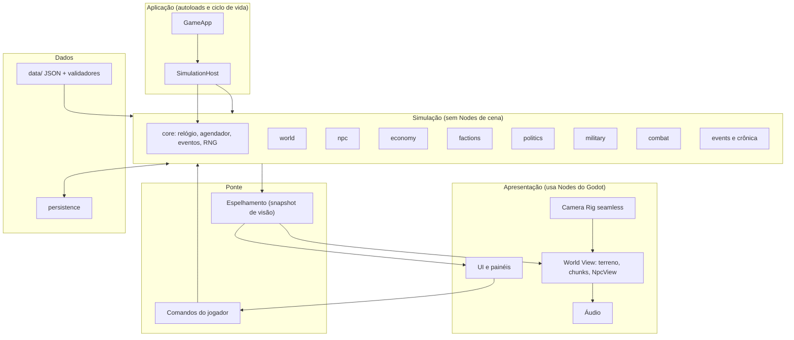
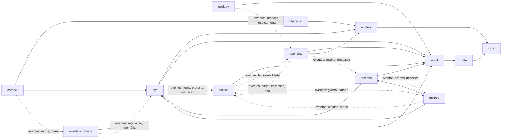
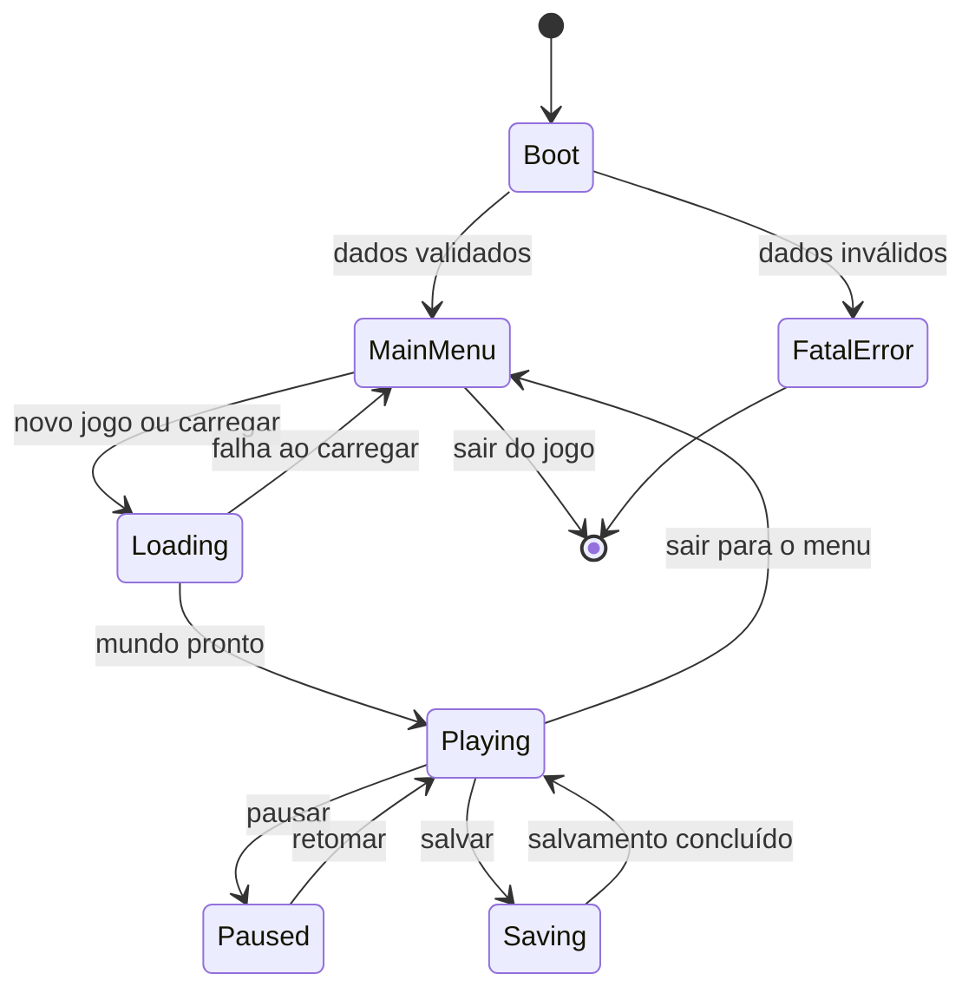
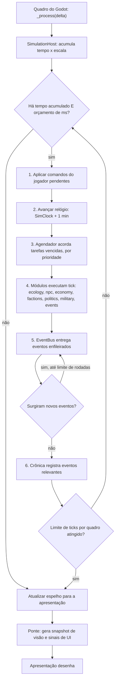
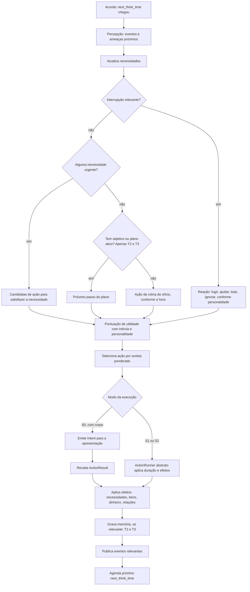
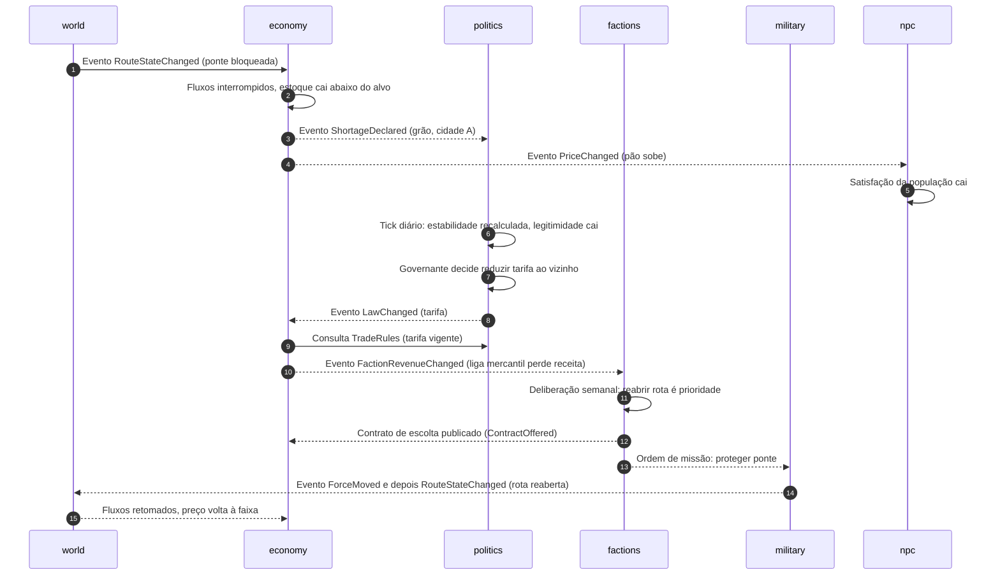
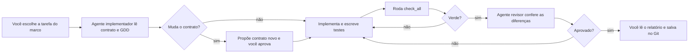

# LIVING WORLD — ARQUITETURA TÉCNICA

**Versão do documento:** 0.3 (atualizado em 01/11/2026 após a revisão final e as diretrizes de Arthur; ver `docs/CONSISTENCY_REPORT.md`)
**Status das decisões:** o registro oficial é `DECISIONS.md`. Neste documento, os rótulos abaixo **não** substituem o status lá registrado.
**Documento irmão:** `GDD.md` (design do jogo). Este documento diz **como construir**. O GDD diz **o que construir**.
**Stack:** Godot 4.7.x (DEC-012), GDScript tipado, PC com desenvolvimento em macOS (DEC-015), single-player, low-poly estilizado.
**Quem vai usar este documento:** um desenvolvedor sem experiência de programação, que implementa tudo por meio de agentes de IA. Por isso o texto explica o "porquê" de cada decisão em linguagem simples e traz regras que um agente de IA pode seguir e um humano pode conferir.

---

## 0. COMO LER ESTE DOCUMENTO

### 0.1 Rótulos de status

| Rótulo | Significado |
|---|---|
| **[CONF]** | Confirmado pelo briefing mestre ou por instrução escrita sua, e registrado como **APROVADA** em `DECISIONS.md`. O rótulo sozinho não prova aprovação: vale o status em `DECISIONS.md`. Não muda sem sua aprovação. |
| **[REC]** | Decisão recomendada por este documento. Adotar, a menos que você discorde. |
| **[VAL]** | Precisa ser validada por um protótipo técnico (chamado de *spike*, ver cap. 26) antes de virar definitiva. |
| **[PEND]** | Decisão sua, ainda em aberto. |
| **[LIM]** | Limitação técnica conhecida. |

### 0.2 Rótulos de fase

**[P1]** primeiro protótipo. **[PREV]** previsto depois do protótipo, e a arquitetura deixa espaço. **[FUT]** futuro, pode nunca acontecer.

### 0.3 Ficha padrão de módulo

Cada módulo importante é descrito com sete campos: **Responsabilidade, Entradas, Saídas, Dependências, Dados controlados, Interfaces de comunicação, Testes necessários.**

### 0.4 Palavras que aparecem muito

| Termo | Em palavras simples |
|---|---|
| Módulo | Um bloco do jogo com uma função clara (ex.: economia). Tem uma pasta própria. |
| Simulação | A "vida do mundo" em forma de dados e regras: quem é quem, quanto custa o pão, quem está em guerra. |
| Apresentação | O que você vê e ouve: modelos 3D, câmera, menus. |
| Node | Peça de uma cena do Godot (um objeto 3D, um botão, uma câmera). |
| Resource | Arquivo de dados do Godot, carregável e editável pelo editor. |
| Signal | Aviso nativo do Godot: "algo aconteceu" que quem quiser pode ouvir. |
| Autoload | Objeto que o Godot cria sozinho no início e deixa acessível de qualquer lugar. |
| Tick | Um "passo" de simulação. O mundo avança tick a tick. |
| Spike | Pequeno experimento descartável para tirar uma dúvida técnica antes de construir de verdade. |

### 0.5 Sumário

1. Princípios arquiteturais
2. Organização de diretórios
3. Responsabilidades dos módulos
4. Inicialização e ciclo de vida
5. Gerenciamento do mundo
6. Separação entre simulação e renderização
7. Entidades e componentes
8. Arquitetura dos NPCs
9. Necessidades, objetivos e decisões
10. Memória e relações dos NPCs
11. Economia e simulação de mercado
12. Facções e organizações
13. Política e diplomacia
14. Sistema militar
15. Combate e personagem
16. Dados, recursos e persistência
17. Eventos e comunicação entre módulos
18. Salvamento e carregamento
19. Interface e câmera seamless
20. Desempenho e escalabilidade
21. Testes automatizados e manuais
22. Segurança e integridade dos dados
23. Possibilidade futura de multiplayer
24. Integração opcional de IA generativa
25. Riscos técnicos
26. Decisões: confirmado, recomendado e a validar (com plano de spikes)
27. Guia de trabalho com agentes de IA
Anexos: A) Convenções de código; B) Modelo de tarefa para agente; C) Glossário.

---

## RESUMO EXECUTIVO (uma página)

**A ideia central.** O mundo do Living World vive em **dados e regras puros** (a *simulação*), sem nenhuma peça visual do Godot. O que você vê (a *apresentação*) é um "espelho" desses dados, desenhado só onde o jogador está olhando. Isso é o que permite um mundo grande com um desenvolvedor só: a simulação é leve e testável sem abrir o jogo, e os gráficos são caros apenas perto da câmera. **[REC]**

**As decisões mais importantes:**

| # | Decisão | Status |
|---|---|---|
| 1 | Simulação separada da apresentação, com regra de dependência de mão única (a simulação nunca conhece a tela) | **[REC]**, validar custo no spike SP1 |
| 2 | NPCs simulados **não são Nodes**. São dados. Só os NPCs perto do jogador ganham um corpo 3D | **[REC]**, validar no spike SP2 |
| 3 | Entidade = número de identificação (ID). Dados guardados em tabelas pertencentes a cada módulo. Sem framework de ECS de terceiros | **[REC]** |
| 4 | Dados de conteúdo (bens, receitas, culturas) em arquivos JSON validados. Cenas, materiais e animações em formatos nativos do Godot | **[REC]**, validar no spike SP3 |
| 5 | Comunicação: chamadas diretas para consulta, **barramento de eventos** próprio para fatos do mundo, **Signals** só na apresentação | **[REC]** |
| 6 | Poucos Autoloads (no máximo 4). Nada de "variável global do mundo" | **[REC]** |
| 7 | Simulação em passo fixo com orçamento de tempo por quadro, começando em **uma única thread** | **[REC]**, validar no spike SP1 |
| 8 | Salvamento em JSON comprimido, escrita atômica, com versão e checagem de integridade. Nunca carregar `.tres`/`.res` vindos de arquivo de save | **[REC]** |
| 9 | Dinheiro e quantidades em **números inteiros** | **[REC]** |
| 10 | Testes automáticos rodando o mundo **sem janela** (modo headless), inclusive testes de longa duração sem jogador | **[REC]** |
| 11 | Regras escritas para agentes de IA e verificação automática de arquitetura | **[REC]** |

**O que fica de fora do protótipo:** multiplayer, IA generativa, GDExtension (C++/Rust), múltiplas threads, geração procedural de mundo. A arquitetura deixa a porta aberta para todos, sem implementá-los. **[CONF/REC]**

**Risco nº 1:** o custo de manter simulação e câmera contínua funcionando juntas em GDScript. Por isso os spikes SP1 a SP4 vêm **antes** de construir sistemas de verdade (cap. 26).

---

# 1. PRINCÍPIOS ARQUITETURAIS

## 1.1 Os doze princípios

Cada princípio traz **por quê** (a razão), **regra** (o que fazer) e **verificação** (como saber se está sendo cumprido).

| # | Princípio | Por quê | Regra prática | Verificação |
|---|---|---|---|---|
| P1 | **Simulação é independente da apresentação** | Permite testar o mundo sem tela, rodar anos de jogo em minutos e, no futuro, ter multiplayer | Nenhum arquivo em `src/sim/` pode usar Nodes de cena, câmera, UI, `get_node`, `$`, `preload` de cenas | Script de verificação de arquitetura (cap. 27) |
| P2 | **Dados antes de objetos** | Dados são fáceis de salvar, testar, inspecionar e depurar | Estado do mundo = estruturas de dados simples e tipadas, sem lógica escondida em Nodes | Todo estado novo precisa ter `to_dict()` e `from_dict()` |
| P3 | **Um dono por dado** | Se dois módulos escrevem o mesmo dado, ninguém sabe quem causou o erro | Cada dado tem exatamente um módulo dono. Os outros só **leem** (via consulta) ou **pedem** mudança (via comando ou evento) | Tabela de "Dados controlados" por módulo (caps. 3 a 15) |
| P4 | **Dependência de mão única** | Evita o emaranhado em que tudo conhece tudo | Camadas numeradas (cap. 3.2). Módulo só importa módulos de camadas inferiores | Script de verificação de imports |
| P5 | **Comunicação por três canais, só três** | Canais demais viram bagunça | Consulta direta (ler), comando (pedir), evento (anunciar). Ver cap. 17 | Revisão de código por checklist |
| P6 | **Simples primeiro, otimizar com medição** | Otimização precoce custa tempo e complica | Começar com a solução mais legível. Só mudar para estruturas "rápidas" depois que o profiler apontar o gargalo | Toda otimização cita a medição que a justificou |
| P7 | **Determinismo controlado** | Bugs que "só acontecem às vezes" são os mais caros | Toda aleatoriedade passa por geradores com semente guardada no save. Nunca usar `randf()` solto na simulação | Busca automática por `randf(`/`randi(` em `src/sim/` |
| P8 | **Tudo que importa é inspecionável** | Sem ver dentro da simulação, ajustar o jogo é adivinhar | Todo módulo expõe um resumo de estado para o painel de depuração | Cada módulo implementa `debug_summary()` |
| P9 | **Orçamento de tempo por quadro** | Simulação pesada não pode travar o jogo | A simulação trabalha em fatias, com limite de milissegundos por quadro | Monitor de desempenho + teste de carga |
| P10 | **Dados de conteúdo fora do código** | Balancear sem mexer em programação | Bens, receitas, culturas, eventos e leis em arquivos de dados validados | Validador de dados no boot (cap. 16) |
| P11 | **Falhar de forma visível** | Erro silencioso corrompe o mundo aos poucos | Violação de regra gera erro claro com contexto, nunca é ignorada | Modo estrito em desenvolvimento |
| P12 | **Não adotar padrão só porque parece profissional** | O desenvolvedor e os agentes precisam entender tudo | Cada padrão adotado precisa de uma justificativa de uma linha ligada a um problema real deste projeto | Seção 1.3 lista o que **não** adotar |

## 1.2 Como evitar acoplamento excessivo

"Acoplamento" é quando mexer em uma peça quebra outras. As regras abaixo são as defesas, na ordem em que mais ajudam:

1. **Camadas e direção única.** Módulo de camada alta pode usar o de camada baixa, nunca o contrário. A economia pode ler o mundo, mas o mundo nunca conhece a economia.
2. **Cada módulo tem uma "porta de entrada".** Um único arquivo (chamado `api` do módulo) lista tudo que os outros podem chamar. Os demais arquivos do módulo são **privados**. Agentes de IA só podem importar a porta de entrada de outro módulo. **[REC]**
3. **Ler é livre, escrever é restrito.** Consultar dados de outro módulo é permitido por funções de consulta que devolvem **cópias** ou **visões somente-leitura**. Alterar dado de outro módulo é proibido. Quer mudar? Envie um **comando** ou publique um **evento**.
4. **Eventos em vez de chamadas em cadeia.** Em vez de a guerra chamar economia, política e NPCs um por um, a guerra anuncia `GuerraDeclarada`, e cada módulo interessado reage por conta própria. O emissor não sabe quem escuta.
5. **Dependências entram de fora, não são buscadas.** Um módulo recebe as referências de que precisa no momento da criação (ver `SimContext`, cap. 4). Ele não "procura" outros módulos pela árvore de cena nem por autoload.
6. **Identificadores, não referências.** Entre módulos, usa-se o **ID** (um número) de uma entidade, nunca o objeto em si. Isso evita referências quebradas, facilita salvar e permite trocar o objeto por trás.
7. **Dados de conteúdo isolam variações.** Diferenças entre culturas, bens e leis ficam em dados, não em `if` espalhado pelo código.
8. **Testes por módulo.** Um módulo que não pode ser testado sozinho está acoplado demais. É um alarme.

**Sinais de alerta de acoplamento** (qualquer agente deve avisar se perceber):
- Um módulo precisa importar mais de 3 outros.
- Um arquivo altera dados que não são do seu módulo.
- Para testar uma função, é preciso criar o jogo inteiro.
- Mudar um nome em um módulo obriga a editar muitos arquivos de outros módulos.

## 1.3 O que NÃO adotar (e por quê) **[REC]**

| Padrão | Por que não |
|---|---|
| Framework de ECS de terceiros (addon) | Adiciona dependência e curva de aprendizado. O ganho de desempenho só aparece com milhares de entidades "quentes", e a simulação em níveis de detalhe já reduz isso. Reavaliar se o spike SP2 mostrar necessidade |
| Injeção de dependência com contêiner automático | Complexidade sem benefício. Basta passar referências no `setup` |
| Camadas de abstração "por precaução" (repositórios, fábricas, interfaces para tudo) | Mais arquivos para o agente errar. Abstrair só quando houver 2 implementações reais |
| Event sourcing completo (reconstruir tudo a partir de eventos) | Caro e difícil. Usaremos uma **crônica** de eventos importantes para histórico, não para reconstruir o estado |
| Microsserviços, rede interna, banco de dados externo | Single-player offline |
| Reflexão e meta-programação | Difícil de depurar por humanos e por IA |
| Herança profunda de classes | Preferir composição de dados. Máximo 2 níveis de herança |
| Autoload para tudo | Vira variável global disfarçada |
| Threads por todo lado | Fonte clássica de bugs raros. Começar single-thread |
| GDExtension (C++/Rust) | Só se o profiler provar que GDScript não dá conta **[FUT]** |

## 1.4 Avaliação dos recursos nativos do Godot

Aqui está o veredito sobre cada ferramenta, para que nenhum agente use a errada.

| Recurso | O que é | Usar para | **Não** usar para | Veredito |
|---|---|---|---|---|
| **Node / Scene** | Objetos da árvore de cena, com ciclo de vida do Godot | Tudo que é visível ou interativo: personagem em S0, câmera, UI, terreno, efeitos | Guardar o estado da simulação. Representar cada NPC distante | Apenas na **apresentação** |
| **Resource** (`.tres`/`.res`) | Arquivo de dados tipado, editável no Inspector, com cache | Conteúdo de **autoria visual**: materiais, curvas, configurações de câmera, tabelas pequenas que você queira editar no editor | Estado de jogo salvo pelo jogador (risco de segurança, cap. 22). Estado que muda a cada tick | Para **conteúdo estático** que se beneficia do editor |
| **RefCounted** (classe com `class_name`) | Objeto leve, sem Node, liberado automaticamente | **Estado de simulação** (NpcState, MarketState), serviços, componentes | Qualquer coisa que precise estar na árvore de cena | **Base da simulação** |
| **Signal** | Aviso síncrono nativo | Apresentação: UI reagindo a dados, botões, animações, ligações entre Nodes | Fatos do mundo que precisam ser registrados, enfileirados, salvos ou testados | Só **apresentação** |
| **Autoload** | Singleton criado no boot | Ciclo de vida do app, configurações, ponte entre simulação e cena | Guardar estado do mundo. Serviço de domínio (economia etc.) | **Máx. 4** (seção 4.3) |
| **Groups** | Rótulos em Nodes | Apresentação (ex.: todos os `NpcView` para ligar/desligar) | Lógica de simulação | Uso pontual |
| **Custom Resource + `@export`** | Configurações editáveis no Inspector | Parâmetros de câmera, de debug, de LOD visual | Tabelas grandes de balanceamento (difícil para IA editar sem erro) | Seletivo |
| **Typed GDScript** | Tipagem estática | **Tudo**. Reduz erros e ajuda a IA | — | **Obrigatório** **[CONF]** |
| **Threads / WorkerThreadPool** | Execução paralela | Salvamento em segundo plano, carregamento de chunks, geração de rascunhos de texto (IA) | Alterar Nodes ou a árvore de cena a partir de outra thread | Só depois de medir (spike SP1) |
| **Servers APIs** (`RenderingServer` etc.) | Acesso direto a baixo nível | Muitos objetos simples (multidões distantes) | Uso geral | Reservado para otimização, se necessário **[VAL]** |
| **MultiMeshInstance3D** | Muitas instâncias de uma malha | Vegetação, multidões distantes, marcadores | Objetos com lógica própria | Provável uso na apresentação |
| **Visibility ranges** | Esconder/mostrar objetos por distância | LOD visual | — | Usar |
| **ResourceLoader threaded** | Carregamento assíncrono | Streaming de chunks e modelos | — | Usar com cuidado **[VAL]** |
| **GDExtension** | Código nativo | Último recurso de desempenho | — | **[FUT]** |
| **Addons de terceiros** | Extensões da comunidade | Testes (um framework), possivelmente terreno | Núcleo da simulação | Poucos e fixados em versão |

**Regra de ouro para Nodes:** "se o jogador não está olhando, não existe Node".

---

# 2. ORGANIZAÇÃO DE DIRETÓRIOS

## 2.1 Estrutura proposta **[REC]**

```
living-world/
├── project.godot
├── README.md                    ← o que é o projeto e como rodar
├── AGENTS.md                    ← regras para agentes de IA (cap. 27)
├── docs/
│   ├── GDD.md
│   ├── TECHNICAL_ARCHITECTURE.md
│   ├── decisions/               ← registro curto de decisões (uma página cada)
│   └── modules/                 ← uma página por módulo (contrato, ver 3.4)
├── data/                        ← CONTEÚDO do jogo (JSON), editável sem programar
│   ├── goods.json
│   ├── recipes.json
│   ├── cultures.json
│   ├── factions.json
│   ├── events.json
│   ├── laws.json
│   └── world/                   ← mapa lógico: províncias, rotas, assentamentos
├── src/
│   ├── app/                     ← inicialização, estados do app, configurações
│   ├── core/                    ← base: relógio, agendador, eventos, IDs, aleatoriedade
│   ├── data/                    ← leitores e validadores dos arquivos de data/
│   ├── sim/                     ← SIMULAÇÃO (nunca usa Nodes de cena)
│   │   ├── world/
│   │   ├── entities/
│   │   ├── npc/
│   │   ├── economy/
│   │   ├── factions/
│   │   ├── politics/
│   │   ├── military/
│   │   ├── combat/
│   │   ├── character/           ← personagem do jogador (estado)
│   │   ├── events/              ← eventos dinâmicos e crônica
│   │   └── ecology/             ← criaturas, recursos naturais
│   ├── persistence/             ← salvar e carregar
│   ├── presentation/            ← APRESENTAÇÃO (Nodes, câmera, UI)
│   │   ├── world_view/          ← terreno, chunks, NpcView, construções
│   │   ├── camera/
│   │   ├── ui/
│   │   └── audio/
│   ├── bridge/                  ← ponte simulação ↔ apresentação (comandos do jogador, espelhamento)
│   ├── ai_text/                 ← IA generativa opcional (isolada) [FUT]
│   ├── net/                     ← reservado, vazio no protótipo [FUT]
│   └── tools/                   ← depuração, inspeção, ferramentas de teste
├── scenes/                      ← arquivos .tscn (cenas)
├── assets/                      ← modelos, texturas, áudio
├── addons/                      ← extensões de terceiros (poucas e fixadas)
├── tests/
│   ├── unit/                    ← testes por módulo
│   ├── integration/             ← testes entre módulos
│   ├── soak/                    ← simulação longa sem jogador
│   └── fixtures/                ← mundos e saves de teste
└── tools/                       ← scripts de linha de comando (verificar arquitetura, rodar testes)
```

## 2.2 Regras de organização

1. **Uma pasta por módulo dentro de `src/sim/`.** Cada uma com: `api` (porta de entrada), arquivos privados e um `README` curto com a ficha do módulo.
2. **`src/sim/` e `src/core/` e `src/data/` não conhecem `src/presentation/`.** Verificado por script.
3. **`src/presentation/` só conversa com a simulação através de `src/bridge/`.**
4. **Nomes:** pastas e arquivos em `snake_case`, classes em `PascalCase` (`class_name NpcState`), constantes em `MAIÚSCULAS`. Idioma do **código**: inglês (ajuda a IA). Idioma dos **comentários e documentos**: português. **[REC]**
5. **Um arquivo = uma responsabilidade.** Se passar de ~300 linhas, o agente deve propor divisão.
6. **Conteúdo editável em `data/`, nunca em código.**
7. **Nada de caminhos "mágicos".** Caminhos de arquivos importantes ficam em um único arquivo de constantes.

## 2.3 Controle de versão **[REC]**

Usar **Git** desde o primeiro dia (com um serviço remoto de backup). Cada tarefa de agente vira uma pequena alteração salva (commit), de preferência em um ramo separado. Isso permite desfazer qualquer erro de IA. Para um usuário sem experiência de programação, é a rede de segurança mais importante deste projeto.

---

# 3. RESPONSABILIDADES DOS MÓDULOS

## 3.1 Visão geral dos módulos

| Camada | Módulo | Responsabilidade resumida | Fase |
|---|---|---|---|
| 0 | `core` | Relógio, agendador, barramento de eventos, IDs, aleatoriedade, registro de erros | P1 |
| 1 | `data` | Ler e validar conteúdo de `data/` | P1 |
| 2 | `world` | Mapa lógico: províncias, rotas, assentamentos, pontos de interesse | P1 |
| 2 | `entities` | Registro de IDs e do ciclo de vida das entidades | P1 |
| 3 | `character` | Estado do personagem do jogador e de notáveis (habilidades, itens) | P1 |
| 3 | `npc` | Estado, necessidades, decisões, rotinas, memória e relações dos NPCs | P1 |
| 3 | `economy` | Bens, produção, mercados, preços, caravanas | P1 |
| 3 | `ecology` | Criaturas, recursos naturais, clima simples (no protótipo do roadmap, clima e estações ficam fora: DEC-060, PROPOSTA) | P1 |
| 4 | `factions` | Facções, hierarquias, orçamento, decisões coletivas | P1 |
| 4 | `politics` | Leis, estabilidade, diplomacia, tratados | P1 |
| 4 | `military` | Forças, moral, suprimento, missões | P1 (simples) |
| 4 | `combat` | Regras de combate, equipamentos, ferimentos | P1 |
| 5 | `events` | Eventos dinâmicos, crônica, reputação | P1 |
| 6 | `persistence` | Salvar e carregar | P1 |
| 6 | `bridge` | Tradução entre simulação e apresentação | P1 |
| 7 | `presentation` | Nodes, câmera, UI, áudio | P1 |
| — | `tools` | Depuração, inspeção, ferramentas de teste | P1 |
| — | `ai_text` | IA generativa opcional | FUT |
| — | `net` | Multiplayer | FUT |

## 3.2 Regra das camadas

Um módulo só pode **depender** de módulos de **camada menor ou igual** (e, dentro da mesma camada, apenas dos listados na ficha do módulo). Exceção: **eventos** podem cruzar camadas, porque o emissor não depende de quem escuta.

```
Camada 7  presentation
Camada 6  bridge, persistence
Camada 5  events (crônica, reputação)
Camada 4  factions, politics, military, combat
Camada 3  character, npc, economy, ecology
Camada 2  world, entities
Camada 1  data
Camada 0  core
```

**Atenção, caso delicado:** `economy` (camada 3) precisa saber de leis de tarifa (`politics`, camada 4), e `politics` precisa saber de preços e escassez (`economy`). A solução é: `economy` **não importa** `politics`. Ela lê os parâmetros de leis por meio de uma **interface de consulta** (`TradeRules`) que é **entregue pronta** pelo `app` ao iniciar, e `politics` publica eventos de mudança de lei. Detalhes no cap. 13.

## 3.3 Diagrama: arquitetura geral



## 3.4 O contrato de um módulo

Cada módulo mantém, em `docs/modules/<nome>.md`, uma página curta com os **sete campos** da ficha (Responsabilidade, Entradas, Saídas, Dependências, Dados controlados, Interfaces de comunicação, Testes necessários). **Esse arquivo é a fonte de verdade para o agente de IA**: antes de alterar um módulo, o agente lê o contrato. Se o contrato precisar mudar, o agente propõe a mudança **antes** de alterar o código. **[REC]**

## 3.5 Diagrama: relações entre módulos

Setas sólidas: "pode ler dados de". Setas tracejadas: "recebe eventos de".



---

# 4. INICIALIZAÇÃO E CICLO DE VIDA

## 4.1 Objetivo

Garantir que o jogo inicia sempre na **mesma ordem**, que cada módulo recebe o que precisa e que desligar o jogo (ou carregar outro save) não deixa lixo.

## 4.2 Estados do aplicativo **[REC]**



## 4.3 Autoloads: no máximo quatro **[REC]**

| Autoload | Responsabilidade | Não pode |
|---|---|---|
| `GameApp` | Máquina de estados do aplicativo, troca de cenas, configurações, encerramento | Guardar estado do mundo |
| `SimulationHost` | Dono do **mundo atual**: cria, roda, para e destrói a simulação. Avança o relógio a cada quadro | Conhecer UI ou Nodes de cena |
| `Debug` | Registro de mensagens, painel de depuração, comandos de teste (somente em desenvolvimento) | Alterar o mundo fora de comandos oficiais |
| `Settings` (opcional) | Preferências do jogador (vídeo, áudio, controles) | Dados de jogo |

**Por que não mais autoloads?** Autoload é fácil de acessar de qualquer lugar, e isso é exatamente o problema: facilita criar dependências invisíveis. A economia, a política etc. **não** são autoloads. Moram dentro do mundo, e são criadas pelo `SimulationHost`.

## 4.4 Sequência de inicialização (Boot)

1. **Configurações e logs.** `Settings` e `Debug` iniciam.
2. **Carregar e validar conteúdo** (`data/`). Se algo estiver errado, o jogo para aqui com mensagem clara apontando arquivo e linha. **[REC]**
3. **Verificação de versão** (jogo, dados, formato de save).
4. **Menu principal.**

## 4.5 Sequência de criação do mundo (Loading)

O `SimulationHost` cria um **`World`** (contêiner de tudo que é simulação) e uma **`SimContext`** (um objeto que reúne as referências dos serviços: relógio, eventos, RNG, definições de dados, módulos). Depois:

1. Criar os serviços do `core` (relógio, agendador, barramento de eventos, gerador de números aleatórios com semente).
2. Criar os módulos **na ordem das camadas** (0 para cima), entregando a `SimContext` a cada um (`setup`).
3. **Segunda fase** (`post_setup`): módulos conectam assinaturas de eventos e consultas, agora que todos existem.
4. Preencher o mundo:
   - **Novo jogo:** cada módulo executa `on_new_game(seed)`, em ordem.
   - **Carregar:** `persistence` entrega cada pedaço salvo ao módulo dono (`on_load(data)`).
5. Validação de consistência (todos os IDs apontam para algo existente, etc.).
6. Criar a **apresentação** (cena de jogo), conectar a ponte, mover para `Playing`.

## 4.6 Contrato de ciclo de vida de um módulo (padrão) **[REC]**

Todo módulo da simulação implementa as mesmas operações, o que permite ao `SimulationHost` tratá-los de forma uniforme e facilita para os agentes de IA:

| Operação | Quando é chamada | Para que serve |
|---|---|---|
| `setup(ctx)` | Criação | Receber referências (relógio, eventos, definições) |
| `post_setup()` | Depois que todos existem | Assinar eventos e conectar consultas |
| `on_new_game(seed)` | Novo jogo | Criar estado inicial |
| `on_load(data) -> Result` | Carregar | Restaurar estado de dados salvos; devolve erro (sem alterar o estado) se o dado for inválido |
| `tick(elapsed_minutes: int)` | A cada passo de simulação, conforme frequência do módulo | Avançar a lógica do módulo; recebe os minutos simulados decorridos desde o último tick do módulo |
| `serialize() -> Dictionary` | Salvar | Devolver o estado em formato salvável |
| `validate() -> Array[String]` | Depois de carregar e em testes | Listar inconsistências |
| `debug_summary() -> Dictionary` | Painel de depuração | Resumo legível do estado |
| `teardown()` | Encerrar o mundo | Soltar referências, cancelar assinaturas |

Esquema de referência (apenas assinaturas, sem lógica):

```gdscript
class_name SimModule
extends RefCounted

func setup(_ctx: SimContext) -> void: pass
func post_setup() -> void: pass
func on_new_game(_world_seed: int) -> void: pass
func on_load(_data: Dictionary) -> Result: return Result.success()
func tick(_elapsed_minutes: int) -> void: pass
func serialize() -> Dictionary: return {}
func validate() -> Array[String]: return []
func debug_summary() -> Dictionary: return {}
func teardown() -> void: pass
```

**[Revisão v0.3.1 — aprovada por Arthur em 01/11/2026]** `on_load` devolve `Result` (AGENTS 13.1.2: função que pode falhar devolve `Result`) e `tick` recebe minutos inteiros (`elapsed_minutes`) em vez de decimal, coerente com a simulação em inteiros (21.5) e com o passo fixo de 1 minuto (6.4).

**[Revisão Godot v0.2]** No esquema acima, parâmetros sem uso levam prefixo `_` (senão o Godot emite o aviso `UNUSED_PARAMETER`) e o parâmetro da semente se chama `world_seed`, porque `seed` é uma função embutida do Godot (aviso `SHADOWED_GLOBAL_IDENTIFIER`). Ambos violariam a regra "código sem avisos" do `AGENTS.md`. Coleções tipadas **aninhadas** (`Array[Array[int]]`, `Dictionary[int, Array[int]]`) **não existem** na linguagem; use `Array`/`Dictionary` simples na fronteira com JSON e valide em `validate()`. `Dictionary[K, V]` tipado exige Godot 4.4 ou mais.

## 4.7 Encerramento

- **Sair para o menu:** `Saving` opcional, `teardown()` em ordem **inversa** das camadas, destruir a apresentação, liberar o `World`.
- **Trocar de save:** o mesmo processo, sem fechar o jogo. Isso é um teste importante: carregar três saves seguidos não pode vazar memória nem estado. **[REC]**

## 4.8 Fichas dos módulos desta parte

### Módulo `app` (GameApp e SimulationHost)

| Campo | Definição |
|---|---|
| Responsabilidade | Ciclo de vida do aplicativo e do mundo. Avança a simulação a cada quadro dentro do orçamento de tempo |
| Entradas | Eventos do sistema (iniciar, sair), pedidos do menu (novo, carregar, salvar), tempo do quadro |
| Saídas | Mundo criado e destruído, sinais de estado do app para a apresentação |
| Dependências | `core`, `data`, `persistence`, `bridge` |
| Dados controlados | Estado do aplicativo, referência ao `World` atual, configurações |
| Interfaces de comunicação | Signals para a apresentação (`state_changed`); chamadas diretas ao `World` |
| Testes necessários | Ciclo completo novo jogo → salvar → sair → carregar; carregar 3 saves em sequência sem vazamento; falha de dados mostra erro claro |

### Módulo `core`

| Campo | Definição |
|---|---|
| Responsabilidade | Infraestrutura comum: relógio de simulação, agendador de tarefas por frequência, barramento de eventos, gerador de IDs, geradores de números aleatórios, registro de erros |
| Entradas | Tempo real decorrido; pedidos de agendamento; eventos publicados |
| Saídas | Ticks nas frequências corretas; eventos entregues; números aleatórios reproduzíveis |
| Dependências | Nenhuma (camada 0) |
| Dados controlados | Tempo de simulação, fila de eventos, estado dos geradores aleatórios, próximo ID |
| Interfaces de comunicação | API de relógio, de agendador, de `EventBus` (publicar/assinar), de `Rng` |
| Testes necessários | Relógio avança com passo fixo independente da taxa de quadros; eventos entregues em ordem estável; mesma semente produz mesma sequência; salvar/restaurar estado do RNG continua a mesma sequência |

---

# 5. GERENCIAMENTO DO MUNDO

## 5.1 O que é o `World`

O **`World`** é um objeto (não é um Node) que contém **todos os módulos da simulação** e a `SimContext` compartilhada. Existe um `World` por jogo carregado. Criar um `World` novo = novo jogo. Destruir = fim da sessão. Isso torna trivial: carregar outro save, rodar testes (cada teste cria seu próprio `World`) e, no futuro, hospedar mais de um mundo. **[REC]**

```
World
 ├─ SimContext (relógio, eventos, RNG, definições de dados)
 ├─ WorldMap (módulo world)
 ├─ EntityRegistry (módulo entities)
 ├─ módulos de domínio: npc, economy, ecology, factions, politics, military, combat, character
 └─ events (crônica, reputação)
```

## 5.2 Mapa lógico (módulo `world`)

O mundo lógico é um **grafo**: **províncias** (nós) ligadas por **rotas** (arestas), contendo **assentamentos** e **pontos de interesse**. Coordenadas lógicas em **2D** (X, Z) em metros. A altura do terreno é um detalhe da apresentação. **[REC]**

| Estrutura | Campos principais |
|---|---|
| `Province` | id, bioma, vizinhas, recursos, fertilidade, risco, dono político |
| `Route` | id, província A, província B, distância, tipo, capacidade, estado (aberta, bloqueada, perigosa) |
| `Settlement` | id, província, posição, população por grupo, referência a mercado e governo |
| `PointOfInterest` | id, tipo, posição, estado, perigo, conteúdo |

**Índice espacial:** uma grade simples (células de tamanho fixo) para responder "quem está perto de X?" sem varrer todas as entidades. **[REC]** Cada módulo que tem entidades com posição registra-se nessa grade.

**Precisão numérica [LIM]:** o Godot usa números de ponto flutuante de precisão simples por padrão, que perdem exatidão longe da origem do mundo. Para a região do protótipo (alguns quilômetros) isso não é problema. Para mundos maiores, será preciso "origem flutuante" (recentrar o mundo em torno do jogador) **[FUT]**.

## 5.3 Níveis de simulação (LOD) e foco

O GDD define S0, S1, S2 e S3. Arquiteturalmente:

- A **apresentação informa o foco** (onde está o jogador e a câmera) à simulação por um comando `SetFocus(position, radius_s0, radius_s1)`.
- O módulo **`world`** mantém o `SimLodManager`, que classifica cada entidade em S0, S1 ou S2 com base na distância ao foco (com **histerese**: para mudar de nível, a entidade precisa ultrapassar o limite por uma margem, evitando "pisca-pisca" na borda). **[REC]**
- Mudanças de nível geram o evento `LodChanged(entity, from, to)`. Quem precisa reagir (npc, economy, apresentação) escuta.

| Nível | Quem decide | O que acontece com um NPC | Custo |
|---|---|---|---|
| S0 | Distância curta | Ganha corpo 3D (`NpcView`). Movimento e animação rodam na apresentação, obedecendo a **intenções** da simulação | Alto |
| S1 | Distância média | Sem corpo. Posição lógica discreta e atividade atual; avança por regras simples | Médio |
| S2 | Longe | Só dados agregados e T2/T3 sem movimento físico | Baixo |

**Regra de preservação de estado [REC]:** ao subir de nível (S2→S1→S0), a simulação **reconstrói** a posição e a atividade a partir da agenda e da hora (ex.: padeiro às 9h está na padaria). Ao descer, **nada se perde**: os dados importantes já estão no estado lógico.

## 5.4 Tempo do mundo

Detalhado no cap. 6. Aqui, apenas: o mundo tem **um relógio único** (`SimClock`), em **minutos de simulação inteiros**, e **ninguém** além do `SimulationHost` o avança. **[REC]**

## 5.5 Ficha do módulo `world`

| Campo | Definição |
|---|---|
| Responsabilidade | Mapa lógico, índice espacial, classificação de LOD de simulação, consultas de espaço |
| Entradas | Definições de `data/world/`; comando `SetFocus`; pedidos de registro de entidades com posição |
| Saídas | Consultas ("vizinhas da província X", "rota entre A e B", "entidades perto de P"); evento `LodChanged`; eventos `RouteStateChanged` |
| Dependências | `core`, `data` |
| Dados controlados | Províncias, rotas, assentamentos (estrutura física), pontos de interesse, índice espacial, nível de LOD de cada entidade |
| Interfaces de comunicação | Funções de consulta (somente leitura); comando `SetFocus`; eventos publicados |
| Testes necessários | Grafo conectado e sem referências quebradas; busca de caminho entre províncias correta; histerese de LOD sem oscilação; índice espacial devolve o mesmo resultado que uma busca bruta (teste de equivalência) |

---

# 6. SEPARAÇÃO ENTRE SIMULAÇÃO E RENDERIZAÇÃO

## 6.1 O princípio em uma frase

> A simulação **decide o que acontece**. A apresentação **mostra** e **executa o que exige física** (movimento fino, colisões, animações), e **reporta resultados**.

## 6.2 Fluxo de duas mãos: "intenções descem, resultados sobem" **[REC, VAL em SP2]**

- **Intenções (simulação → apresentação):** "o NPC 4012 quer ir até o ponto X e trabalhar na forja". Descrevem **o quê**, não **como**.
- **Resultados (apresentação → simulação):** "NPC 4012 chegou", "NPC 4012 foi atingido pela arma W na região R", "caminho bloqueado".
- **Quem decide regras:** a simulação. Dano, preço, lealdade, crime, resultado de batalha são calculados nela.
- **Quem executa física:** a apresentação. Caminhar até o ponto, desviar de obstáculos, tocar animação, detectar contato de arma.

Isso evita duplicar tudo (duas físicas, duas navegações) e mantém as regras testáveis sem tela.

## 6.3 Os três jeitos de a apresentação saber o que mostrar

| Mecanismo | Uso | Detalhe |
|---|---|---|
| **Espelhamento (snapshot de visão)** | Dados contínuos (posição lógica, atividade atual, preços exibidos) | A ponte monta, por quadro ou por tick, estruturas de leitura leves para o que está em vista |
| **Eventos de apresentação** | Fatos pontuais (NPC nasceu, morreu, edifício queimou) | A ponte traduz eventos da simulação em **Signals** para a apresentação |
| **Comandos** | Ações do jogador (comprar, atacar, aceitar contrato) | Apresentação → ponte → simulação, como objetos de comando tipados |

## 6.4 Relógio e passo de simulação

- A simulação roda em **passo fixo**: 1 **minuto de simulação** por tick base. **[REC]**
- Cada quadro, o `SimulationHost` acumula o tempo real multiplicado pela **escala de tempo** (pausa, 1x, 2x, 4x, 8x). Enquanto houver acumulado suficiente **e** orçamento de milissegundos, executa ticks.
- **Proteção contra "espiral da morte":** limite máximo de ticks por quadro. Se a simulação não consegue acompanhar, **a velocidade do mundo cai** em vez de congelar o jogo. **[REC]**
- **Independência de taxa de quadros:** o resultado da simulação **não pode depender** de FPS.
- Calibração de referência **[HIP]**: 1 dia de jogo ≈ 30 minutos reais em 1x, ou seja, ~0,8 minuto de simulação por segundo real. Os valores exatos serão calibrados em testes.

### Frequências por módulo (referência) **[HIP]**

| Módulo | Frequência de processamento | Observação |
|---|---|---|
| `ecology` (clima, criaturas) | A cada hora de simulação | Estações mudam por dia |
| `npc` (decisões de T1/T2) | A cada 5 a 15 min de simulação, **escalonado** | Cada NPC tem um `next_think_time` |
| `economy` (produção e consumo) | A cada hora; preços ao fim do dia | Caravanas avançam por tick |
| `factions` | Semanal | Mais ações extraordinárias por eventos |
| `politics` | Diária (estabilidade) e semanal (leis) | |
| `military` | A cada hora em operação | |
| `events` | A cada hora | |

## 6.5 Ciclo de simulação



**Pontos importantes do ciclo:**
- **Comandos primeiro:** as ações do jogador entram no início do tick, em ordem de chegada.
- **Ordem fixa de módulos:** a ordem do passo 4 é constante e documentada. Mudar a ordem muda o comportamento do mundo.
- **Rodadas de eventos com limite:** eventos podem gerar outros eventos. Para evitar laço infinito, há um **máximo de rodadas por tick** (ex.: 8 **[HIP]**). Se estourar, registra-se erro e o excedente vai para o tick seguinte.
- **Orçamento adaptativo:** tarefas de baixa prioridade (ex.: reorganização de memória de NPCs distantes) são adiadas quando o tempo aperta.

## 6.6 O que a apresentação nunca faz

- Nunca altera o estado da simulação diretamente (só por comandos e resultados).
- Nunca guarda estado que precise sobreviver a um salvamento. Se precisa ser salvo, é dado de simulação.
- Nunca é necessária para a simulação rodar (teste: o jogo roda `--headless`).

## 6.7 Ficha do módulo `bridge`

| Campo | Definição |
|---|---|
| Responsabilidade | Única ponte entre simulação e apresentação: traduz comandos, espelha estado, converte eventos em signals |
| Entradas | Ações do jogador (da UI e do personagem); resultados da física (chegada, acerto); eventos da simulação |
| Saídas | Comandos tipados para a simulação; snapshots de visão; signals para a UI |
| Dependências | Interfaces públicas dos módulos de simulação (leitura e comandos); `core` |
| Dados controlados | Nenhum dado de jogo. Apenas caches de visão (descartáveis) |
| Interfaces de comunicação | Objetos `Command`; objetos `ViewSnapshot`; Signals |
| Testes necessários | Cada tipo de comando é aceito ou rejeitado de forma previsível (com motivo); snapshot é cópia, não referência ao estado vivo; eventos viram signals na ordem correta; ponte funciona sem apresentação (testes) |

---

# 7. ENTIDADES E COMPONENTES

## 7.1 O problema

O jogo tem muitas "coisas" com dados diferentes: NPCs, criaturas, caravanas, edifícios, itens, facções. Precisamos de um jeito de organizá-las que seja **simples para a IA implementar**, **fácil de salvar** e **rápido o bastante**.

## 7.2 Opções avaliadas

| Opção | Como funciona | Prós | Contras | Veredito |
|---|---|---|---|---|
| **A. Um Node por entidade** (jeito "clássico" do Godot) | Cada NPC é uma cena com scripts | Natural no editor, ótimo para o que é visível | Pesado com milhares de entidades. Estado preso a cenas. Difícil testar sem tela. Salvar é trabalhoso | Só para entidades **em S0** (corpo visual) |
| **B. Um Resource por entidade** | Cada entidade é um `.tres` | Editável no Inspector | Não é pensado para estado dinâmico em massa; riscos de segurança ao carregar; desempenho ruim | **Não** para estado de jogo |
| **C. Objetos RefCounted com "componentes" como objetos** | `NpcState` tem `Needs`, `Skills`... como objetos aninhados | Fácil de entender e de escrever; ótimo para IA | Mais memória por entidade; cuidado com ciclos de referência | Bom para centenas |
| **D. ID + tabelas por módulo** | Entidade é um número. Cada módulo guarda seus dados daquela entidade em sua própria tabela, indexada pelo ID | Dados separados por dono; fácil salvar; testável; escalável | Exige disciplina com IDs | **Recomendado** |
| **E. ECS completo (framework)** | Entidades, componentes e sistemas formais | Alto desempenho em massa | Dependência de terceiros; paradigma mais difícil para iniciante e para IA; pouco ganho nesta escala | Não agora |

## 7.3 Decisão recomendada **[REC]**

**Híbrido simples das opções D e C:**

1. **Entidade = ID inteiro**, gerado pelo `core`, **nunca reutilizado** (contador crescente salvo no save). Simples e evita o bug clássico de "ID antigo apontando para coisa nova".
2. **`EntityRegistry`** (módulo `entities`) sabe, para cada ID, **o tipo** (npc, creature, caravan, building, item, faction...) e se está **vivo**.
3. **Cada módulo guarda "seus" dados** daquela entidade em uma **tabela própria** (`Dictionary` do ID para um objeto `RefCounted` tipado). Exemplo: `npc` guarda `NpcState`; `factions` guarda `Membership`; `character` guarda `Skills`.
4. **Entre módulos, só circula o ID.** Para ler dados de outro módulo, usa-se **consulta** que devolve um **resumo somente-leitura** (um objeto pequeno copiado, ex.: `NpcSummary`).
5. **Apresentação:** um `NpcView` (Node) existe **apenas** para entidades em S0, vinculado ao ID. Fica em um **pool** (reaproveitado).

## 7.4 Por que não ECS completo

Para o protótipo (centenas de indivíduos detalhados e milhares agregados), objetos tipados em `Dictionary` são suficientes. O **LOD de simulação já faz o trabalho de escala**, e não a estrutura de dados. Se o spike SP2 mostrar que o gargalo é a estrutura (ex.: 5.000 NPCs T1), a otimização planejada é converter **somente os dados quentes** dos T1 para **arrays compactos** (`PackedInt32Array`, `PackedFloat32Array`) por trás da **mesma API** do módulo, sem mudar quem o usa. **[REC/VAL]** Esse é o motivo pelo qual a porta de entrada de cada módulo (cap. 1.2) é importante: ela permite trocar a estrutura interna sem quebrar os outros.

## 7.5 Mutação e "somente leitura" **[LIM]**

GDScript não tem objetos imutáveis. Mitigações:
- Convenção de nomes na API: `peek_...()` (leitura, devolve resumo/cópia) e `request_...()` (pedido de mudança, vira comando ou evento).
- Resumos são cópias, então mexer neles não afeta o estado real.
- Teste de integridade: após cada tick em modo de teste, o `validate()` do módulo dono confere invariantes.
- Script de verificação sinaliza código fora do módulo que acessa tabelas privadas.

## 7.6 Ficha do módulo `entities`

| Campo | Definição |
|---|---|
| Responsabilidade | Criar, registrar e encerrar entidades; guardar tipo e estado de vida; garantir IDs únicos |
| Entradas | Pedidos de criação (`create(kind)`) e encerramento (`destroy(id)`) feitos pelos módulos donos |
| Saídas | IDs; eventos `EntityCreated`, `EntityDestroyed`; consultas `is_alive`, `kind_of` |
| Dependências | `core` |
| Dados controlados | Tabela id → (tipo, vivo, data de criação), contador de IDs |
| Interfaces de comunicação | Funções de consulta; eventos |
| Testes necessários | IDs nunca repetem, nem após salvar/carregar; destruir marca como morto e dispara evento; consultar ID inexistente falha de forma clara e não trava |

---

# 8. ARQUITETURA DOS NPCs

## 8.1 Visão

Um NPC é, na simulação, um **registro de dados** (`NpcState`) mais um **comportamento** executado por **sistemas** do módulo `npc`. Na apresentação, só quando perto, é também um **corpo 3D** (`NpcView`). **[REC]**

## 8.2 Camadas (tiers) na arquitetura

| Tier | Representação | Onde mora | Como "pensa" |
|---|---|---|---|
| **T0 Massa** | `PopulationGroup` (contagens e médias por assentamento, ocupação, cultura, riqueza) | Módulo `npc` | Regras agregadas (produção, consumo, satisfação) |
| **T1 Cidadão** | `NpcState` compacto | Módulo `npc` | Rotina de ofício + necessidades simples |
| **T2 Notável** | `NpcState` completo + `Memory` + `Relations` + `Goals` | Módulo `npc` | Utilidade + objetivos |
| **T3 Líder** | T2 + vínculo com facção/governo + planos longos | `npc` e `factions` | Deliberação periódica pela facção |

**Nota v0.3 (DEC-041, aprovada):** o **T0 e o nível de simulação agregado (S2 e S3) não são construídos no primeiro protótipo**; só T1, T2 e T3 individuais. `PopulationGroup` fica descrito aqui como primeira expansão e não ganha classe, dado nem evento até haver tarefa própria.

**Promoção e rebaixamento [REC]:** operações explícitas do módulo (`promote(id, to_tier)`, `demote(id, to_tier)`), com regras de quando acontecem (ex.: interação do jogador, cargo, evento marcante). Um limite global de T2/T3 simultâneos impede explosão de custo. Rebaixar **resume** memória e relações em poucos "traços" que permanecem.

## 8.3 Componentes do `NpcState` **[REC]**

| Bloco | Conteúdo | Muda com que frequência |
|---|---|---|
| Identidade | ID, nome, cultura, idade aproximada, tier | Raro |
| Personalidade | Traços numéricos (poucos) | Quase nunca |
| Necessidades | Valores atuais e urgência | A cada processamento |
| Habilidades | Níveis por habilidade | Lenta |
| Posição lógica | Província/assentamento, coordenadas, LOD | Frequente |
| Ocupação e locais | Ofício, casa, local de trabalho | Raro |
| Ação atual | Ação, alvo, início, duração prevista | Frequente |
| Recursos | Dinheiro, itens (referência ao inventário) | Frequente |
| Objetivos e plano (T2/T3) | Lista de objetivos, plano atual | Ocasional |
| Memória e relações (T2/T3) | Ver cap. 10 | Ocasional |

## 8.4 Subsistemas internos do módulo `npc`

```
src/sim/npc/
  api/            ← porta de entrada (consultas e comandos)
  state/          ← NpcState, PopulationGroup
  needs/          ← cálculo e satisfação de necessidades
  decision/       ← avaliação de utilidade e seleção de ação
  routine/        ← agenda por ofício
  actions/        ← catálogo de ações (definições vêm de data/)
  perception/     ← o que o NPC percebe
  memory/         ← memória episódica
  relations/      ← grafo de relações
  lod/            ← promoção, rebaixamento, reconstrução de estado
```

## 8.5 Execução de ações em dois modos **[REC]**

| Modo | Quando | Como a ação acontece |
|---|---|---|
| **Abstrato** (S1/S2) | NPC sem corpo | O `ActionRunner` desconta duração e aplica **efeitos** (necessidade satisfeita, bem produzido, dinheiro gasto), com chance de falha por regra |
| **Corpóreo** (S0) | NPC com `NpcView` | A simulação emite uma **intenção** (`Intent`). A apresentação executa o movimento e a animação, e devolve **resultado** (`ActionResult`). Só então os efeitos são aplicados |

Os **efeitos** são os mesmos nos dois modos (mesma função), o que garante que o mundo evolua de forma equivalente com ou sem jogador por perto.

## 8.6 Fichas dos módulos

### Módulo `npc` (núcleo)

| Campo | Definição |
|---|---|
| Responsabilidade | Existência e vida dos NPCs: estado, tiers, rotinas, percepção, execução de ações, ligação com LOD |
| Entradas | Ticks do relógio; eventos (fome pública, guerra, mudança de lei, `LodChanged`); definições de ações e ofícios; comandos (contratar, convocar, promover) |
| Saídas | Intenções para a apresentação; eventos (`NpcDied`, `NpcMigrated`, `NpcProtested`, `NpcCommittedCrime`); pedidos de compra/venda/produção à economia; consultas de resumo |
| Dependências | `core`, `data`, `world`, `entities` (consulta a `economy` por interface; ver cap. 11) |
| Dados controlados | `NpcState` de todos os T1/T2/T3; `PopulationGroup` (T0); fila de pensamento (`next_think_time`) |
| Interfaces de comunicação | `peek_npc(id)`, `peek_group(...)`, `request_hire(...)`, `request_promote(...)`; eventos publicados |
| Testes necessários | Sem jogador, 100 NPCs sobrevivem 30 dias de jogo comendo, trabalhando e dormindo; promoção e rebaixamento preservam o essencial; ação abstrata e corpórea aplicam os mesmos efeitos; detector de impasse reinicia NPC travado; mesma semente produz mesma vida |

---

# 9. SISTEMA DE NECESSIDADES, OBJETIVOS E DECISÕES

## 9.1 Visão geral

A decisão de um NPC combina três coisas, da mais barata à mais cara:

1. **Rotina de ofício:** o que ele faz normalmente a cada hora do dia.
2. **Necessidades e interrupções:** quando algo aperta (fome, perigo, convite), reavalia.
3. **Objetivos de médio e longo prazo (T2/T3):** planos como "juntar dinheiro", "entrar na facção".

## 9.2 Necessidades **[REC]**

- Cada necessidade tem **valor** (0 a 100, inteiro), **taxa de variação** (por hora de simulação) e **limiares** (confortável, atenção, urgente, crítico). Valores e taxas vêm de dados.
- Necessidades do protótipo: **fome, descanso, segurança, renda, social**. Outras vêm depois. **[P1]**
- Satisfazer uma necessidade exige **ações** do catálogo, que produzem efeitos nela.

## 9.3 Catálogo de ações (em dados) **[REC]**

Em `data/actions.json`, cada ação descreve: identificador, duração, tipo de local necessário, habilidade usada, **pré-condições**, **efeitos** (sobre necessidades, bens, dinheiro, relações), risco e **pesos de personalidade**. Adicionar uma ação nova é **editar dados**, não criar código, sempre que possível. Isso reduz muito o trabalho dos agentes de IA e o risco de erro.

## 9.4 Escolha de ação (utilidade) **[REC]**

Para cada ação possível, o sistema calcula uma **pontuação** de utilidade com os ingredientes:

- **Benefício** nas necessidades: quanto a ação melhora cada necessidade, **ponderado pela urgência** dela.
- **Ajuste de personalidade:** ações compatíveis com os traços ganham, incompatíveis perdem.
- **Custos:** tempo, distância, risco, dinheiro.
- **Compromisso (inércia):** bônus para continuar a ação atual, evitando que o NPC mude de ideia a cada instante.
- **Contexto:** leis, horário, presença de ameaças.

A escolha **não é sempre a de maior pontuação**: sorteia-se entre as melhores com pesos (usando o gerador aleatório do NPC), para dar variedade sem perder coerência. O formato exato das fórmulas fica em dados e é calibrado nos testes. **[HIP]**

**Por que utilidade e não árvore de comportamento ou planejador completo?** Utilidade com catálogo em dados é **fácil de entender, de ajustar e de depurar** (é possível imprimir "por que o NPC escolheu isso"). Planejadores completos (GOAP/HTN) são mais caros e difíceis de depurar. Para T2/T3, os objetivos usam **planos curtos em passos** feitos de ações do mesmo catálogo. **[REC]**

## 9.5 Objetivos e planos (T2/T3)

- **Objetivo:** tipo, alvo, prioridade, prazo opcional, condição de sucesso e de abandono.
- **Plano:** lista ordenada de ações. Se uma ação falha, o NPC **replaneja** (limite de tentativas) ou abandona o objetivo com consequência (frustração, memória).
- **Objetivos nascem de:** personalidade, estado atual (pobre quer renda), eventos e ordens de facção.

## 9.6 Interrupções

Eventos percebidos com **severidade** acima do limiar do NPC (fuga, ajuda, combate) interrompem a ação atual. Depois, ele **retoma** a rotina (ou o plano).

## 9.7 Fluxo de decisão do NPC



## 9.8 Depuração das decisões **[REC]**

Cada decisão de um NPC selecionado no painel de depuração mostra: necessidades, candidatas, pontuações, ação escolhida e motivo. **Sem isso, balancear será adivinhação.** Custo: guardar o "rastro" apenas para NPCs marcados (ligado por comando de depuração).

## 9.9 Ficha do módulo `npc/decision` (parte do `npc`)

| Campo | Definição |
|---|---|
| Responsabilidade | Escolher a próxima ação de cada NPC a partir de necessidades, objetivos, rotina, personalidade e contexto |
| Entradas | Estado do NPC, catálogo de ações, contexto (hora, local, leis ativas, ameaças percebidas), gerador aleatório do NPC |
| Saídas | Ação escolhida (com alvo e duração); registro de motivo (se depuração) |
| Dependências | `npc/state`, `npc/actions`, `core` (RNG), consultas de contexto a `world`, `economy`, `politics` por interfaces de leitura |
| Dados controlados | Pesos de utilidade em uso, rastros de decisão de depuração |
| Interfaces de comunicação | Função `decide(npc_id) -> ChosenAction`; evento `NpcDecided` apenas em modo de depuração |
| Testes necessários | Dado um estado fixo e uma semente, a escolha é a mesma; NPC faminto com comida disponível come; NPC covarde foge, NPC valente luta (mesmo cenário); histerese impede troca de ação a cada tick; nenhuma ação sem pré-condições satisfeitas é escolhida |

---

# 10. MEMÓRIA E RELAÇÕES DOS NPCs

## 10.1 Memória episódica **[REC]**

Cada T2/T3 guarda uma lista **limitada** de `MemoryRecord`:

| Campo | Significado |
|---|---|
| `kind` | Tipo do episódio (ajuda recebida, roubo sofrido, vitória, humilhação...) |
| `actors` | IDs envolvidos |
| `place` | Local (assentamento) |
| `time` | Instante em minutos de simulação |
| `valence` | Positivo ou negativo (−100 a +100) |
| `salience` | Importância (0 a 100) |
| `source` | Presenciou, soube por rumor (com ID de quem contou) |
| `confidence` | Certeza da informação |

**Capacidade e esquecimento [REC]:** limite por NPC (ordem de **dezenas** de registros **[HIP]**). Quando cheia, remove a de menor "valor" (saliência decaída pelo tempo). Registros muito fortes viram **traços permanentes** ("odeia a facção X", "deve favor a Y") antes de serem removidos.

## 10.2 Relações **[REC]**

- **Grafo esparso:** só existem relações entre pessoas que **se conheceram**. Armazenadas por **par de IDs** em tabela única do módulo (chave gerada de forma ordenada pelos dois IDs).
- Dimensões inteiras de −100 a +100: **afeição, confiança, respeito, medo, dívida**; e **rótulos** (família, amigo, rival, empregador, mentor).
- **Limite por NPC** (ordem de dezenas **[HIP]**). Relações com o jogador e com membros de facção têm prioridade para permanecer.
- **Mudança:** por eventos (memória gravada gera ajuste), por tempo (decaimento suave) e por rumores.

## 10.3 Rumores **[REC]**

- Rumor = memória "de segunda mão" com **confiança menor** e **distorção** (intensidade e detalhes podem mudar).
- Propagação **em lote**, não NPC a NPC: periodicamente, cada assentamento processa "encontros" por grupos (taverna, mercado), trocando rumores com regras e limite por lote. Custo previsível.
- Rumores alimentam **reputação** (módulo `events`) e a **informação disponível ao jogador** (quadros de avisos, conversas).

## 10.4 Estimativa de custo de memória **[HIP]**

300 NPCs T2 × 32 memórias × cerca de 100 bytes ≈ 1 MB. Relações: 300 × 24 × cerca de 40 bytes ≈ 0,3 MB. Cabe com folga. O que merece atenção é o **tempo de salvamento** e a **poda**, não a memória (cap. 18).

## 10.5 Ficha do módulo `npc/memory` e `npc/relations`

| Campo | Definição |
|---|---|
| Responsabilidade | Guardar o que cada NPC viveu e sabe; manter o grafo de relações; propagar rumores |
| Entradas | Eventos relevantes (ação presenciada, crime, favor, batalha); ações sociais; ticks de decaimento e de rumores |
| Saídas | Consultas ("o que X pensa de Y?", "X lembra de Z?"); ajustes de relação; eventos `RumorSpread`, `RelationChanged` (agregados) |
| Dependências | `npc/state`, `entities`, `core`, `world` (para quem está no mesmo lugar) |
| Dados controlados | Memórias de cada T2/T3, grafo de relações, traços permanentes |
| Interfaces de comunicação | `peek_opinion(a, b)`, `peek_memories(id, filter)`; eventos publicados em lote |
| Testes necessários | Capacidade nunca excedida; memória forte vira traço antes de sumir; rumor perde confiança a cada salto; relação com jogador não é removida por poda; após salvar e carregar, mesmas opiniões; propagação em lote respeita limite de custo por tick |

---

# 11. ECONOMIA E SIMULAÇÃO DE MERCADO

## 11.1 Estrutura do módulo `economy`

```
src/sim/economy/
  api/          ← porta de entrada
  goods/        ← bens (definições vêm de data/)
  markets/      ← mercados locais: estoque, preço, spread
  production/   ← locais de produção, receitas, trabalhadores
  trade/        ← caravanas (S0/S1) e fluxos agregados (S2)
  consumption/  ← demanda da população e de organizações
  ledger/       ← livro-razão do dinheiro
  contracts/    ← mercado de serviços: contratos de trabalho, escolta, entrega, recompensa
  rules/        ← interface TradeRules (tarifas, proibições, licenças)
```

**Contratos moram dentro da economia [REC].** Contrato de trabalho, escolta, entrega e recompensa é uma troca de serviço por dinheiro. NPCs, facções e o jogador usam o mesmo mecanismo, o que dá ao jogador oportunidades vindas das necessidades reais do mundo (GDD cap. 7.4).

## 11.2 Conceitos

| Conceito | Descrição técnica |
|---|---|
| **Bem (`GoodDef`)** | Definição em dados: id, categoria, valor-base, peso, perecibilidade. Quantidades são **inteiros** |
| **Mercado (`MarketState`)** | Um por assentamento. Estoque por bem, estoque-alvo, preço atual, histórico curto |
| **Local de produção (`ProductionSite`)** | Entidade com receita (dados), trabalhadores, estoque de insumos e de produtos, eficiência |
| **Caravana (`Caravan`)** | Entidade com rota, carga, posição, estado, escolta, risco |
| **Fluxo (`TradeFlow`)** | Transferência **agregada** entre mercados distantes: bem, quantidade por dia, atraso, risco |
| **Conta (`Account`)** | Saldo de dinheiro de uma entidade (NPC, facção, mercado) |
| **Contrato (`Contract`)** | Oferta de serviço com emissor, objetivo, recompensa, prazo, requisitos |

## 11.3 Dinheiro e quantidades em inteiros **[REC]**

- Dinheiro na **menor unidade** (inteiro). Quantidades de bens inteiras. Preços em inteiros com **pontos-base** quando houver proporções (ex.: 1,25x = 12500 em 10000).
- **Por quê?** Evita erros de arredondamento acumulados, torna o save exato e facilita o teste de "o dinheiro não some nem aparece".

## 11.4 Livro-razão (Ledger) e conservação do dinheiro **[REC]**

**Toda** movimentação de dinheiro passa por uma única função (`transfer(de, para, valor, motivo)`) e é registrada (em modo de teste, com histórico completo; em jogo normal, só totais por motivo). Existem **apenas duas** funções que criam ou destroem dinheiro, com nomes explícitos: `mint(motivo)` (fontes: ex.: extração de metal precioso) e `burn(motivo)` (sumidouros: ex.: desgaste, serviços do mundo exterior).

**Teste de ouro:** a qualquer momento, `soma de todas as contas = dinheiro inicial + criado − destruído`. Se falhar, há bug. Esse teste detecta quase todo erro econômico. **[REC]**

## 11.5 Preços **[REC]**

- Cada mercado define, por bem, um **estoque-alvo** (dias de consumo da população local).
- O **preço** deriva da razão entre estoque atual e alvo, dentro de **faixa limitada** (ex.: 0,5x a 3x o valor-base **[HIP]**) e com **suavização** no tempo (o preço anda uma fração em direção ao novo valor a cada dia, para evitar saltos).
- **Spread** entre compra e venda (diferença fixa em dados) impede lucro infinito por compra e venda imediatas.
- **Profundidade:** o preço de uma ordem grande considera o efeito da própria ordem (impacto) para o jogador não esvaziar um mercado ao preço inicial.
- Todas as constantes vêm de dados. **Nenhuma está no código.**

## 11.6 Duas escalas de simulação do comércio **[REC, VAL em SP1]**

| Representação | Quando | Como |
|---|---|---|
| **Caravana física** | Rotas e mercados em S0/S1 | Entidade com posição, que anda pela rota, pode ser atacada, escoltada, bloqueada |
| **Fluxo agregado** | Rotas em S2 | Taxa de transferência entre mercados com atraso e risco calculado por regra |

Uma rota pode **alternar** de fluxo para caravanas e voltar quando entra ou sai do alcance do jogador (via `LodChanged`). **Exige teste de equivalência** (o resultado econômico em ambas as representações deve ser compatível em média).

## 11.7 Produção e consumo

- Cada tick horário, cada `ProductionSite` com trabalhadores e insumos produz segundo a receita. Falta de insumo, trabalhador ou energia reduz ou para a produção, e o motivo fica registrado (para o painel "Por quê?").
- **Consumo:** `PopulationGroup` (npc, T0) e as necessidades dos T1/T2 geram **demanda** por bens. Se o mercado não tem estoque, a necessidade fica sem atendimento (consequência no cap. 9).
- **Produtores NPC** adaptam o que produzem aos preços (com limite e inércia), para que o mundo se reequilibre sozinho.

## 11.8 Interface com política: `TradeRules` **[REC]**

A economia precisa de regras de tarifa, proibição e licença, que pertencem à política (camada acima). Para não criar dependência indevida, a economia **define uma interface** (`TradeRules`, com perguntas do tipo "qual a tarifa do bem G no mercado M para o comprador B?") e usa uma implementação **padrão neutra**. Ao iniciar, o módulo `politics` **fornece** sua implementação, que a `SimContext` entrega à economia. Esta é a única inversão de dependência do projeto. É justificada porque evita um ciclo entre módulos.

## 11.9 Eventos da economia

Publica: `PriceChanged` (somente variações significativas), `ShortageDeclared`, `ShortageEnded`, `RouteCargoLost`, `CaravanAttacked`, `ProductionStopped`, `ProductionResumed`, `ContractOffered`, `ContractCompleted`, `ContractFailed`, `BusinessBankrupt`.
Escuta: `RouteStateChanged`, `LodChanged`, `LawChanged`, `WarDeclared`, `NpcDied` etc.

## 11.10 Ficha do módulo `economy`

| Campo | Definição |
|---|---|
| Responsabilidade | Produção, estoque, preço, transporte de bens, consumo, dinheiro e contratos |
| Entradas | Ticks; definições de bens e receitas; comandos de compra, venda, produção, entrega, contrato (do jogador e de NPCs); eventos de rota e de LOD; implementação de `TradeRules` |
| Saídas | Preços e estoques (consulta); eventos listados acima; pedidos de trabalho a `npc` por contrato; resultados de transações |
| Dependências | `core`, `data`, `world`, `entities`. Usa `npc` e `factions` **somente por IDs e eventos** (não importa seus internos) |
| Dados controlados | Mercados, estoques, preços, locais de produção, caravanas, fluxos, contas, contratos, histórico curto de preços |
| Interfaces de comunicação | `peek_price`, `peek_stock`, `request_trade`, `request_post_contract`, `request_accept_contract`; eventos; `TradeRules` (entrada) |
| Testes necessários | **Conservação de dinheiro** (teste de ouro); preços ficam na faixa; mercado sem produtores em 60 dias entra em escassez declarada; fechar rota gera escassez e variação de preço no destino; ordem enorme move preço contra o operador; fluxo agregado ≈ caravanas (equivalência); mesma semente, mesma economia; salvar e carregar mantém preços e estoques exatos |

---

# 12. FACÇÕES E ORGANIZAÇÕES

## 12.1 Estrutura

```
src/sim/factions/
  api/
  state/          ← Faction, Membership, Rank
  hierarchy/      ← postos, promoções, vagas
  deliberation/   ← ciclo de decisão coletiva
  orders/         ← transformação de decisões em ordens e contratos
  relations/      ← afinidade entre facções
```

## 12.2 Modelo de dados **[REC]**

- **`Faction`** (entidade): tipo (governo, mercantil, criminosa, militar, religiosa...), cultura, doutrina (pesos), conta (tesouro), território (lista de IDs), objetivos (pesos), estado (moral, coesão, legitimidade).
- **`Membership`**: NPC, facção, posto, lealdade, data de entrada.
- **`RankDef`** (dados): posto, requisitos, benefícios, deveres, vagas.
- **`FactionRelation`**: afinidade entre pares de facções, inteira, com histórico de causas.

**Uma facção do tipo governo é também uma "unidade política":** seus dados políticos (leis, estabilidade, tratados) pertencem ao módulo `politics`, ligados pelo mesmo ID (cap. 13). Isso é o padrão "ID + tabelas por módulo" aplicado, sem duplicar entidades.

## 12.3 Deliberação (o "cérebro" da facção) **[REC]**

Roda em frequência semanal e quando um evento relevante acontece:

1. **Avaliar situação:** ler (por consulta) tesouro, território, ameaças, preços relevantes, relações, membros disponíveis.
2. **Gerar opções:** a partir de `faction_options` em dados (cada opção tem condições, custo e efeito esperado).
3. **Pontuar:** objetivos da facção, doutrina e personalidade do líder (T3).
4. **Escolher** (sorteio ponderado) e **alocar recursos**.
5. **Emitir ordens:** viram **contratos** (economia/contracts), **missões** (military) ou **pedidos a membros**.
6. **Registrar** a decisão para a crônica e o painel de causas.

Esse formato permite adicionar comportamentos novos **por dados**, sem editar o código da deliberação.

## 12.4 Interação com o jogador **[REC]**

Entrar, ascender, receber tarefas, trair, financiar. Tudo via comandos do jogador à API da facção (`request_join`, `request_promote_me`...), e a facção responde com **eventos** e **contratos**. O jogador **não tem poderes especiais**: ele é um membro como outro, com a mesma verificação de requisitos. **Fundar facção [PREV]** usa a mesma estrutura, criando uma `Faction` nova.

## 12.5 Ficha do módulo `factions`

| Campo | Definição |
|---|---|
| Responsabilidade | Organizações como atores coletivos: membros, hierarquia, recursos, decisões e ordens |
| Entradas | Ticks semanais; eventos econômicos e políticos; pedidos de ingresso, promoção, saída; resultados de ordens (contratos concluídos, missões militares) |
| Saídas | Contratos e ordens; eventos `FactionDecided`, `MemberJoined`, `MemberPromoted`, `MemberExpelled`, `FactionRelationChanged`, `FactionCollapsed` |
| Dependências | `core`, `data`, `world`, `entities`, `npc` (membros, só por API), `economy` (conta e contratos, por API) |
| Dados controlados | `Faction`, `Membership`, relações entre facções, estado de moral e coesão |
| Interfaces de comunicação | `peek_faction`, `peek_membership`, `request_join`, `request_promote`, `request_issue_order`; eventos |
| Testes necessários | Facção sem dinheiro reduz gastos e eventualmente perde membros; deliberação com mesma semente é igual; postos respeitam vagas; jogador sujeito às mesmas regras; facção sem membros "colapsa" de forma limpa; ordens viram contratos que NPCs aceitam |

---

# 13. POLÍTICA E DIPLOMACIA

## 13.1 Estrutura

```
src/sim/politics/
  api/
  laws/           ← definições (dados) e valores vigentes
  stability/      ← satisfação, legitimidade, estabilidade
  governance/     ← decisões do governante, sucessão (P1: simples)
  diplomacy/      ← estados entre unidades políticas, tratados
  rules_provider/ ← implementação de TradeRules fornecida à economia
```

## 13.2 Modelo de dados **[REC]**

- **`PolityState`**: ligado ao ID de uma facção de governo. Contém governante (ID de NPC T3), leis vigentes, estabilidade, legitimidade, satisfação média, conta do tesouro (referência).
- **`LawDef`** (dados): parâmetro, faixa permitida, quem pode alterar, efeito.
- **`LawState`**: valor atual de cada lei no polity (tarifa, imposto, conscrição, pena de crime, licença).
- **`DiplomaticState`**: guerra, hostilidade, neutralidade, comércio, aliança, vassalagem.
- **`Treaty`**: partes, termos, prazo, condição de quebra.

## 13.3 Estabilidade **[REC]**

Atualizada diariamente por uma função **declarada em dados**, com insumos que chegam de outros módulos **por eventos e consultas**:

| Insumo | Origem |
|---|---|
| Satisfação da população (fome, renda, segurança) | `npc` (agregado de `PopulationGroup`), `economy` (escassez) |
| Segurança e ordem | `military`, eventos de crime |
| Tributação percebida | Leis do próprio polity |
| Resultado de guerra | `military` |

Estabilidade baixa por tempo prolongado gera `UnrestRaised` → protestos → (PREV) rebelião e troca de poder.

## 13.4 Diplomacia **[REC]**

Máquina de estados entre pares de unidades políticas, com **eventos que mudam o estado** (ofensa, acordo, casamento [FUT], derrota). Tratados têm **termos aplicáveis automaticamente** (ex.: tarifa reduzida via `TradeRules`; passagem livre via `world`).

## 13.5 Comunicação entre economia, política e facções

Esta é a "cola" central do jogo. A regra é **dados fluem por eventos e consultas, nunca por chamadas cruzadas de escrita**.



**Observações:**
- Setas tracejadas (`-->>`) são **eventos**. Setas sólidas (`->>`) são **consultas ou ações dentro do próprio módulo**.
- Nenhum módulo **escreve** nos dados de outro. A economia lê tarifas por `TradeRules`, política lê satisfação por consulta, facções transformam decisões em contratos e missões.
- O mesmo desenho vale para o jogador: ele pode ser a causa de qualquer evento (bloquear a ponte, vender grão barato) ou executar o contrato de escolta.

## 13.6 Ficha do módulo `politics`

| Campo | Definição |
|---|---|
| Responsabilidade | Leis, estabilidade, legitimidade, diplomacia e tratados; fornece regras de comércio à economia |
| Entradas | Ticks diários e semanais; eventos de escassez, preços, crimes, guerra; decisões de governantes (NPC T3); comandos do jogador (petição, proposta) |
| Saídas | Eventos `LawChanged`, `UnrestRaised`, `UnrestEnded`, `WarDeclared`, `TreatySigned`, `TreatyBroken`, `RulerChanged`; implementação de `TradeRules` |
| Dependências | `core`, `data`, `world`, `entities`, `factions` (IDs e conta), `npc` e `economy` por consultas e eventos |
| Dados controlados | `PolityState`, leis vigentes, estados diplomáticos, tratados |
| Interfaces de comunicação | `peek_polity`, `peek_law`, `request_propose_law`, `request_declare_war`, `request_sign_treaty`; eventos; `TradeRules` |
| Testes necessários | Estabilidade responde de forma previsível a escassez e imposto; lei fora da faixa é rejeitada; tratado comercial altera tarifa efetiva; quebra de tratado tem custo; política funciona com economia "falsa" (teste isolado com dublê); sem jogador, 1 ano sem colapso ilógico |

---

# 14. SISTEMA MILITAR

## 14.1 Estrutura

```
src/sim/military/
  api/
  forces/         ← Force, Unit, composição
  missions/       ← patrulha, escolta, repressão, ataque, defesa
  logistics/      ← suprimento, soldo, moral
  resolution/     ← resolução abstrata de combates
  recruitment/    ← recrutamento e mercenários
```

## 14.2 Modelo **[REC]**

- **`Force`** (entidade): facção dona, comandante (NPC), composição por tipo de unidade, moral, suprimento, posição lógica, missão atual.
- **Membros individuais** de uma força: **NPCs T1/T2** (mesmo cadastro do módulo `npc`). Uma `Force` guarda as IDs. Assim a mesma pessoa existe uma só vez no jogo.
- **Missão:** tipo, alvo, rota, prazo, regras de engajamento.
- **Custo:** soldo, comida e equipamento passam pela economia (conta da facção, compras no mercado). Falta de suprimento reduz moral, e moral baixa gera deserção.

## 14.3 Resolução de confrontos em duas escalas **[REC, VAL em SP2/SP4]**

| Escala | Quem resolve | Observação |
|---|---|---|
| **Abstrata** | `military/resolution` | Fórmula com força, moral, terreno, comandante e suprimento. Baixas aplicadas a indivíduos (sorteio entre os membros) |
| **Local em S0** | `combat` + apresentação | Se o confronto ocorre no foco do jogador, os combatentes ganham corpos e lutam. Mortes e ferimentos individuais **voltam** à `Force` como baixas |

O limite de combatentes **corpóreos** simultâneos é um **orçamento** (ex.: algumas dezenas **[HIP]**). O excedente é simulado de forma abstrata dentro da mesma batalha (blocos). Isso mantém desempenho.

## 14.4 Ficha do módulo `military`

| Campo | Definição |
|---|---|
| Responsabilidade | Forças armadas das facções: composição, missões, moral, suprimento e resolução abstrata de confrontos |
| Entradas | Ordens de facções (missões); declarações de guerra; ticks horários em operação; eventos de LOD; baixas vindas de combate em S0 |
| Saídas | Eventos `ForceMoved`, `ForceEngaged`, `BattleResolved`, `ForceDemoralized`, `ForceDeserted`, `MissionCompleted`, `MissionFailed`; pedidos de compra de suprimento; encontros para `combat` |
| Dependências | `core`, `data`, `world`, `entities`, `npc` e `factions` (por API), `economy` (contas e compras por API) |
| Dados controlados | `Force`, composição, moral, suprimento, missões, histórico de batalhas recentes |
| Interfaces de comunicação | `peek_force`, `request_assign_mission`, `request_recruit`, `request_disband`; eventos |
| Testes necessários | Sem pagamento, moral cai e há deserção; escolta reduz perdas de caravana; resolução abstrata é determinística dada a semente; baixas individuais somam baixas da força; força sem comandante age por doutrina padrão; encontro em S0 devolve baixas coerentes |

---

# 15. COMBATE E PERSONAGEM

## 15.1 Princípio

> **Regras na simulação, física na apresentação.** Quem calcula o resultado de um golpe é o módulo `combat` (testável sem tela). Quem detecta o contato de uma arma, toca a animação e mexe no corpo é a apresentação.

## 15.2 Módulo `combat` (simulação)

| Elemento | Descrição |
|---|---|
| `CombatantState` | Vida, estamina, ferimentos, estados (atordoado, sangrando), arma e armadura equipadas, moral |
| `resolve_hit(...)` | Recebe atacante, alvo, arma, zona atingida, contexto (golpe leve/pesado, defesa ativa, posição) e **devolve** `HitResult` (dano, ferimento, efeitos, defesa bem-sucedida) |
| Tabelas em dados | Armas, armaduras, zonas, tipos de dano, ferimentos |
| Durabilidade | Itens desgastam; reparo é uma atividade da economia (ferreiro) |
| Decisão de combate dos NPCs | Avaliação de risco (fugir, render-se, pedir ajuda) usando o mesmo sistema de utilidade (cap. 9) |

## 15.3 Fronteira com a apresentação **[REC, VAL em SP2]**

| Quem | Faz |
|---|---|
| **Apresentação** | Entrada do jogador (teclado e mouse), movimento do corpo, hitboxes (áreas de contato), animações, janelas de tempo de defesa (bloqueio e esquiva em tempo real), efeitos |
| **Ponte** | Transforma "a arma W tocou a zona Z do corpo de T" em um `HitReport` para a simulação |
| **Simulação (`combat`)** | Valida (alcance, estado, cooldown), calcula dano, atualiza estados, publica eventos (`CombatantWounded`, `CombatantDied`, `CrimeCommitted` se for o caso) e **devolve** o resultado |
| **Apresentação** | Toca reação conforme o resultado |

Essa divisão também é o que **prepara para multiplayer** (validação pela simulação autoritativa) sem custo extra agora. **[REC]**

## 15.4 Personagem (módulo `character`)

```
src/sim/character/
  api/
  skills/        ← habilidades, progressão por uso, retorno decrescente
  inventory/     ← itens, equipamentos, contêineres
  body/          ← vida, ferimentos persistentes
  knowledge/     ← mapas, receitas, informações descobertas
  origin/        ← origens (dados)
```

- O **jogador** é uma entidade como outra qualquer, com `CharacterState` e marcada como `is_player`. Isso significa que **os mesmos sistemas** valem para ele e para NPCs T2/T3 (combate, habilidades, inventário). **[REC]**
- **Itens:** bens comuns (grão, minério) são **quantidades** na economia. **Equipamentos** (espada, armadura) são **instâncias** com qualidade e durabilidade. A conversão acontece na fronteira (ex.: um ferreiro consome "metal" e produz uma instância "espada de qualidade X").
- **Progressão por uso:** a ação publica `SkillUsed(id, skill, dificuldade)`, e `character` aplica ganho com **retorno decrescente** (parâmetros em dados).
- **O corpo do jogador (CharacterBody3D) pertence à apresentação.** A simulação guarda o estado lógico. A posição é enviada à simulação a cada tick **como foco e como posição lógica**.

## 15.5 Controlador do jogador (apresentação)

`PlayerController` (Node) lê **ações do InputMap** (mapeamento de teclas do Godot, que permite remapear), controla o corpo, a câmera de terceira pessoa e envia **comandos** à ponte. **Sem regras de jogo** dentro dele.

## 15.6 Fichas

### Módulo `combat`

| Campo | Definição |
|---|---|
| Responsabilidade | Regras de combate: dano, defesa, estamina, ferimentos, durabilidade, moral individual |
| Entradas | `HitReport` (da ponte); pedidos de início e fim de combate; definições de armas e armaduras; ticks de recuperação |
| Saídas | `HitResult`; eventos `CombatantWounded`, `CombatantDied`, `CombatEnded`, `CrimeCommitted`; baixas para `military` |
| Dependências | `core`, `data`, `entities`, `character`, `npc` (consultas) |
| Dados controlados | `CombatantState` de quem está em combate; histórico recente do encontro |
| Interfaces de comunicação | `request_resolve_hit`, `request_start_encounter`, `peek_combatant`; eventos |
| Testes necessários | Mesmo golpe, mesma semente, mesmo resultado; armadura reduz dano conforme tabela; estamina esgotada impede ação; morte dispara evento uma única vez; durabilidade cai e item quebrado deixa de funcionar; combate sem apresentação roda em teste automático |

### Módulo `character`

| Campo | Definição |
|---|---|
| Responsabilidade | Estado de jogador e notáveis: habilidades, inventário, corpo, conhecimento e origem |
| Entradas | Eventos de uso de habilidade; transações (itens ganhos ou perdidos); dano; descobertas; instrução de mentores |
| Saídas | Consultas (nível de habilidade, itens, conhecimento); eventos `SkillImproved`, `ItemEquipped`, `ItemBroken`, `KnowledgeGained` |
| Dependências | `core`, `data`, `entities`; `economy` apenas por IDs de bens |
| Dados controlados | `Skills`, `Inventory`, `BodyState`, `Knowledge` de cada personagem |
| Interfaces de comunicação | `peek_character`, `request_equip`, `request_transfer_item`, `request_learn`; eventos |
| Testes necessários | Habilidade tem retorno decrescente; inventário respeita peso e capacidade; item não pode estar em dois lugares; salvar e carregar preserva instâncias de itens; origem aplica itens e relações iniciais corretos |

---

# 16. DADOS, RECURSOS E PERSISTÊNCIA

## 16.1 Três tipos de dados (não misturar) **[REC]**

| Tipo | Exemplo | Onde vive | Muda durante o jogo? | Salvo no save? |
|---|---|---|---|---|
| **Definições** (conteúdo) | Bens, receitas, culturas, leis, ações de NPC, eventos | Arquivos em `data/` | **Não** | Não (só a versão) |
| **Estado de simulação** | Quem é o NPC 4012, preço do grão, quem governa | Memória (objetos `RefCounted`) | Sim, a todo tick | **Sim** |
| **Ativos de apresentação** | Modelos, texturas, cenas, materiais, áudio | `assets/`, `scenes/` | Não | Não |

## 16.2 Formato das definições: avaliação **[REC, VAL em SP3]**

| Formato | Prós | Contras | Uso |
|---|---|---|---|
| **JSON** | Fácil para IA escrever e revisar; diferenças legíveis no Git; sem risco de executar código | Sem comentários; números sempre viram decimais ao ler (precisa conversão); sem validação nativa | **Tabelas de conteúdo** (bens, receitas, culturas, ações, leis, eventos) |
| **CSV** | Ótimo para tabelas grandes, editável em planilha | Estruturas aninhadas são ruins | Tabelas planas grandes **(opcional)** |
| **Resource (`.tres`)** | Editor visual, tipado, integrado | Texto verboso, IDs internos que a IA erra com facilidade, mistura com scripts | **Conteúdo visual**: configuração de câmera, curvas, temas |
| **Binário próprio** | Compacto e rápido | Ilegível, difícil de depurar | Só se o desempenho exigir **[FUT]** |

**Decisão:** definições de jogo em **JSON validado**, lidas no boot e convertidas em objetos tipados (`GoodDef`, `RecipeDef`...). Resources só para o que é visual e se beneficia do editor. **[REC]**
**A validar (SP3):** se a edição de JSON por agentes de IA e o validador produzem uma rotina confortável. Se não, o plano B é `.tres` com scripts de validação.

## 16.3 Validação de dados no boot **[REC]**

Um **`DataValidator`** confere, para cada arquivo:

1. **Campos obrigatórios e tipos** (esquema declarado no código do `data`).
2. **Faixas** (preço-base > 0, probabilidades entre 0 e 1).
3. **Referências cruzadas** (toda receita cita bens que existem; todo evento cita facções que existem).
4. **Unicidade** de identificadores.

Falha de validação **interrompe o boot** com mensagem apontando **arquivo, item e campo**. Isso é essencial: um erro de dado nunca deve virar comportamento estranho no meio do jogo.

## 16.4 Identificadores **[REC]**

- **Definições:** identificadores **textuais estáveis** em `snake_case` (`grain`, `iron_ore`). Nunca mudam depois de usados em saves. Se precisar renomear, é uma migração.
- **Entidades:** **inteiros** gerados em tempo de execução.
- **Textos para o jogador:** sempre por **chave de tradução** (`tr("good.grain.name")`), nunca texto fixo no código. Português primeiro, outros idiomas depois. Custa quase nada agora e muito depois. **[REC]**

## 16.5 Recarga de dados em desenvolvimento **[REC]**

Comando de depuração `reload_defs`: recarrega e revalida `data/` **sem reiniciar** o jogo (em modo de desenvolvimento). Acelera muito o balanceamento. Mudanças que alteram a estrutura exigem reiniciar.

## 16.6 Versionamento

Três versões independentes: **versão do jogo**, **versão do esquema de dados**, **versão do formato de save**. O save registra as três. Carregar um save de versão **mais nova** que o jogo é recusado com mensagem clara; de versão **mais antiga** passa por **migrações** (cap. 18).

## 16.7 Ficha do módulo `data`

| Campo | Definição |
|---|---|
| Responsabilidade | Ler, validar e fornecer as definições de conteúdo, de forma tipada e somente leitura |
| Entradas | Arquivos de `data/`; esquemas declarados |
| Saídas | Objetos `*Def` tipados por identificador; relatório de erros de validação; versão do esquema |
| Dependências | `core` |
| Dados controlados | Todas as definições carregadas (somente leitura em jogo) |
| Interfaces de comunicação | `get_good(id)`, `get_recipe(id)`, `all_goods()`, etc.; `reload()` em desenvolvimento |
| Testes necessários | Dados do projeto passam na validação; cada tipo de erro de dado (campo ausente, referência quebrada, faixa inválida, ID duplicado) é detectado com mensagem útil; leitura converte números para os tipos corretos; carregar duas vezes dá o mesmo resultado |

---

# 17. EVENTOS E COMUNICAÇÃO ENTRE MÓDULOS

## 17.1 Os três canais **[REC]**

| Canal | Direção | Para que serve | Exemplo | Como é |
|---|---|---|---|---|
| **Consulta** | Ler | Saber algo de outro módulo | "Qual o preço do grão em A?" | Função `peek_*` que devolve **resumo/cópia** |
| **Comando** | Pedir | Pedir a outro módulo que faça algo | "Comprar 10 de grão" | Função `request_*` que devolve um `Result` (sucesso ou erro com motivo) |
| **Evento** | Anunciar | Informar um fato a quem interessar | "A ponte foi bloqueada" | Publicado no `EventBus`; entregue a todos os assinantes |

**Regra de decisão simples:** *Preciso de uma informação agora?* → consulta. *Preciso que algo seja feito e quero saber se deu certo?* → comando. *Aconteceu algo que outros podem querer saber, e não me importa quem?* → evento.

## 17.2 Por que um `EventBus` próprio e não Signals **[REC]**

| Aspecto | Signals do Godot | `EventBus` próprio |
|---|---|---|
| Execução | **Síncrona**: o ouvinte roda dentro do `emit` | Enfileirado, entregue em **pontos definidos** do tick |
| Ordem | Depende da ordem de conexão, difícil de controlar | **Ordem determinística** e documentada |
| Reentrância | O ouvinte pode disparar outro sinal no meio, causando efeitos difíceis de rastrear | Eventos novos entram na fila (com **limite de rodadas**) |
| Registro | Não se registra sozinho | Pode registrar **log, crônica e causa** |
| Teste | Exige Nodes | Funciona sem cena |
| Ciclo de vida | Quebra se o objeto for liberado | Assinatura explícita e cancelável no `teardown` |

**Signals ficam na apresentação** (UI, animações, ligações entre Nodes) e na saída da ponte (eventos da simulação viram signals para a UI). **[REC]**

## 17.3 Anatomia de um evento **[REC]**

Todo evento é um objeto tipado (uma classe por tipo) com campos comuns:

| Campo | Significado |
|---|---|
| `id` | Número único do evento |
| `type` | Nome (`PascalCase`, passado: `RouteStateChanged`) |
| `time` | Instante de simulação |
| `cause_id` | **ID do evento que o provocou** (se houver) |
| `severity` | Importância (0 a 100). Define se vai para a crônica e se o jogador é avisado |
| campos específicos | Ex.: `route_id`, `new_state` |

**Cadeia causal automática [REC]:** quando um ouvinte, ao tratar o evento X, publica o evento Y, o `EventBus` preenche `Y.cause_id = X.id` sozinho. Com isso, o painel **"Por quê?"** do GDD (cap. 20) é só **seguir a cadeia de `cause_id`**. Custo: um número a mais por evento. Benefício: rastreabilidade das cascatas, de graça.

## 17.4 Disciplina de eventos

1. **Evento = fato já ocorrido** (passado). Nunca "ordem". Ordens são comandos.
2. **Poucos e significativos.** Não publicar `PriceChanged` a cada centavo: só variações acima de um limiar.
3. **Carga pequena.** O evento leva IDs e valores, não objetos inteiros.
4. **Quem publica não conhece quem escuta.**
5. **Todo evento do projeto está catalogado** em `docs/events.md` (nome, quem publica, quem escuta, se vai para a crônica). Um agente de IA **atualiza o catálogo** ao criar um evento.
6. **Ouvintes não bloqueiam.** Tratar e sair.
7. **Eventos de depuração** (ex.: `NpcDecided`) só existem com depuração ligada.

## 17.5 Catálogo inicial (amostra)

| Evento | Publica | Escuta (exemplos) | Crônica |
|---|---|---|---|
| `RouteStateChanged` | world | economy, military, events | Se grave |
| `LodChanged` | world | npc, economy, bridge | Não |
| `ShortageDeclared` / `ShortageEnded` | economy | politics, factions, npc, events | Sim |
| `PriceChanged` | economy | npc, factions, bridge | Não |
| `CaravanAttacked` | economy/combat | factions, politics, events | Sim |
| `FactionDecided` | factions | events | Sim |
| `LawChanged` | politics | economy, npc, events | Sim |
| `UnrestRaised` | politics | npc, military, events | Sim |
| `WarDeclared` | politics | military, economy, events | Sim |
| `ForceEngaged` / `BattleResolved` | military | politics, factions, events | Sim |
| `CombatantDied` | combat | npc, factions, events | Se notável |
| `CrimeCommitted` | combat/npc | politics, events | Se testemunhado |
| `NpcDied` | npc | factions, politics, events | Se notável |
| `RumorSpread` | npc | events, bridge | Não |
| `ContractOffered` / `ContractCompleted` | economy | npc, factions, bridge | Sim |
| `SkillImproved` | character | bridge | Não |

## 17.6 Comandos e resultados **[REC]**

- Como GDScript não tem exceções para fluxo normal, comandos devolvem um objeto **`Result`**: `ok` (verdadeiro/falso), `code` (identificador do erro) e `message`. Quem chama **sempre** verifica.
- A UI traduz `code` em texto ao jogador (ex.: `NOT_ENOUGH_MONEY`).
- Comandos do jogador passam pela ponte e **entram no início do próximo tick** (cap. 6), para manter a ordem determinística.

## 17.7 Ficha do módulo `events` (eventos dinâmicos, crônica, reputação)

```
src/sim/events/
  api/
  definitions/   ← eventos dinâmicos (sementes, condições, ciclo de vida) lidos de data/
  runtime/       ← instâncias ativas de eventos do mundo
  chronicle/     ← registro histórico, com poda e agregação
  reputation/    ← reputação por entidade, baseada em quem sabe o quê
```

| Campo | Definição |
|---|---|
| Responsabilidade | Criar e conduzir acontecimentos dinâmicos (seca, praga, tumulto, aparição de criatura); manter a crônica; calcular reputação |
| Entradas | Ticks horários; eventos de todos os módulos; definições de `data/events.json`; comandos de depuração |
| Saídas | Eventos dinâmicos publicados; consultas à crônica ("o que aconteceu em A?", cadeia causal); reputação por par de entidades; eventos `ReputationChanged` |
| Dependências | `core`, `data`, `world`, `entities`. Demais módulos **só por eventos** |
| Dados controlados | Eventos dinâmicos ativos, crônica (com agregados de poda), tabela de reputação |
| Interfaces de comunicação | `peek_chronicle(filter)`, `peek_causal_chain(event_id)`, `peek_reputation(a, b)`; eventos |
| Testes necessários | Evento dinâmico segue o ciclo semente → início → desenvolvimento → resolução → legado; cadeia causal reconstruída corretamente; poda da crônica preserva marcos e agregados; reputação depende de testemunhas (ação sem testemunha não muda); mesma semente, mesmos eventos; frequência de eventos dentro da faixa em soak test |

---

# 18. SALVAMENTO E CARREGAMENTO

## 18.1 O que é salvo

**Tudo que é estado de simulação**, mais metadados e a semente. **Não** é salvo: apresentação (cenas, Nodes), definições de `data/` (só a versão) e caches.

## 18.2 Estrutura do arquivo de save **[REC]**

```
save_slot_N.lwsave   (arquivo único, comprimido)
 ├─ meta: versão do save, versão do jogo, versão dos dados, data, tempo de jogo, semente, nome do personagem, miniatura (opcional)
 ├─ sim_clock: tempo atual da simulação
 ├─ rng: estados de todos os geradores aleatórios
 ├─ modules:
 │    ├─ entities: {...}
 │    ├─ world: {...}
 │    ├─ npc: {...}
 │    ├─ economy: {...}
 │    ├─ (um bloco por módulo, produzido por serialize())
 └─ checksum: SHA-256 do conteúdo canônico (JSON com chaves ordenadas, antes de comprimir)
```

Mais um arquivo pequeno `save_slot_N.meta.json` com os metadados, para o menu listar saves **sem** abrir o arquivo grande.

## 18.3 Formato: JSON agora, binário se for preciso **[REC, VAL em SP5]**

Há uma interface pequena **`SaveCodec`** com duas implementações possíveis (JSON e binário do Godot sem objetos). Justifica-se aqui a abstração porque há **dois formatos reais** em jogo. Começa-se com **JSON comprimido**, legível e fácil de depurar, e troca-se por binário **só se** o tamanho ou o tempo de salvar/carregar passarem do orçamento (cap. 20).

**Armadilhas conhecidas e como evitar:**
- No JSON, **todo número volta como decimal**. Os módulos devem converter para inteiro ao carregar (funções auxiliares `to_int`, `to_id`).
- **Chaves de dicionário viram texto**. IDs usados como chave são convertidos para texto ao salvar e de volta ao carregar (auxiliares comuns, para ninguém reinventar).
- **Precisão:** IDs ficam abaixo de 2^53 para não perder exatidão.
- **[Revisão Godot v0.2]** A leitura do JSON converte todo número em decimal de 64 bits (`double`): **inteiros acima de 2^53 se corrompem**. Por isso `seed` e `state` do gerador aleatório (64 bits) são gravados como **texto decimal**. `JSON.stringify` grava floats com cerca de 14 dígitos por padrão: use `full_precision = true` ou converta para inteiro/ponto fixo, senão "salvar e carregar" não é exato. Mantenha `sort_keys = true` (já é o padrão).
- **[Revisão Godot v0.2]** O Godot 4 preserva a **ordem de inserção** dos `Dictionary`, e o JSON sai com chaves ordenadas: após carregar, a ordem muda. **Módulos iteram por IDs ordenados, nunca pela ordem natural do `Dictionary`**; o teste "com e sem salvar/carregar no meio" (21.5) pega o erro.
- **Nunca** salvar objetos do Godot com scripts (ver cap. 22).

## 18.4 Processo de salvar **[REC]**

1. **Só em limites de tick**, com a fila de eventos **vazia** (portanto a fila não é salva).
2. Cada módulo devolve `serialize()` (dicionário de dados simples).
3. **Escrita segura:** grava em arquivo temporário → relê e confere o checksum → **promove** o temporário a arquivo final → mantém **backups rotativos** (ex.: os 3 últimos). Se algo falhar no meio, o save anterior continua recuperável.
   - **[Revisão Godot v0.2]** **"Renomear sobre o final" não é atômico no Windows**: o `DirAccess.rename` do Godot apaga o destino e só depois move (confirmado no código-fonte, `dir_access_windows.cpp`); em Linux e macOS usa `rename()` do sistema, que é atômico no mesmo volume. Além disso `flush()` não garante gravação física (sem `fsync`). Sequência adotada **[VAL em SP5]**: (a) grava `slot.tmp` e confere o checksum; (b) renomeia o `slot` atual para `slot.bak`; (c) renomeia `slot.tmp` para `slot`; (d) ao carregar, se `slot` faltar ou falhar no checksum, recorre a `slot.tmp` válido ou a `slot.bak`. O teste injeta falha **entre cada passo**.
4. **Salvamento automático** em marcos (início do dia de jogo, ao sair, antes de eventos grandes **[HIP]**).
5. **Para não travar o jogo [VAL]:** copiar o estado serializado na thread principal (rápido) e **escrever em disco em outra thread**. Se a cópia em si for lenta, dividir por módulos ao longo de alguns quadros.

## 18.5 Processo de carregar **[REC]**

1. Ler o arquivo e conferir **checksum**. Falha → recusar, tentar o backup, avisar o jogador.
2. Verificar versões. Se mais nova → recusar. Se mais antiga → **migrar** (18.6).
3. Criar um `World` **novo e vazio** (o atual só é destruído **depois** que o novo carregou com sucesso, para nunca perder o jogo em curso por falha).
4. Chamar `on_load(data)` de cada módulo, na ordem das camadas.
5. **Validar** (`validate()` de cada módulo + conferência de IDs e dinheiro).
6. Reconstruir a apresentação a partir do estado; **foco** inicia na posição salva do jogador.
7. Registrar na crônica "jogo carregado" (técnico, não de jogo).

## 18.6 Migrações **[REC]**

**Proporcionalidade (v0.3, DEC-083):** o mecanismo de migração e uma migração-exemplo existem desde a Fase 0 (LW-026), mas, **até o "save congelado"** (proposta: depois da validação da Fase 4), uma mudança de estado só exige atualizar `save_version` e o teste de ida e volta; save de versão antiga é **rejeitado com mensagem clara**. Depois do congelamento vale o parágrafo abaixo integralmente.

Cada mudança no formato incrementa `save_version` e vem com uma **função de migração** (de N para N+1) que transforma os dados antigos. Migrações são **encadeadas**. **Cada migração tem um teste** com um save de exemplo da versão anterior (mantido em `tests/fixtures/`). Regra: **ninguém altera o formato de um módulo sem escrever a migração e o teste**. Isso é a rotina mais importante para um projeto longo, e deve constar no `AGENTS.md`.

## 18.7 Tamanho e poda **[HIP]**

Os maiores contribuintes: crônica, memórias, relações, histórico de preços. A **poda** acontece antes do salvamento (resumir eventos antigos em agregados; remover relações fracas; limitar histórico). Orçamento de referência: **save de poucos MB** e salvar/carregar em **poucos segundos** no protótipo; medir no spike SP5.

## 18.8 Ficha do módulo `persistence`

| Campo | Definição |
|---|---|
| Responsabilidade | Gravar e ler o estado do mundo com segurança, controlar versões e migrações, manter backups |
| Entradas | Pedido de salvar/carregar (do `GameApp`); `serialize()` e `on_load()` dos módulos; definições de versão |
| Saídas | Arquivos de save e de metadados; `World` restaurado; relatório de erros (com motivo) |
| Dependências | `core`, `data`, `entities`; interface comum dos módulos (`SimModule`) |
| Dados controlados | Arquivos de save e backups; tabela de migrações |
| Interfaces de comunicação | `save(slot)`, `load(slot)`, `list_slots()`, `delete(slot)` devolvendo `Result` |
| Testes necessários | **Ida e volta:** salvar → carregar → salvar de novo gera conteúdo equivalente; após carregar, a simulação segue **igual** à que não foi salva (mesma semente); save corrompido é detectado e o backup é usado; falha no meio do salvamento não destrói o save anterior; migração de cada versão antiga funciona; carregar 3 saves em sequência sem vazamento; save de versão futura é recusado |

---

# 19. INTERFACE E CÂMERA SEAMLESS

## 19.1 Estrutura da apresentação

```
src/presentation/
  world_view/
    terrain/        ← chunks de terreno, LOD visual
    entities/       ← NpcView, CreatureView, CaravanView, BuildingView (pool)
    markers/        ← ícones e blocos para visão tática/estratégica
  camera/           ← CameraRig, curvas de escala, modos de controle
  ui/
    hud/
    panels/         ← mapa, crônica, relações, propriedades, "Por quê?"
    viewmodels/     ← dados de leitura para a UI (montados pela ponte)
    theme/
  audio/
```

## 19.2 Câmera contínua **[CONF: a experiência (DEC-025, DEC-026) · REC: o mecanismo `t` e as faixas (DEC-028) · VAL em SP4a e SP4]**

Uma única câmera (`CameraRig`) controlada por **um parâmetro contínuo de escala** `t` de 0 (terceira pessoa) a 1 (estratégica). Curvas editáveis no editor (Resources do tipo `Curve`) mapeiam `t` para: distância ao alvo, ângulo (inclinação), campo de visão, planos de corte (near/far), intensidade de névoa e distância de sombras.

| Faixa de `t` | Modo | Controle |
|---|---|---|
| 0,00 a 0,25 | Terceira pessoa | Personagem controlado diretamente |
| 0,25 a 0,65 | Tática local | Câmera livre sobre o local; seleção e ordens de alto nível |
| 0,65 a 1,00 | Estratégica regional | Mapa com camadas; consulta e planejamento |

**Transições:** as mudanças de **modo de controle** acontecem em limiares com histerese. A **imagem** muda gradualmente (nada de "corte" brusco). O gatilho é a roda do mouse ou teclas, com **suavização**.

## 19.3 Como a imagem muda com a altura **[REC]**

| Elemento | Perto (`t` baixo) | Longe (`t` alto) |
|---|---|---|
| Terreno | Malha detalhada por chunk | Malha de baixa resolução cobrindo a região |
| Vegetação e objetos pequenos | Visíveis (instâncias agrupadas em `MultiMesh`) | Somem por *visibility range* |
| NPCs | `NpcView` com animação (S0) | Ícones ou blocos desenhados a partir do **snapshot** |
| Edifícios | Modelo completo | Modelo simplificado/ícone |
| Informação | Mínima (HUD) | **Camadas de mapa** (política, economia, militar, recursos, perigo) |
| Pós-processamento e sombras | Completo | Reduzidos |

**Camadas de mapa** são desenhadas **a partir dos dados da simulação** (via ponte), como **sobreposições** sobre o mesmo terreno (decals/malhas simples ou `CanvasLayer`), e **não** como um mundo separado. Assim a transição é realmente contínua.

## 19.4 Terreno e chunks **[VAL em SP4]**

- O terreno é dividido em **chunks** de tamanho fixo, carregados e descarregados conforme a **área visível pela câmera**.
- Níveis de detalhe: vários níveis por chunk, com transição.
- **Decidido em 05/11/2026 (DEC-057, APROVADA):** terreno próprio simples (mapa de altura → malha por chunk), na camada de apresentação; o addon (Terrain3D) fica como plano B condicional (DEC-057, condição d). A validação com a câmera subindo e descendo continua no SP4 final (LW-168). **[VAL]**
- **Carregamento assíncrono** de chunks e modelos (carregamento em segundo plano do Godot) para não travar. **[VAL]**
- **[Revisão Godot v0.2]** O LOD automático de malhas do Godot é gerado **na importação** de modelos; malhas criadas em código (terreno por chunk) **não** o recebem. O LOD do terreno é manual (malhas de menor resolução por chunk ou visibility ranges). Vegetação em `MultiMesh`: **um `MultiMeshInstance3D` por chunk**, pois não há descarte por instância.
- **Precisão de profundidade [LIM]:** ao variar muito a altura da câmera, o buffer de profundidade pode causar falhas visuais (z-fighting). A curva de near/far acompanha `t` para mitigar.

## 19.5 Arquitetura da UI **[REC]**

- A UI **nunca lê a simulação diretamente**. Ela lê **`ViewModel`s**: objetos simples montados pela ponte (ex.: `MarketViewModel` com lista de preços já formatados) e atualizados quando os eventos relevantes chegam.
- A UI envia **comandos** à ponte (ex.: "comprar 5 de grão").
- **Painéis** são cenas independentes, abertos e fechados pela UI, cada um com seu `ViewModel`. Um painel quebrado não derruba os outros.
- **Contextos de entrada:** jogo, tática, estratégica, diálogo, menu. Uma pilha de contextos decide quem recebe as teclas (o `InputMap` do Godot permite remapear). **[REC]**
- **Textos por chave de tradução**, sempre.
- **Tema único** (`Theme`) para consistência visual.

## 19.6 Painel "Por quê?" **[REC]**

Mostra a **cadeia causal** de um fato (preço do pão subiu → escassez de grão → rota bloqueada → ponte fechada → disputa de fronteira). Implementação: a ponte consulta `events/peek_causal_chain(event_id)` e monta uma lista de `ViewModel`s com textos por chave. O **trabalho pesado já foi feito** no cap. 17 (`cause_id`).

## 19.7 Ficha do módulo `presentation`

| Campo | Definição |
|---|---|
| Responsabilidade | Tudo que é visto e ouvido: terreno, entidades visíveis, câmera, UI, áudio. Executa física local e animação |
| Entradas | Snapshots e signals da ponte; entrada do jogador (InputMap); resultados de física |
| Saídas | Comandos à ponte; `ActionResult`, `HitReport` (resultados físicos); foco da câmera (`SetFocus`) |
| Dependências | `bridge` (apenas); assets e cenas |
| Dados controlados | Nodes de cena, estados visuais (animação, câmera), pools de objetos, configurações de vídeo e áudio. **Nada que precise ser salvo no mundo** |
| Interfaces de comunicação | Signals; funções da ponte; Resources de configuração (curvas de câmera, tema) |
| Testes necessários | A cena de jogo inicia sem erros; subir e descer a câmera 100 vezes sem vazamento de Nodes nem queda de quadros; pool devolve e reaproveita `NpcView`; alternar entre S0/S1 de um NPC não duplica corpo; UI funciona só com `ViewModel`s falsos (teste isolado); teste manual de conforto de câmera |

---

# 20. DESEMPENHO E ESCALABILIDADE

## 20.1 Orçamentos de referência **[HIP, a calibrar no spike SP1]**

O hardware-alvo mínimo é uma **decisão pendente [PEND]**. Até lá, usar como referência um PC intermediário.

| Item | Meta de referência |
|---|---|
| Taxa de quadros | 60 FPS estáveis em jogo normal; 30 FPS como piso em aceleração de tempo |
| Orçamento da simulação por quadro | ~3 ms em tempo normal; teto de ~6 ms em tempo acelerado |
| Pico de um tick (régua da DEC-113) | Medido em **build de release**, no hardware de referência, em 3 execuções completas com laço de controle: nenhum tick acima de 50 ms; no máximo 1 tick acima de 10 ms por minuto de execução contínua (contado de forma acumulada nas execuções) ou, se for maior, não mais que a taxa do controle + 1 por minuto; os ticks mais lentos não se repetem nos mesmos passos entre execuções (média e p99,9 em 26.3). Depuração é só informativa. Tick que passar do limite é quebrado em fatias |
| Salvamento | Sem travada perceptível (≤ ~100 ms na thread principal) |
| Carregamento | Poucos segundos no protótipo |
| Memória | A definir após medição; sem crescimento contínuo ao longo do tempo |

## 20.2 Alavancas de escalabilidade (em ordem de preferência)

1. **LOD de simulação** (S0 a S3): a maior alavanca. Já é parte do design.
2. **Frequência diferenciada por módulo e por entidade** (cap. 6.4), com **escalonamento**: nem todos os NPCs pensam no mesmo tick.
3. **Limites duros:** número máximo de T2/T3, de memórias, de relações, de caravanas físicas, de combatentes corpóreos. Todos em dados.
4. **Cálculo incremental e "sujo/limpo" (*dirty flags*):** recalcular só o que mudou (ex.: preço só se estoque mudou).
5. **Cache** de resultados caros (caminhos, agregados).
6. **Índice espacial** para consultas de proximidade.
7. **Pools de objetos** na apresentação.
8. **Estruturas compactas** (`Packed*Array`) nos dados quentes **(só após medir)**.
9. **Threads** para trabalho isolado (salvar, gerar malha de chunk) **(só após medir)**.
10. **GDExtension** para um gargalo específico **(último recurso, [FUT])**.

## 20.3 Regras de código eficiente para agentes de IA **[REC]**

- Usar **tipos** sempre (acelera e evita erro).
- **Não criar objetos novos dentro de laços quentes** (reaproveitar).
- **Evitar procurar em listas grandes** (`find`): usar `Dictionary`.
- **Não montar texto** (logs, formatação) em laços quentes: só se a depuração estiver ligada.
- **Não usar `get_node`/`$` em laços.** Guardar a referência.
- **Não emitir signals em tempestade**: agregar por quadro.
- **Funções pequenas e puras** para o cálculo (fáceis de medir e de testar).
- **Medir antes de otimizar.** Toda otimização cita a medição.

## 20.4 Medição embutida **[REC]**

- O **agendador mede** o tempo de cada módulo por tick (microssegundos) e guarda média, máximo e contagem.
- **Painel de desempenho** (somente desenvolvimento): ms por módulo, número de NPCs por tier e LOD, eventos por tick, tamanho das filas, objetos órfãos e contagem de Nodes.
- **Monitores personalizados** do Godot expõem esses números ao profiler.
- **Alerta automático** quando um módulo excede seu orçamento.

## 20.5 Testes de carga **[REC]**

Cenários automáticos sem janela: 100, 300, 1.000 e 3.000 NPCs; 10, 30 e 100 caravanas; 1 e 3 anos de jogo. Registram tempo por tick, memória e tamanho do save. Resultado orienta **limites e a decisão de otimizar ou não**.

## 20.6 Gatilhos de decisão **[REC]**

| Se medir... | Então... |
|---|---|
| Tick de NPCs (T1) domina o orçamento | Reduzir frequência, aumentar escalonamento, depois compactar dados quentes |
| Economia domina | Mais agregação (S2), cache de preços, atualização por "sujo" |
| Salvamento trava | Gravar em thread, dividir por módulos, trocar para binário |
| Chunks causam engasgos | Carregamento assíncrono, chunks menores, LOD mais agressivo |
| Nodes demais | Pool menor, `MultiMesh`, reduzir raio S0 |
| Nada acima basta | Avaliar threads e, só então, GDExtension |

---

# 21. TESTES AUTOMATIZADOS E MANUAIS

## 21.1 Por que testes são mais importantes aqui do que em um jogo comum

Em uma simulação com muitos sistemas ligados, **um erro pequeno aparece só semanas de jogo depois**, longe da causa. Além disso, o código é escrito por agentes de IA, que podem errar de forma convincente. Testes automáticos são a **rede de segurança** que permite ao desenvolvedor confiar no que foi entregue **sem precisar ler o código**. **[REC]**

## 21.2 Tipos de teste

| Tipo | O que verifica | Onde | Quando roda |
|---|---|---|---|
| **Unitário** | Um módulo isolado, com dados falsos | `tests/unit/` | A cada tarefa de agente |
| **Integração** | Dois ou mais módulos juntos (ex.: rota fechada → escassez → estabilidade) | `tests/integration/` | A cada tarefa que mexe em fronteira entre módulos |
| **Invariantes** (`validate()`) | Regras que sempre devem valer (dinheiro conservado, IDs válidos) | Dentro dos módulos | Após cada tick **em modo de teste** e após carregar |
| **Determinismo** | Mesma semente → mesmo resultado | `tests/integration/` | A cada marco |
| **Ida e volta de save** | Salvar e carregar não altera o mundo | `tests/integration/` | A cada mudança em estado persistente |
| **Soak (longa duração)** | O mundo sem jogador por meses/anos de jogo permanece estável | `tests/soak/` | Versão curta a cada tarefa; versão longa antes de marcos |
| **Perturbação** | Choques (fechar rota, matar governante) não quebram o mundo | `tests/soak/` | Antes de marcos |
| **Dados** | `data/` passa na validação | `tests/unit/` | Sempre |
| **Arquitetura** | Regras de camadas, de aleatoriedade e de independência da simulação | `tools/` | Sempre |
| **Carga** | Tempo por tick e memória sob N NPCs | `tests/soak/` | Antes de marcos |
| **Manual (jogo)** | Sensação, legibilidade, câmera, combate | Checklists (21.6) | A cada marco |

## 21.3 Como rodar testes sem abrir o jogo **[REC]**

O Godot permite executar scripts em **modo sem janela** (*headless*) pela linha de comando. Como a simulação não depende da apresentação (cap. 6), **todo o mundo pode rodar assim**. Um único comando de projeto, `tools/check_all`, executa em sequência: verificação de arquitetura → validação de dados → testes unitários → testes de integração → soak curto. O resultado é **verde** (tudo certo) ou **vermelho** (lista do que falhou). **O desenvolvedor só precisa olhar a cor e o resumo.**

**[Revisão Godot v0.2]** (a) Em **clone novo**, a pasta `.godot/` (cache, fora do Git) não existe e os `class_name` não são reconhecidos: o primeiro comando é `godot --headless --path . --import`. (b) O Godot **não devolve código de saída diferente de zero** por erro de script em todos os casos (exportação com script quebrado sai com 0): o executor de testes conta as falhas e chama `quit(1)`, e `check_all` também varre a saída por `SCRIPT ERROR` e `Parse Error`, com um teste do alarme usando um erro de sintaxe proposital. (c) A versão do Godot e a escolha do framework são acopladas: GUT 9.7.x declara suporte à 4.7; o gdUnit4 estável (6.2.x) declara 4.5/4.6; só seu ramo de desenvolvimento lista a 4.7.

**Framework de testes [VAL]:** usar um framework de testes da comunidade para Godot (há mais de um popular) ou um executor mínimo próprio. A escolha vira decisão do spike SP3 e deve levar em conta: funciona em modo sem janela, tem saída legível por IA, é mantido para a versão do Godot fixada.

## 21.4 O teste mais valioso: soak sem jogador **[REC]**

Rodar o mundo por muito tempo de jogo, sem jogador, e conferir **invariantes** a cada dia:

| Invariante | Falha significa |
|---|---|
| Soma do dinheiro = inicial + criado − destruído | Bug econômico |
| Todo ID referenciado existe e está vivo (ou marcado morto de forma coerente) | Referência quebrada |
| Nenhum valor numérico inválido (NaN, infinito) | Erro de cálculo |
| Preços dentro da faixa configurada | Mercado descontrolado |
| População por assentamento dentro de limites plausíveis | Colapso ou explosão |
| Nenhum NPC parado na mesma ação além de um limite | Impasse |
| Taxa de eventos por mês dentro da faixa | Mundo morto ou caótico |
| Crescimento de memória e de tamanho do save limitado | Vazamento ou acúmulo |
| Nenhuma facção com fundos negativos sem consequência | Regra quebrada |
| Cada evento relevante tem causa registrada | Rastreabilidade perdida |

Esses testes **precisam existir antes** de os sistemas ficarem complexos. É o que mais protege contra o risco de o mundo "estragar" sem ninguém perceber.

## 21.5 Teste de determinismo e de "impressão digital" **[REC]**

- Rodar duas vezes o mesmo cenário com a mesma semente e comparar uma **impressão digital** (hash) do estado salvo em formato canônico (chaves ordenadas). Se diferirem, algo usou aleatoriedade fora do gerador, ordem instável ou dado externo.
- Comparar também **sem e com** salvar/carregar no meio. Devem coincidir.
- **[Revisão Godot v0.2]** O hash de estado e o checksum são **SHA-256** (`HashingContext` ou `String.sha256_text`) sobre o JSON canônico. É proibido usar `hash()` ou `Dictionary.hash()` do Godot para isso: têm 32 bits e dependem da ordem das chaves.
- **[Revisão Godot v0.2]** O `RandomNumberGenerator` do Godot (hoje PCG32) tem algoritmo documentado como **detalhe de implementação**: pode mudar entre versões do Godot. Hashes de referência e saves antigos valem **só para a versão fixada** (DEC-012); trocar de versão exige regerar os hashes de referência (ver R10). Os fluxos nomeados derivam a semente por SHA-256 de `semente_do_mundo:nome_do_fluxo`, nunca por `seed + 1`.
- **[DEC-081, aprovada]** Três níveis, em palavras simples: *resultados reproduzíveis* (repetir um bug com semente, save e comandos), *determinismo* (mesma semente e mesmos comandos dão o mesmo mundo, **no mesmo ambiente**) e *replay exato* (idêntico entre máquinas e versões). **Exigimos o segundo**; o terceiro não é objetivo.
- **[LIM]** Determinismo **entre computadores diferentes** não é objetivo (cálculos decimais podem variar). O objetivo é **no mesmo computador e versão**, o que já pega a maioria dos bugs.

## 21.6 Testes manuais **[REC]**

Checklists curtas, em `docs/manual_tests/`, para o desenvolvedor executar:

- **Teste dos 15 minutos:** iniciar novo jogo, andar, falar, comprar, vender, salvar, sair, carregar, continuar.
- **Teste do mundo sem mim:** acelerar o tempo por alguns dias com o painel de inspeção e anotar: o que mudou? Faz sentido? O "Por quê?" explica?
- **Teste da câmera:** subir e descer 20 vezes, em vários locais. Há engasgo, "pulo" de imagem, perda de controle?
- **Teste de combate:** três lutas (um contra um, grupo, fuga).
- **Teste de consequência:** fazer algo notável (roubar, ajudar), avançar alguns dias, conferir a reação.
- **Teste de save:** salvar em três pontos e confirmar o retorno exato.

## 21.7 Conferência antes de cada marco **[REC]**

Cada marco do GDD (M0 a M7) tem uma **conferência prévia** definida de antemão, para não deixar verificação para o último momento:

| Marco | O que deve estar verde na conferência | Quando acontece |
|---|---|---|
| M0 Fundações | Relógio e eventos determinísticos, save ida e volta, `check_all` funcionando, spikes SP1, SP3 e SP5 concluídos | Quando M0 chegar a ~80% |
| M1 Economia | Dinheiro conservado em soak de 1 ano, preços na faixa, equivalência fluxo × caravana (SP7) | ~80% de M1 |
| M2 Sociedade | 300 NPCs vivem 30 dias sem impasse, determinismo, medição de tempo por tick | ~80% de M2 |
| M3 Mundo físico | SP2 e SP4 concluídos, S0/S1 sem duplicar corpos, câmera sem vazamento | ~80% de M3 |
| M4 Facções, política, eventos | Cascata do GDD reproduzida em teste de integração; cadeia causal correta | ~80% de M4 |
| M5 Jogador e combate | SP6 concluído, três trajetórias jogáveis, save com jogador | ~80% de M5 |
| M6 Câmera e UI | Transição contínua estável, "Por quê?" funcional | ~80% de M6 |
| M7 Polimento | Todos os critérios do GDD cap. 25 | ~80% de M7 |

---

# 22. SEGURANÇA E INTEGRIDADE DOS DADOS

## 22.1 Contexto

O jogo é **offline e single-player**, então o foco **não** é "hackers", e sim: **perda e corrupção de dados**, **bugs que quebram o mundo**, **código malicioso vindo de arquivos** e **riscos do processo com agentes de IA**.

## 22.2 Riscos e defesas **[REC]**

| Risco | Defesa |
|---|---|
| **Save corrompido** (queda de energia, disco cheio) | Escrita atômica, checksum, backups rotativos (cap. 18) |
| **Save editado à mão ou malformado** | O carregamento **valida** tipos, faixas e referências; rejeita o que não faz sentido, com mensagem. Não confia no arquivo |
| **Execução de código vindo de arquivo** | **Nunca** carregar `.tres`, `.res`, `.tscn`, `.gd` ou objetos serializados a partir de saves ou de pastas do usuário. Saves usam apenas dados simples (JSON ou binário **sem objetos**). **Proibido:** funções `*_with_objects`, `allow_objects = true`, `full_objects = true`, `load()` e `ResourceLoader` sobre caminhos em `user://`. `check_architecture` busca esses termos |
| **Estado inconsistente por bug** | Invariantes (`validate()`), conservação de dinheiro, IDs nunca reutilizados, testes de soak |
| **Perda do projeto** | Git com cópia remota, commits pequenos, backup do repositório |
| **Agente de IA apaga ou estraga arquivos** | Trabalhar em ramos, revisar diferenças, `check_all` verde antes de aceitar, agentes sem acesso ao que não precisam |
| **Segredos vazando** (chaves de API) | Nunca no repositório, nunca nos saves; arquivo de configuração local fora do controle de versão (`.gitignore`) |
| **Dependências de terceiros** (addons) | Poucos, versão fixada, origem confiável, revisados; nada no núcleo da simulação |
| **Comandos de depuração em versão final** | Só existem em build de desenvolvimento (a exportação final desliga o `Debug`) |
| **Telemetria sem aviso** | Sem telemetria por padrão. Qualquer coleta futura será opcional e explícita **[PEND]** |
| **Conteúdo gerado por IA com risco** (cap. 24) | Só cosmético, filtrado, opt-in |
| **Mods [FUT]** | Começar só com **mods de dados** (JSON validado). Mods com código são um risco à parte e exigem decisão própria |

## 22.3 Regras de integridade que valem sempre

1. **Um dono por dado** (cap. 1).
2. **Todo dinheiro passa pelo `Ledger`.**
3. **IDs nunca reutilizados.**
4. **Referência morta nunca trava o jogo:** consultar ID inexistente devolve erro tratado e registra no log.
5. **Falhas viram mensagens claras**, não travamentos silenciosos.
6. **Ao carregar, o mundo antigo só é descartado depois que o novo foi validado.**

---

# 23. POSSIBILIDADE FUTURA DE MULTIPLAYER

## 23.1 Posição **[CONF]**

Multiplayer **não** é objetivo do protótipo. O objetivo aqui é **não fechar a porta** gastando quase nada agora.

## 23.2 Modelo candidato **[FUT]**

**Cooperativo com anfitrião autoritativo:** um jogador hospeda o mundo. O anfitrião roda **toda a simulação**. Os outros jogadores enviam **comandos** e recebem **estados de visão**. O Godot tem recursos nativos de multiplayer (conexão por rede e chamadas remotas), suficientes para esse modelo. Como a simulação é **autoritativa no anfitrião**, não é preciso determinismo entre máquinas, o que elimina o maior problema técnico do GDScript.

## 23.3 Premissas baratas que a arquitetura já cumpre **[REC]**

| Premissa | Onde está |
|---|---|
| Simulação separada da apresentação | Cap. 6 |
| Toda ação do jogador é um **comando** (objeto de dados) com `actor_id` | Cap. 17 |
| Resultados físicos reportados para validação central | Cap. 15 |
| IDs estáveis; estado serializável | Caps. 7 e 18 |
| Relógio e ordem de tick fixos | Cap. 6 |
| **Nada de "o jogador" no singular** dentro da simulação: usar uma lista de **entidades controladas por jogadores** | Regra nova |
| Foco de LOD aceita **vários** focos (S0 em volta de cada jogador) | Regra nova |

**Regra:** nenhum código da simulação pode assumir que existe **um único jogador**. O teste correspondente (rodar a simulação com dois personagens-jogador falsos) deve existir a partir do M5. **[REC]**

## 23.4 O que **não** será feito agora

Sincronização de rede, predição, reconciliação, lobby, tempo compartilhado (quem controla pausa e velocidade), saves compartilhados. Dificuldades já mapeadas: **escala de tempo por jogador** (resolver por votação ou fixar), **custo de transmitir estado**, **carga de CPU do anfitrião**.

## 23.5 Ficha do módulo `net` (reservado)

| Campo | Definição |
|---|---|
| Responsabilidade | [FUT] Conectar jogadores a um mundo autoritativo |
| Entradas | Comandos de clientes; estados da simulação |
| Saídas | Snapshots de visão por cliente; resultados de comandos |
| Dependências | `bridge`, `core` |
| Dados controlados | Sessões, mapeamento jogador ↔ entidade |
| Interfaces de comunicação | Os mesmos objetos `Command` e `ViewSnapshot` da ponte, sobre a rede |
| Testes necessários | [FUT] Dois clientes falsos enviam comandos simultâneos sem divergir; desconexão não corrompe o mundo. **No protótipo:** teste de simulação com dois personagens-jogador |

---

# 24. INTEGRAÇÃO OPCIONAL DE IA GENERATIVA

## 24.1 Posição **[CONF]**

Opcional, **nunca necessária** ao funcionamento. É **[FUT]**, fora do protótipo. Este capítulo define só **onde ela encaixaria** sem contaminar a simulação.

## 24.2 Regras de encaixe **[REC]**

1. **Só apresentação de texto.** Falas, variações de rumores, resumos da crônica, descrições. **Nunca** altera estado do mundo.
2. **Informação com valor de jogo nunca depende só do texto gerado.** Se um rumor contém uma localização, ela vem de **dados estruturados** (`facts`), e o texto gerado só a "veste". A interface mostra os fatos de forma determinística.
3. **Sempre existe um gerador padrão offline** baseado em modelos de frase e dados (`TemplateTextGenerator`). O jogo é jogável apenas com ele.
4. **Nunca bloqueia.** Chamadas são assíncronas, com tempo limite; enquanto isso, usa-se o texto padrão. Se falhar, o padrão permanece.
5. **Cache** de respostas por pedido (mesma entrada, mesma saída), para custo e consistência.
6. **Nada de segredos no jogo**: a chave do serviço (se houver) fica em configuração local do jogador, nunca no projeto nem nos saves.
7. **Consentimento:** ligado só por escolha do jogador. Enviar dados de jogo a um serviço externo é decisão dele **[PEND]**.
8. **Filtragem:** limite de tamanho, idioma esperado, remoção de conteúdo indevido, descarte de texto que cite fatos que não estavam na entrada.
9. **Não entra no determinismo:** texto gerado **não** é lido pela lógica. Pode ser guardado no save como cosmético.

## 24.3 Desenho do encaixe

```
src/ai_text/
  api/                  ← interface TextGenerator
  template/             ← gerador padrão offline
  llm/                  ← [FUT] cliente de serviço externo ou local
  cache/                ← cache por hash do pedido
  filter/               ← validação e saneamento
```

**Entrada:** `TextRequest` (intenção, personagem falante e traços, relação com o ouvinte, lista de **fatos permitidos**, tom, idioma).
**Saída:** `TextResult` (texto, origem: padrão ou gerado, qualidade/validação).

Duas implementações reais (padrão e externa) **justificam** a interface neste ponto. **[REC]**

## 24.4 Ficha do módulo `ai_text` (FUT)

| Campo | Definição |
|---|---|
| Responsabilidade | Produzir texto cosmético para diálogos e rumores, com fallback sempre disponível |
| Entradas | `TextRequest` da ponte/diálogo; configuração do jogador (ligado/desligado, serviço) |
| Saídas | `TextResult` (assíncrono); estatísticas de uso |
| Dependências | `core`; **nenhuma** dependência de módulos de simulação (recebe só dados prontos) |
| Dados controlados | Cache de textos; configuração de serviço (local, fora do save) |
| Interfaces de comunicação | `request_text(request, callback)`; padrão sempre responde imediatamente |
| Testes necessários | Sem rede, o jogo funciona igual; falha ou lentidão do serviço não trava nem altera o mundo; texto com fato inventado é descartado; mesma entrada usa cache; chave nunca aparece em save, log ou repositório |

---

# 25. RISCOS TÉCNICOS

Probabilidade (P) e impacto (I): **A**lta, **M**édia, **B**aixa.

| # | Risco | P | I | Mitigação | Sinal de alerta | Spike |
|---|---|---|---|---|---|---|
| R1 | GDScript lento para a simulação em escala | M | A | LOD, escalonamento, limites, medição; compactar dados quentes; GDExtension como último recurso | Tick de NPCs passa do orçamento com ~300 NPCs | SP1 |
| R2 | Resultados diferentes entre simulação agregada e detalhada | A | A | Regras compartilhadas, testes de equivalência | Preços divergem quando a rota alterna de fluxo para caravana | SP7 |
| R3 | Câmera contínua com terreno em chunks instável | M | A | Spike antecipado, plano B (addon ou transição mais "fatiada") | Engasgos ou falhas visuais ao subir/descer | SP4 |
| R4 | Deriva de código por agentes de IA (cada tarefa "inventa" um estilo) | A | A | `AGENTS.md`, contratos de módulo, verificação de arquitetura, revisão por um segundo agente | Aumentam imports entre módulos e exceções nas regras | — |
| R5 | O desenvolvedor não consegue depurar sozinho | A | A | Painel de depuração, "Por quê?", rastro de decisão, testes verdes/vermelhos, relatórios padronizados do agente | Bug que dura mais de alguns ciclos de tentativa | — |
| R6 | Economia instável (colapso ou explosão) | A | A | Faixas, suavização, conservação de dinheiro, soak | Preço batendo nos limites por longo tempo | SP1, SP7 |
| R7 | Cascata de eventos em laço ou excessiva | M | M | Limite de rodadas, amortecimento, severidade, `cause_id` | Fila de eventos crescente por tick | SP1 |
| R8 | Saves quebram a cada mudança | A | A | Versionamento, migrações com teste, fixtures por versão | Esquecimento de migração em tarefa de agente | SP5 |
| R9 | Escopo cresce além do protótipo | A | A | Lista de corte do GDD, rótulos de fase, revisão por marco | Itens [PREV]/[FUT] aparecendo em tarefas | — |
| R10 | Atualização do Godot muda comportamento (inclui a sequência do gerador aleatório, ver 21.5) | M | M | Fixar versão, atualizar só entre marcos, testes verdes antes e depois, regerar hashes de referência | — | — |
| R11 | Dependência de addon abandonado | M | M | Poucos addons, isolados, plano B | Addon sem atualização para a versão fixada | SP4 |
| R12 | Determinismo frágil (ordem, floats, aleatoriedade solta) | M | M | RNG único, inteiros, ordem fixa, teste de hash | Hash diferente entre execuções iguais | SP1 |
| R13 | Dados de conteúdo com erros sutis | A | M | Validador forte, recarga em desenvolvimento, testes de dados | Comportamentos estranhos ligados a um bem/receita | SP3 |
| R14 | NPCs travam na transição S0/S1 ou na navegação | A | M | Detector de impasse, reconstrução de estado a partir da agenda, testes de transição | NPCs "teleportando" ou parados | S2 |
| R15 | Sensação de combate ruim com física do Godot | M | M | Combate com janelas de tempo claras, protótipo cedo, ajuste de parâmetros em dados | Feedback ruim em playtest | SP6 |
| R16 | Bugs de threads | M | A | Começar single-thread; threads só em tarefas isoladas e testadas | Falhas intermitentes | SP5 |
| R17 | Estado global escondido (autoload/estáticos) | M | A | Máximo 4 autoloads; proibir variáveis estáticas mutáveis na simulação | Teste passa sozinho e falha em conjunto | — |
| R18 | Perda de projeto ou de saves de teste | B | A | Git remoto, backups | — | — |
| R19 | Complexidade de UI (excesso de informação) | M | M | ViewModels, camadas opcionais, playtests de legibilidade | Playtester não entende o painel | SP4 |
| R20 | Manutenção de muitos módulos para um desenvolvedor | M | M | Contratos curtos, padronização do ciclo de vida, geração de documentação por agentes | Módulos sem README ou testes | — |

---

# 26. DECISÕES: CONFIRMADO, RECOMENDADO E A VALIDAR

## 26.1 Confirmado **[CONF]**

| # | Decisão |
|---|---|
| 1 | Godot 4.x, GDScript tipado, PC, single-player, low-poly estilizado |
| 2 | Arquitetura modular e expansível |
| 3 | Simulação determinística como base; IA generativa opcional e nunca necessária |
| 4 | Câmera contínua (terceira pessoa, tática e estratégica) |
| 5 | Protótipo pequeno; multiplayer fora do protótipo |
| 6 | Desenvolvimento por uma pessoa sem experiência de programação, com agentes de IA |
| 7 | O mundo não depende do jogador (GDD) |

## 26.2 Recomendado para adotar agora **[REC]**

| # | Decisão | Motivo curto |
|---|---|---|
| 1 | Separar simulação de apresentação, com regra de mão única e ponte | Testabilidade, desempenho, futuro |
| 2 | `World` como contêiner de módulos; `SimulationHost` o dono | Carregar/testar/trocar mundos facilmente |
| 3 | Máximo 4 autoloads | Evitar estado global escondido |
| 4 | Entidade = ID inteiro nunca reutilizado; tabelas por módulo | Simplicidade para IA, salvar fácil |
| 5 | NPCs simulados são dados; só os próximos têm Node | Escala |
| 6 | Três canais de comunicação; `EventBus` próprio com `cause_id` | Rastreabilidade e testes |
| 7 | Signals só na apresentação | Evitar efeitos imprevisíveis |
| 8 | Passo fixo de 1 minuto de simulação; orçamento de ms por quadro; começar single-thread | Estabilidade |
| 9 | Dinheiro e quantidades inteiras; `Ledger` com conservação | Integridade |
| 10 | RNG único com semente salva; sem `randf()` solto | Determinismo |
| 11 | Definições em JSON validado; textos por chave de tradução | Conteúdo editável por IA |
| 12 | Save JSON comprimido, atômico, versionado, com migrações testadas | Segurança e longevidade |
| 13 | Nunca carregar `.tres`/`.res`/objetos de saves | Segurança |
| 14 | Utilidade com catálogo em dados para NPCs; sem planejador complexo | Depurável |
| 15 | Intenções descem, resultados sobem; regras na simulação, física na apresentação | Evitar duplicação |
| 16 | Inversão de dependência única: `TradeRules` | Evitar ciclo economia ↔ política |
| 17 | Nada de "o jogador" no singular na simulação | Prepara multiplayer |
| 18 | `check_all` (arquitetura, dados, testes, soak) obrigatório | Rede de segurança |
| 19 | `AGENTS.md` e contratos de módulo | Controlar agentes de IA |
| 20 | Git com backup remoto desde o primeiro dia | Desfazer erros |

## 26.3 A validar por protótipos técnicos (spikes) **[VAL]**

Spikes são **pequenos, descartáveis e objetivos**. Cada um responde a uma pergunta com critério de sucesso e plano B. Os spikes **sem gráficos** (SP1, SP3, SP5) vêm primeiro: são rápidos de depurar e protegem as decisões mais caras.

| Spike | Pergunta | Escopo | Critério de sucesso | Plano B |
|---|---|---|---|---|
| **SP1: Núcleo da simulação** | GDScript aguenta relógio + agendador + EventBus + 1.000 NPCs "de mentira" em orçamento de ms? | Sem janela. NPCs com necessidades e ações simples. Medir por 1 ano de jogo | Tick dentro do orçamento (cap. 20); régua de pico da DEC-113, medida em release com 3 execuções e laço de controle (média ≤ 1 ms, p99,9 ≤ 3 ms, nenhum tick > 50 ms, no máximo 1 tick > 10 ms por minuto de forma acumulada, picos que não se repetem nos mesmos passos); hash determinístico | Reduzir frequências, compactar dados quentes, limitar contagens; só depois avaliar threads |
| **SP2: Corpos e LOD de NPCs** | Dá para alternar NPCs entre S1 e S0 (com corpo e navegação) sem teleporte, duplicação ou queda de quadros? | 100 NPCs, `NpcView` em pool, intenções/resultados, raio S0 | Sem duplicar, sem travar, quadros estáveis | Reduzir raio S0, simplificar navegação, menos NPCs corpóreos |
| **SP3: Pipeline de dados e testes** | JSON + validador + framework de testes funcionam bem com agentes de IA? | 3 tipos de dado, validador, `check_all` headless | Erros apontados com clareza; agente edita dados sem quebrar; tudo roda sem janela | `.tres` com validadores; framework mínimo próprio |
| **SP4: Câmera contínua e terreno** | Subir e descer a câmera com chunks e camadas de mapa fica estável e bonito? | Terreno de teste, câmera com curvas, camada de marcadores | Sem engasgos, sem falhas de profundidade, sem vazamento | Addon de terreno, transição "fatiada", menos detalhe |
| **SP5: Salvamento** | Salvar e carregar mundo cheio é rápido, exato e seguro? | Estado do SP1 + ida e volta, escrita atômica, escrita em thread | Equivalência exata; tempos no orçamento; falha simulada preserva o save | Binário; dividir por módulos; salvar entre quadros |
| **SP6: Combate (laço completo)** | O laço golpe → `HitReport` → regras → resultado → animação tem boa sensação? | Duelo 1v1 com arma e armadura, janelas de defesa [a revisar à luz da DEC-117, no SP6] | Responsivo e legível em playtest | Mais tolerância nas janelas, regras no cliente com validação leve |
| **SP7: Equivalência de comércio** | Fluxo agregado e caravanas dão resultados compatíveis? | 2 mercados, 1 rota, 1 ano | Diferença média abaixo do limite acordado | Ajustar fórmulas; simplificar para só um modo |
| SP8: IA de texto **[FUT]** | Texto gerado agrega sem arriscar o jogo? | Fora do protótipo | — | Permanecer só com padrão |

**Ordem sugerida:** SP1 → SP3 → SP5 (todos sem janela) → SP2 → SP4 → SP6 → SP7 (junto à economia).

**[Nota v0.2, atualizada na v0.3]** Os spikes se chamam **SP1 a SP8** (os níveis de simulação são S0 a S3). O roadmap executa em outra ordem, porque a Fase 1 (mundo jogável) vem antes da sociedade e da economia: SP1, SP3 e SP5 na Fase 0; SP4a (terreno, com teste de subida de câmera) na Fase 1; **SP6 (combate) logo depois da Fase 1** (antecipado por Arthur, DEC-080); SP2 na Fase 2; SP7 na Fase 3; SP4 final na Fase 5. Vale a ordem do roadmap. Quem decide a ordem das fases é Arthur (DEC-112).

## 26.4 Pendências e decisões iniciais

| # | Decisão | Situação (v0.3) |
|---|---|---|
| 1 | Versão do Godot | **Decidida (DEC-012):** 4.7.x estável; 4.6.x se houver impedimento concreto. Versão exata na LW-006 |
| 2 | Hardware | **Referência decidida (DEC-016):** identificada pelo Codex na máquina (LW-006). Mínimo: pendente, definir só depois da medição (LW-179) |
| 3 | Framework de testes | **Decidido (DEC-086, APROVADA):** GUT 9.7.1 |
| 4 | Hospedagem do Git | **Decidida (DEC-089, só o serviço):** GitHub, repositório existente. Visibilidade: pública, por ora (DEC-114) |
| 5 | Terreno próprio ou addon | **Decidida em 05/11/2026 (DEC-057, APROVADA):** terreno próprio |
| 6 | Idioma | **Decidido (DEC-022):** código em inglês; documentação, relatórios e interface em português |
| 7 | Telemetria e IA generativa | Não no protótipo (pendentes, sem prazo) |
| 8 | Sistema operacional | **Decidido (DEC-015):** macOS |
| 9 | Determinismo | **Decidido (DEC-081):** no mesmo ambiente |

O status oficial está em `DECISIONS.md`. Esta lista não é a fonte de status.

---|---|---|
| 1 | Versão exata do Godot 4.x a fixar | A estável mais recente no início, travada até o fim do protótipo |
| 2 | Hardware-alvo mínimo | Definir antes do SP1 (orça a simulação) |
| 3 | Framework de testes | Decidir no SP3 |
| 4 | Hospedagem do Git (backup remoto) | Qualquer serviço confiável; o essencial é **ter** |
| 5 | Terreno próprio ou addon | Decidido na LW-033 (DEC-057); o SP4 final (LW-168) valida a câmera contínua |
| 6 | Idioma do código e dos comentários | Código em inglês, comentários e docs em português |
| 7 | Telemetria e IA generativa (consentimento, serviço) | Não no protótipo |
| 8 | Sistema operacional alvo (adicionado na v0.2: o executável de teste e os caminhos de arquivo dependem dele) | O sistema que você realmente usa para testar; os demais ficam como futuro |

O status oficial de cada pendência está em `DECISIONS.md` (DEC-012, 015, 016, 022, 023, 086 e 089, entre outras). Esta lista não é a fonte de status.

---

# 27. GUIA DE TRABALHO COM AGENTES DE IA

Este capítulo é para **você** e para os **agentes**. Ele transforma a arquitetura em hábitos práticos.

## 27.1 Papéis

| Papel | Quem | Faz |
|---|---|---|
| **Dono do produto** | Você | Decide o quê e o porquê; aprova contratos e mudanças de design; olha o resultado verde/vermelho; joga os testes manuais |
| **Agente implementador** | IA | Faz **uma tarefa pequena** dentro de **um módulo**, seguindo o contrato |
| **Agente revisor** | **Outra** IA (conversa separada) | Confere diferenças contra o contrato e as regras; não implementa |
| **Agente de testes** | IA | Escreve e roda testes; relata |

Usar um **segundo agente para revisar** reduz o risco de erro "convincente". **[REC]**

## 27.2 Regras do `AGENTS.md` (conteúdo mínimo) **[REC]**

**[Nota v0.2]** O arquivo `AGENTS.md` do pacote é a versão operacional destas regras. Em caso de diferença, vale o `AGENTS.md`.

1. **Leia antes:** `docs/GDD.md` (capítulo relevante), este documento e o **contrato do módulo** em `docs/modules/`.
2. **Uma tarefa = um módulo = uma mudança pequena** (até ~300 linhas alteradas). Se for maior, proponha divisão.
3. **Contrato primeiro:** se a tarefa exige mudar entradas, saídas ou dados do módulo, **proponha a mudança no contrato e espere aprovação**.
4. **Camadas:** só importe módulos de camada inferior e **apenas a porta de entrada (`api`)**. Dúvida → pergunte.
5. **Simulação sem Nodes de cena.** Nada de `get_node`, `$`, câmera, UI em `src/sim/`.
6. **Aleatoriedade só pelo gerador do `core`.** Nunca `randf()`/`randi()` soltos.
7. **Dinheiro só pelo `Ledger`**, em inteiros.
8. **Eventos:** publique fatos no passado; registre no catálogo `docs/events.md`; sem eventos em laços quentes.
9. **Dados de conteúdo em `data/`**, nunca números mágicos no código.
10. **Estado novo exige** `serialize`/`on_load`, **migração e teste de save** se o formato mudar.
11. **Tipagem sempre.** Funções pequenas. Sem `await` na simulação.
12. **Nada de novo autoload, addon ou dependência** sem aprovação.
13. **Nunca** apagar, enfraquecer ou "consertar para passar" um teste. Se um teste parece errado, **explique e pergunte**.
14. **Sempre rode `tools/check_all`** e inclua o resultado no relatório.
15. **Nunca** altere arquivos fora do escopo da tarefa.
16. Sem otimização sem medição.
17. **Em caso de dúvida de design, pergunte; não invente.**

## 27.3 Verificação automática de arquitetura **[REC]**

Um script (`tools/check_architecture`) falha se encontrar:

| Regra | Como detecta (busca de texto) |
|---|---|
| Simulação usando cena | `Node`, `Node3D`, `get_node`, `$`, `Camera`, `Camera3D`, `Control`, `res://scenes`, `src/presentation` em `src/sim/`, `src/core/`, `src/data/` e `src/persistence/` |
| Aleatoriedade solta | `randf(`, `randi(`, `randomize(`, `randf_range(`, `randi_range(`, `randfn(`, `rand_from_seed(`, `.shuffle(`, `.pick_random(` e `RandomNumberGenerator.new(` fora de `core/rng/` |
| Tempo do sistema na simulação | `Time.get_` e `OS.get_` em `src/core/`, `src/app/`, `src/data/`, `src/persistence/` e `src/sim/`. Única exceção: a linha com `Time.get_ticks_usec` em `src/core/scheduler/scheduler.gd` (medição que não entra no estado) |
| Import fora das camadas | Referências a pastas de camada superior ou a arquivos privados de outro módulo. **[FUT]** regra ainda não implementada; chega na LW-036 |
| Autoload novo | Lista de autoloads em `project.godot` diferente da permitida |
| Variável estática mutável | `static var` em `src/core/`, `src/app/`, `src/data/`, `src/persistence/` e `src/sim/` |
| Relógio e barramento fora de core e app | chamadas `.advance_step(`, `.set_paused(`, `.set_speed(` e `.dispatch(` fora de `src/core/` e `src/app/` |
| Falta de contrato | Pasta de módulo sem `README`/contrato |
| Evento fora do catálogo | Nome de evento publicado não presente em `docs/events.md` |

**[LIM]** É busca de texto, então pega o óbvio, não o sutil. Complementa, **não substitui**, a revisão. `seed(`, instâncias criadas por `ClassDB` e fontes do sistema (por exemplo `Crypto.generate_random_bytes`) não são pegas pela regra de aleatoriedade; a regra do relógio e barramento só varre `src/`.

**[Nota v0.2]** A tarefa que implementa cada regra está na seção 0.15 do roadmap.

## 27.4 Relatório padrão que o agente devolve **[REC]**

Para você entender sem ler código, o agente devolve um relatório curto, em palavras simples, com avanço da fase, riscos e as decisões que dependem de você (cada uma com recomendação).

**[Nota v0.2]** O modelo oficial, com títulos e ordem fixos, está na **seção 15 do `AGENTS.md`** (Resumo, Arquivos criados, Arquivos modificados, Decisões técnicas, Testes executados, Resultados, Problemas encontrados, Riscos, Pendências e o bloco de acompanhamento). Ele substitui a lista de nove itens da versão 0.1 deste documento. Havendo diferença, vale o `AGENTS.md`.

## 27.5 Fluxo recomendado por tarefa



## 27.6 O que você precisa saber fazer (e só isso)

1. Rodar `tools/check_all` e entender **verde ou vermelho**.
2. Salvar o trabalho no Git quando estiver verde.
3. Rodar os testes manuais das checklists.
4. Ler o relatório do agente e responder às decisões.
5. Dizer "não" a tarefas fora do escopo do marco.

---

# ANEXO A. CONVENÇÕES DE CÓDIGO **[REC]**

| Tema | Regra |
|---|---|
| Nomes | Arquivos e pastas `snake_case`; classes `PascalCase` com `class_name`; funções e variáveis `snake_case`; constantes `MAIÚSCULAS`; eventos `PascalCase` no passado |
| Prefixos de API | `peek_*` (consulta), `request_*` (comando), `on_*` (reação a evento) |
| Tipagem | Todas as variáveis, parâmetros e retornos tipados; coleções tipadas (`Array[int]` etc.) |
| Tamanho | Funções curtas; arquivos até ~300 linhas |
| Erros | Funções que podem falhar devolvem `Result`; nada de falha silenciosa; `assert` para invariantes em desenvolvimento |
| Logs | Níveis (erro, aviso, info, depuração); depuração só quando ligada; sem texto montado em laços quentes |
| Números mágicos | Proibidos. Vão para `data/` ou constantes nomeadas |
| Estado global | Proibido na simulação (sem `static var` mutável) |
| Corrotinas | Sem `await` na simulação; assíncrono só em apresentação, persistência (thread) e `ai_text` |
| Comentários | Em português, explicando o **porquê**, não o óbvio |
| Documentação | Todo módulo tem `README`/contrato; todo evento está em `docs/events.md` |
| Commits | Só com autorização escrita da tarefa; um por tarefa, mensagem `LW-NNN: resumo em português` (ver `AGENTS.md` seção 10) |

---

# ANEXO B. MODELO DE TAREFA PARA AGENTE (copiar e colar)

```
TAREFA: <título curto>

CONTEXTO
- Marco: <M0..M7>
- Módulo: <nome>
- Capítulo do GDD: <n>   Capítulo da arquitetura: <n>

OBJETIVO (em palavras simples)
<o que deve passar a existir ou funcionar>

ESCOPO
- Pode alterar: <pastas/arquivos>
- NÃO pode alterar: <o restante>

CONTRATO
- Entradas / Saídas / Dados controlados: <referência a docs/modules/<nome>.md>
- Mudança de contrato necessária? <sim/não; se sim, proponha antes>

CRITÉRIOS DE ACEITE
1. <comportamento verificável>
2. <teste que deve existir>
3. tools/check_all verde

RESTRIÇÕES
- Seguir AGENTS.md. Sem novas dependências. Sem mudar formato de save sem migração.

ENTREGA
- Relatório no modelo da seção 15 do AGENTS.md, incluindo porcentagem de avanço do marco e decisões que dependem de mim, cada uma com recomendação.
```

---

# ANEXO C. GLOSSÁRIO ADICIONAL

| Termo | Em palavras simples |
|---|---|
| Acoplamento | O quanto uma peça depende de outra. Quanto menos, melhor |
| API (de um módulo) | A "porta de entrada" oficial: o que os outros módulos podem chamar |
| Autoritativo | Quem tem a palavra final sobre o estado do mundo |
| Checksum | Número calculado a partir de um arquivo para detectar corrupção |
| Chunk | Pedaço do terreno carregado e descarregado conforme a câmera |
| Comando | Pedido a um módulo para fazer algo; devolve sucesso ou erro |
| Conservação (de dinheiro) | Regra: dinheiro não some nem aparece sem registro |
| Determinismo | Mesmas condições e semente, mesmo resultado |
| Dublê (de teste) | Versão falsa e simples de um módulo, usada para testar outro |
| EventBus | Quadro de avisos da simulação, com fila e ordem previsível |
| Headless | Rodar o Godot sem janela, só a lógica |
| Hash (impressão digital) | Resumo de um conteúdo; se mudou, o hash muda |
| Invariante | Algo que deve ser sempre verdadeiro |
| LOD | Nível de detalhe (visual ou de simulação) conforme a distância |
| Migração | Conversão de um save antigo para o formato novo |
| Pool | Conjunto de objetos reaproveitados, em vez de criar e destruir |
| Profiler | Ferramenta que mede onde o tempo é gasto |
| Resumo (summary) | Cópia pequena e somente leitura de dados, usada entre módulos |
| Semente (seed) | Número que inicia a sequência de aleatoriedade |
| Snapshot | Foto do estado necessária para a apresentação |
| Soak test | Teste de longa duração para ver se o mundo se mantém estável |
| ViewModel | Dados já prontos para a UI exibir |

---

**Fim do documento — versão 0.2.**

