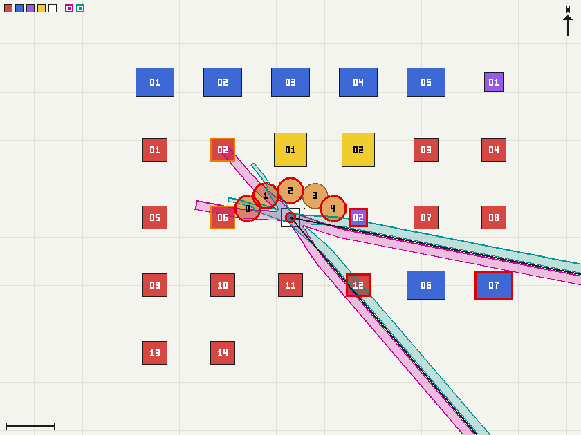
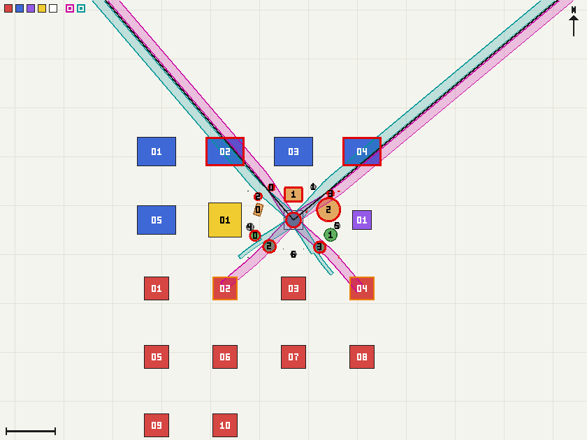
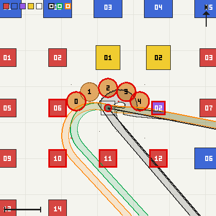
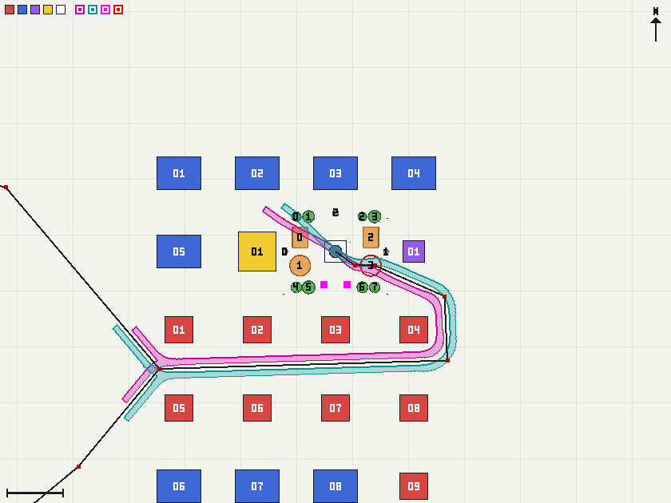

# LW-099g: a caravana atravessa construções? Comparação das opções A, B e C (26/11/2026)

**Status: análise (documento, sem código). Nada foi implementado nem alterado:** nenhum dado, a geometria oficial das estradas, a ponte, a economia, o `SimClock` e os saves ficaram como estavam. Pedido de Arthur em 26/11/2026: "não considero adequado que uma caravana atravesse casas, mercados ou outros estabelecimentos"; comparar (A) manter a trajetória com melhorias locais, (B) pontos de passagem nos dados das estradas, respeitando os povoados (preferência inicial dele) e (C) a ponte informar mais sobre trechos e conexões, com o impacto em contratos, saves, determinismo e arquitetura. **Classe 1 (documento); qualquer das três opções, se implementada, é classe 3 e só com a aprovação dele.**

**Como foi medido (só `--headless`, nenhuma janela).** Com as classes reais do PR #178 (`CaravanRoad`, `CaravanChain`, `CaravanPath`) sobre `data/world/places.json`: as caixas dos locais (`PlacePalette`: casa 5x5, oficina 8x6, repouso 4x4, social 7x7, mercado 4x4 m, centradas no ponto do local), e os objetos da praça (`PlazaData` e `PlazaVariants`, com a escala de encaixe do `MarketPlazaView`): barracas, peça central, postes, árvores e rochas. Veículos: **carroça com cavalo** (9,1 m x 2,01 m, medidas das malhas reais: entre-eixos 2,46 m, timão 2,807 m) e **carrinho de hoje** (comerciante com carrinho, cerca de 3,2 m x 1,2 m), os dois na faixa de 1,2 m à direita do eixo (carroça: 2,205 m do eixo; carrinho: 1,805 m). "Toca" = o varrido (a área coberta ao andar) entra na construção; "folga" = a distância exata do varrido ao obstáculo. Conferido por um segundo método independente (grade de pontos) em dezenas de casos. Os scripts de medição ficam fora do Git; os números abaixo são o registro.

**Atualização (26/11/2026, noite).** Arthur aprovou a opção B como direção técnica **para o carrinho**, em PR experimental isolado: **#180** (rascunho; NÃO integrar sem revisão independente, CI verde e a autorização dele). Resultado: docas (a 5,70, 6,00 e 5,66 m do centro dos mercados, fora da peça central) e pontos de passagem (14, 11 e 14) nas 3 rotas; razão do comprimento mostrado 1,022 / 0,974 / **1,072** (a B-C que o estudo dava como 1,209 ficou dentro de 0,90 a 1,10 sem mexer em velocidade nem tempo); folga mínima do carrinho de 0,52 a 0,61 m de caixas, objetos da praça e árvores e pedras do mundo; um reposicionamento na praça de C (árvore, 3,88 m, em commit à parte); revisão independente APROVADO COM AJUSTES. Limitações conhecidas: as viagens de dois trechos por B e por C (desvio por estrada fechada) dão a volta em U na doca e a traseira toca a praça; o salto da chegada passa de 0,01 m para 5,66 a 6,00 m. A carroça com cavalo continua como direção artística e fica para uma etapa de adaptação dos povoados. O texto abaixo é o estudo original, anterior a esta implementação.

## 1. O que a medição mostra
**1.1 A estrada reta de hoje já atravessa construções.** As 6 viagens (cada estrada, nos dois sentidos) tocam 2 ou 3 locais cada, com os dois veículos, perto das pontas (de 10 a 50 m da saída e de 17 a 42 m antes da chegada); nove construções diferentes; a estrada passa pelo MEIO de oficinas e casas (penetração até 3,0 m).

| viagem (comprimento) | carroça: locais tocados (penetração máx.) | carrinho de hoje | objetos da praça tocados (carroça) |
|---|---|---|---|
| A>B (503 m) | a_work_07, b_work_05, b_social_01 (3,08 m) | 2 | 3 |
| A>C (391 m) | a_home_12, c_work_02 (3,00 m) | 2 | 2 |
| B>A (503 m) | b_social_01, a_rest_02 (1,58 m) | 2 | 3 |
| B>C (312 m) | b_home_02, c_work_04 (3,00 m) | 2 | 6 |
| C>A (391 m) | c_work_02, a_home_12 (2,50 m) | 2 | 3 |
| C>B (312 m) | c_work_04, b_home_05, b_home_02 (2,50 m) | 3 | 8 |

**1.2 A curva natural não resolve, e hoje piora a contagem.** Nas 6 passagens de dois trechos (o canto é no centro do mercado do povoado do meio; só existem num desvio por estrada fechada), a soma de locais tocados pela carroça é **14 em HOJE, 18 em R 4,1, 22 em R 6, 21 em R 8 e 21 em R 10** (carrinho: 13, 16, 19, 18, 18). O motivo: a curva natural anda reto 1,2 m mais R·tan(virada/2) além do mercado (17 m com R 6 na virada de 142 graus; 23 m com R 8) e só então vira, e a grade de 14 m dos locais não tem esse espaço livre. O PR #178 faz a quina fechada deixar de quebrar a carroça, mas **não decide por onde ela passa**: isso é geometria da estrada.

**1.3 A praça agrava.** Cada viagem reta bate em 2 a 8 objetos da praça (barracas, árvores, rochas, postes) e **a estrada termina exatamente no centro do mercado, onde ficam a peça central (poço no A, fonte no B, rotunda no C)**: a carroça sai cobrindo 79 a 100% dela e chega cobrindo 36 a 60%. Pela mesma razão, **hoje a caravana nasce dentro da peça central** (a ponta da estrada é o centro). O maior círculo livre da praça (sem a peça central) tem raio 4,77 m (A), 4,35 m (B) e 4,48 m (C); a carroça em R 6 precisa de cerca de 7 m.

## 2. As três opções
**A. Manter a trajetória com melhorias locais** (faixa do outro lado, faixa menor, desvio local, fade ao cruzar casa). **Não resolve:** a reta mercado a mercado passa pelo meio de oficinas e casas (penetração até 3,0 m), e uma faixa de 1,2 m ou outro lado não tira o veículo de dentro de uma caixa de 8x6 m. Qualquer desvio local que funcione é, na prática, a opção B calculada na hora. Fica como o estado de hoje (válido só se você aceitar que o provisório atravesse casas até a arte definitiva).

**B. Pontos de passagem no dado de apresentação** (o campo `points_m` que o contrato da LW-099 JÁ prevê, por rota, em `data/presentation/caravan_routes.json`, de `settlement_a_id` para `settlement_b_id`, sem as pontas; a regra do contrato: caminho entre 90% e 110% do `length_m`). Resultado da viabilidade (proposta gerada por ferramenta, NÃO aplicada):

| veículo e situação | pontos por rota (A>B, A>C, B>C) | razão de comprimento | folga mínima | toques |
|---|---|---|---|---|
| carroça, só as caixas | 6, 7, 7 | 0,976; 0,951; 0,950 (dentro da regra) | 0,52 m | 0 nas 12 situações; **R 6 pleno só em A>B e B>A**; o canto de A (154 graus) não cabe |
| carroça, caixas + praça como é | os mesmos | idem | -2,34 m | **12 a 13 objetos da praça** |
| carroça, retirando 5 objetos da praça | 15, 18, 19 | 1,085; 1,038; **1,143 (B>C fora da regra)** | 0,57 m (R 8: 0,08 m) | 0; arco de R 6 pleno em nenhuma viagem |
| carrinho, só as caixas | 6, 6, 7 | 0,976; 0,921; 0,950 | 1,02 / 1,01 / 0,97 m (R 3 / 4,1 / 6) | 0; arcos plenos em R 3 e 4,1 |
| carrinho, retirando 2 objetos da praça (b:guardasol3 e c:arvore2) | 9, 11, 11 | 1,099; 1,032; **1,209 (B>C fora da regra)** | 0,63 / 0,62 / 0,10 m | 0 |

- **Gargalo da praça** (o maior raio livre de um caminho do centro ao portão a 60 m; o necessário é 2,705 m para a carroça e 2,305 m para o carrinho, ambos com folga de 0,5 m): só caixas, A 4,50 m, B 4,75 m, C 4,75 m; **com a praça como é, A 3,86 m, B 2,02 m (entre as tochas b:tocha0 e b:tocha1, vão de 4,04 m) e C 1,06 m (entre o toldo c:toldo1 e a tocha c:tocha2, vão de 2,1 m)**. Para o carrinho basta tirar b:guardasol3 (B) e c:arvore2 (C); para a carroça, 5 objetos (b:guardasol3, b:arvore7, b:arvore6, c:arvore2, c:arvore0).

- **O centro não pode ser o ponto de parada.** O `stop_point` do comerciante a pé fica a 2,4 a 3,2 m do centro. O carrinho chega e para nele sem tocar (folga 1,29 a 1,87 m), mas **não parte dele pelo lado de onde o comerciante vem** (o leito, 2,9 m atrás dos pés, recua sobre a peça central): parte sem tocar apenas quando o comerciante vem do lado sul (cerca de 45 a 135 graus, 0 = leste e 90 = sul; com folga de 0,5 m, só em A e B). A carroça só sai sem tocar com o líder a 8,5 a 10 m do centro (folga de 0,5 m). A dissolução de 0,4 s do PR #175 pressupõe a partida no `stop_point`: pede o ponto de partida do veículo 1 a 2 m mais longe (carrinho) ou bem mais longe (carroça).
- **As passagens (desvio por estrada fechada) viram retornos.** Com a praça corrigida as duas rotas de cada povoado saem pelo MESMO lado (A a 24 e 40 graus; B ambas a 36; C ambas a 139): a passagem vira retorno de 164 a 180 graus e nenhum arco cabe, nem R 3. Só com as caixas, as viradas são 154 (A), 83 (B) e 81 graus (C). **Contornar a peça central ficou INCONCLUSIVO** (não provei que não exista; falta refazer por busca na grade).
- **Sensibilidade ao layout (que é um blockout provisório):** mover uma caixa perto do caminho 3 m, em 156 variantes, quebra 28 (18%) das propostas só com caixas e 31 (20%) das com a praça corrigida. **Qualquer `points_m` precisa de um teste de dados** que recalcule a folga do varrido das 12 situações a partir de `places.json`, dos pontos e dos dados da praça, e falhe abaixo de 0,5 m (quando o layout mudar, o teste avisa e os pontos são regerados).
- **O que B exige:** `caravan_routes.json` com `points_m` por rota e, junto, os dois povoados da rota (`settlement_a_id`, hoje só há `route_id`: é o que resolve a orientação que a `_via_of` não tem, sem tocar a ponte); `CaravanRoutesReader` (já lê `points_m`: validar sentido, razão e folga); `CaravanBodiesView._via_of` (hoje devolve vazio com aviso) e `CaravanRoad.entering` (só aceita início e fim: trecho de saída com pontos); regra de parada fora do centro; testes. **Fica de fora:** ponte, `data/world/*`, simulação, saves.

**C. A ponte informa mais** (variantes): **C1** `leg_forward` (o sentido do trecho na rota; você adiou em 24/11): resolve só a orientação, que o dado de B já resolve sozinho; **C2** a geometria vira dado OFICIAL (`routes.json` ganha o caminho, o `RouteLoader` hoje recusa campo desconhecido, a ponte o entrega): é o destino natural quando as estradas virarem fato do mundo (Fase 4: eventos de estrada, risco); **C3** a ponte entrega os trechos vizinhos da viagem (chegada e saída): só torna a pose independente da memória da vista, que já funciona. **Nenhuma das variantes decide por onde a estrada passa entre as casas:** isso é geometria, e ela tem de morar num dado (em B, na apresentação; em C2, no mundo).

## 3. Comparação
| critério | A | B | C (C1 / C2) |
|---|---|---|---|
| resolve o atravessar? | **não** (6 de 6 viagens retas continuam tocando 2 ou 3 construções) | **caixas e viagens retas, sim** (0 toques, folga 0,52 m); praça, parada e passagens pedem regra nova | C1 não; C2 só se vier com o dado das ruas |
| onde mora a geometria | código (o de hoje) | `data/presentation/caravan_routes.json` (apresentação) | C2: `data/world/routes.json` (oficial, protegido) |
| contratos | nenhum muda | a LW-099 já prevê `points_m`; muda a decisão da geometria (proposta de DEC) e o texto de `presentation.md` | C1: `bridge.md` e `BridgeReplies`; C2: `world.md`, `economy.md`, `bridge.md` e o formato de `routes.json` (AGENTS 14.1a) |
| saves | nenhum | **nenhum** (dado estático; a posição vem de `u`, do relógio simulado) | nenhum (dado estático); C2 muda o formato de dado do mundo |
| determinismo | nenhum | **nenhum:** só apresentação; `length_m` segue mandando no tempo, hashes e referências iguais (DEC-175 intacta) | nenhum, desde que a simulação siga usando `length_m` (C2 abre o risco de passar a usar o comprimento do caminho) |
| arquitetura | só a vista | continua na camada de apresentação (só lê dado; `check_architecture` não muda); dado + leitor + vista + testes | a ponte ganha campos (C1) ou o `world` ganha geometria (C2) |
| reversibilidade | n/a | alta (é dado e vista; o padrão de hoje fica se o dado ficar vazio) | média (contrato de ponte) a baixa (formato de dado do mundo) |
| classe e aprovação | 3 | **3** (dado e apresentação; arquivo de dado fora do escopo: AGENTS 12.5) | 3 (C1) ou 3/4 (C2) |
| tamanho | pequeno, sem efeito | médio (3 PRs; ver abaixo) | médio a grande |

## 4. Recomendação
1. **Não A.** Não resolve, e a estrada reta já atravessa casas desde a LW-099.
2. **B, em etapas e só depois do seu OK** (nenhuma foi iniciada): **(1)** `points_m` das 3 rotas, gerados por ferramenta e revistos por você, com os dois povoados da rota no dado, a orientação na vista e o teste de folga das 12 situações; **(2)** a praça: mover os objetos que bloqueiam (2 para o carrinho; 5 para a carroça com cavalo) e **o ponto de partida e de parada do veículo fora da peça central** (decisão de arte e de layout, nos dados da praça, não em `data/world`); **(3)** a passagem por um povoado do meio (estrada fechada): como o desvio é raro (só por comando de desenvolvimento hoje) e, com as rotas saindo do mesmo lado, vira retorno de 160 a 180 graus, manter o caminho de hoje nesse caso (o PR #178 já faz isso para a volta de 180 graus) até o desenho dos povoados existir.
3. **C só depois**, se as estradas virarem fato do mundo na Fase 4.
4. **Primeira caravana: o carrinho.** Ele passa com 2 objetos da praça movidos e a B, com a folga medida; a **carroça com cavalo (composição C, 9,1 m)** não cabe no layout provisório sem abrir ruas nas praças e acertar a grade de 14 m, o que é uma decisão de desenho dos povoados (arte), e não só de pontos de passagem.
5. **Ordem de integração:** B antes (ou junto) do #178, porque com `points_m` TODAS as viagens passam a ter quinas e o #178 passa a valer para todas, não só para o desvio; `caravans_visible` só liga no `main` depois da aprovação visual dele; o #178 só segue para integração depois disto, da validação visual e de uma nova revisão independente das correções finais.

## 5. O que não foi medido
Alturas (tudo em planta); o formato exato dos objetos da praça (círculos e retângulos aproximados); a vista real (só as contas puras das classes); planejador de pontos ciente de arcos (as propostas foram geradas sem essa restrição: por isso o R 6 só é pleno em algumas viagens); saídas em lados opostos da praça; o contorno da peça central; desempenho. Nenhum valor de referência foi regravado.
